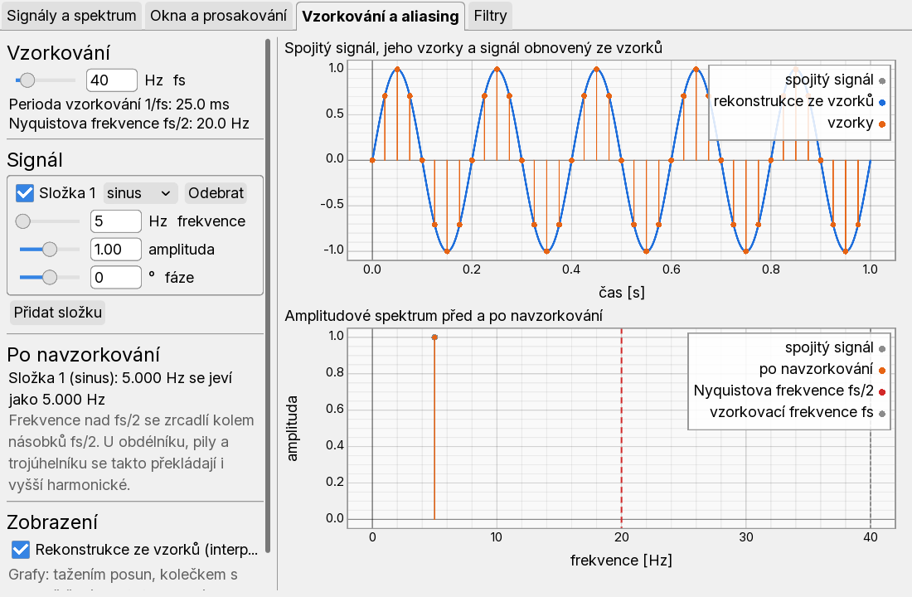
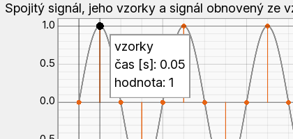
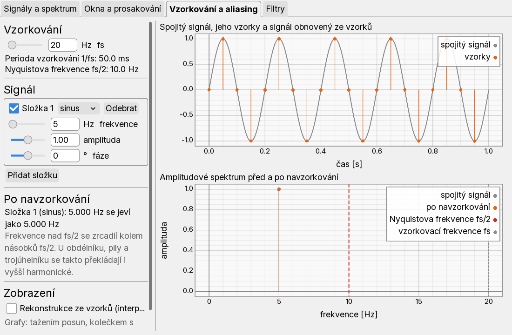
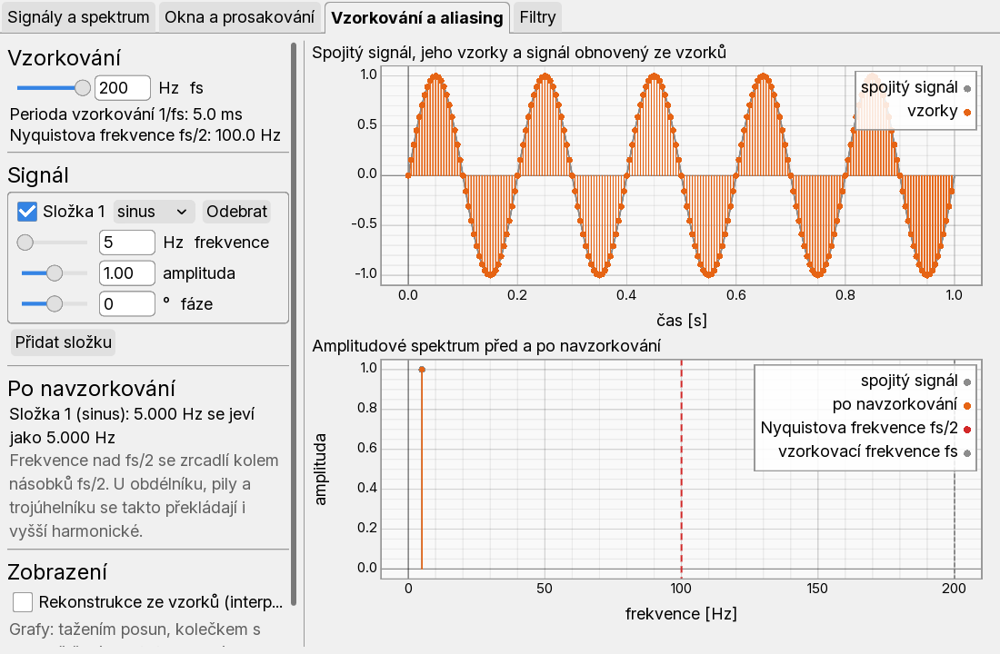
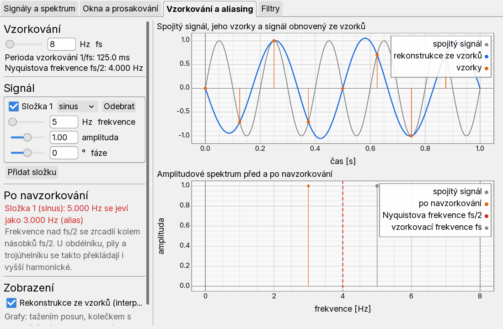

# Lekce 1: Signál a vzorek

## Cíl lekce

Pochopíš, co je signál a jak z něj počítač dělá řadu čísel – **vzorků**.
Naučíš se, co znamená vzorkovací frekvence `fs` a jak spočítat, ke kterému
času patří který vzorek.

## Základy

### Signál je veličina, která se mění v čase

Představ si teploměr za oknem. Teplota se mění plynule: v každém okamžiku
nějakou hodnotu má. Takové veličině, která se mění v čase, se říká
**signál**. Signálem je i tlak vzduchu u mikrofonu (zvuk), napětí v zásuvce
nebo výška vody v přístavu.

Protože má signál hodnotu v *každém* okamžiku, říkáme mu **spojitý signál**
a zapisujeme ho `x(t)`: `x` je hodnota, `t` je čas v sekundách.

### Počítač si pamatuje jen vzorky

Počítač nemůže uložit nekonečně mnoho hodnot. Udělá to jako člověk, který
si teplotu zapisuje do sešitu: **v pravidelných okamžicích hodnotu změří
a zapíše**. Každé zapsané číslo je **vzorek**. Signál se tím změní na
obyčejný seznam čísel.

Kdyby sis teplotu zapisoval každou hodinu, dělal bys 1 vzorek za hodinu.
Zvuková karta zapisuje tlak vzduchu 44 100× za sekundu.

### Vzorkovací frekvence a perioda vzorkování

- **Vzorkovací frekvence** `fs` je počet vzorků za sekundu. Jednotkou je
  hertz (Hz), tedy „za sekundu“.
- **Perioda vzorkování** `T` je čas mezi dvěma sousedními vzorky:

```text
T = 1 / fs
```

Například při `fs = 40 Hz` je `T = 1/40 s = 0,025 s = 25 ms`.

### Který vzorek patří ke kterému času

Vzorky číslujeme od nuly: `x[0], x[1], x[2], …` Hranaté závorky znamenají
„vzorek s pořadovým číslem“, kulaté `x(t)` „hodnota v čase `t`“. Vzorek
číslo `n` byl změřen v čase

```text
tₙ = n / fs = n · T
```

a jeho hodnota je hodnota spojitého signálu v tom okamžiku:

```text
x[n] = x(n / fs)
```

- `n` – pořadové číslo vzorku (0, 1, 2, …),
- `fs` – vzorkovací frekvence v Hz,
- `tₙ` – čas vzorku v sekundách.

Příklad pro `fs = 40 Hz`: vzorek 0 je v čase 0 ms, vzorek 1 v 25 ms,
vzorek 4 ve 100 ms, vzorek 40 v 1 s.

## V programu

Spusť program (`zig build run`) a otevři záložku **Vzorkování
a aliasing**. Výchozí nastavení:

- vlevo nahoře `fs` = **40 Hz**, pod ním „Perioda vzorkování 1/fs: 25.0 ms“,
- v rámečku **Složka 1**: tvar **sinus**, frekvence **5 Hz**, amplituda
  **1.00**, fáze **0°** (co tyto veličiny znamenají, vysvětlí lekce 2;
  zatím stačí, že jde o vlnu, která se opakuje 5× za sekundu).

Údaj „Nyquistova frekvence“ a spodní graf zatím přeskoč – patří do lekcí
3 a 11.



V horním grafu je na vodorovné ose čas od 0 do 1 s:

- **oranžové puntíky se svislými čarami** jsou vzorky. Je jich 40 (v časech
  0; 0,025; 0,05; … 0,975 s), protože za 1 s se při `fs = 40 Hz` odebere
  40 vzorků.
- **modrá křivka** je signál dopočítaný ze vzorků. Zatím ji vypni:
  v sekci **Zobrazení** odškrtni „Rekonstrukce ze vzorků (interpolace
  sinc)“. Vrátíme se k ní v lekci 12.
- **šedá křivka** (po vypnutí modré je vidět) je „spojitý“ signál, ze
  kterého se vzorkuje. Ve skutečném zařízení bychom ho neznali – máme jen
  vzorky.

Když najedeš myší do grafu, ukáže se popisek se souřadnicemi kurzoru. Když
najedeš přímo na puntík, popisek se k němu „přichytí“ a ukáže název křivky
(„vzorky“), čas a hodnotu toho vzorku:



Prvních osm vzorků má hodnoty 0; 0,707; 1; 0,707; 0; −0,707; −1; −0,707 a pak se to opakuje.
Na jednu vlnu (od 0 do 0,2 s) tedy připadá právě 8 vzorků, protože
`40 / 5 = 8`.

Hodnotu posuvníku lze nastavit i přesně: klikni na číslo vedle posuvníku,
smaž ho (nebo ho označ klávesami Ctrl + A) a napiš novou hodnotu. Program
ji použije už během psaní.

## Pokusy

1. **Méně vzorků.** Nastav `fs` = **20 Hz**. → Perioda vzorkování je
   „50.0 ms“, v grafu je 20 vzorků a na každou vlnu připadají 4 s hodnotami
   0, 1, 0, −1. Protože `20 / 5 = 4`, padnou vzorky přesně na začátek,
   vrchol, průchod nulou a dolní vrchol vlny.

   

2. **Hodně vzorků.** Nastav `fs` = **200 Hz** (nejvíc, kolik posuvník
   dovolí). → Perioda vzorkování je „5.0 ms“, vzorků je 200 a 40 na vlnu.
   Puntíky leží tak hustě, že samy vykreslí tvar křivky.

   

3. **Záleží na poměru.** Vrať `fs` = **40 Hz** a nastav frekvenci složky
   na **10 Hz**. → Na vlnu připadají zase jen 4 vzorky (0, 1, 0, −1), stejně
   jako v pokusu 1. Počet vzorků na periodu je `fs / f` a ten je teď
   `40 / 10 = 4`.

4. **Vzorky jsou jen čísla.** Vrať frekvenci na **5 Hz** a nastav amplitudu
   **2.00**. → Vzorky mají hodnoty 0; 1,414; 2; 1,414; 0; … Každý vzorek je
   prostě hodnota signálu v daném okamžiku, takže se dvojnásobně větší
   signál projeví dvojnásobně velkými čísly.

5. **Příliš málo vzorků.** Vrať amplitudu **1.00**, zaškrtni znovu
   „Rekonstrukce ze vzorků“ a nastav `fs` = **8 Hz**. → Vlevo v sekci „Po
   navzorkování“ se červeně objeví „Složka 1 (sinus): 5.000 Hz se jeví jako
   3.000 Hz (alias)“ a modrá křivka spočítaná ze vzorků má jen tři vrcholy
   za sekundu. Na jednu vlnu teď připadá jen `8 / 5 = 1,6` vzorku a to
   nestačí. Proč přesně a kolik vzorků stačí, ukáže lekce 11.

   

## Častá nedorozumění

- **„Mezi vzorky je čára.“** Program sice kreslí šedou křivku, ale
  v počítači po navzorkování zůstanou jen oranžová čísla. Co bylo mezi nimi,
  nevíme – můžeme to jen dopočítat (lekce 12), a to jen za určitých
  podmínek (lekce 11).
- **„Frekvence signálu a vzorkovací frekvence jsou totéž.“** Obě se měří
  v Hz, ale znamenají něco jiného: frekvence signálu je počet *vln* za
  sekundu, vzorkovací frekvence počet *měření* za sekundu.
- **„Čím víc vzorků, tím vždycky lépe.“** Víc vzorků znamená víc dat
  a výpočtů. Od určitého počtu už nic nového nepřinesou – kolik jich stačí,
  řekne vzorkovací věta v lekci 11.

## Shrnutí

- Signál je veličina, která se mění v čase. Spojitý signál `x(t)` má
  hodnotu v každém okamžiku.
- Počítač uchovává jen vzorky `x[n]` změřené v pravidelných okamžicích.
- Vzorkovací frekvence `fs` je počet vzorků za sekundu, perioda vzorkování
  `T = 1/fs` čas mezi nimi.
- Vzorek číslo `n` patří času `tₙ = n / fs`.
- Na jednu periodu signálu s frekvencí `f` připadá `fs / f` vzorků.

## Otázky k zamyšlení

1. Zvuk na CD má `fs = 44 100 Hz`. Jak dlouhá je perioda vzorkování?
2. Kolik čísel zabere minuta zvuku z CD, když má dva kanály (stereo)?
3. Proč se v pokusu 3 objevily stejné hodnoty vzorků jako v pokusu 1, přestože
   signál i `fs` byly jiné?

<details>
<summary>Odpovědi</summary>

1. `T = 1 / 44 100 s ≈ 0,0000227 s = 22,7 µs`.
2. `44 100 · 60 · 2 = 5 292 000` čísel.
3. Hodnoty vzorků závisí jen na tom, kolik vzorků připadá na jednu vlnu,
   tedy na poměru `fs / f`. V obou pokusech byl tento poměr 4 (`20/5`
   a `40/10`), takže vzorky padly na stejná místa vlny.

</details>

## Cvičení

1. Sinusovka 5 Hz s amplitudou 1 a fází 0° je vzorkovaná `fs = 40 Hz`.
   Spočítej ručně hodnoty vzorků `x[0]` až `x[4]` a ověř je v programu.
2. Signál byl vzorkován s `fs = 250 Hz`. V jakém čase byl změřen vzorek
   číslo 1000? Kolik vzorků bylo změřeno v časech od 0,2 s (včetně) do
   0,3 s (bez 0,3 s)?
3. Chceš, aby na každou periodu sinusovky 5 Hz připadlo 10 vzorků. Jakou
   vzorkovací frekvenci nastavíš? Ověř v programu.

<details>
<summary>Řešení</summary>

**1.** Sinusovka 5 Hz s amplitudou 1 a fází 0° je `x(t) = sin(2π · 5 · t)`
(vzorec podrobně vysvětlí lekce 2). Vzorek `n` je v čase `tₙ = n / 40`,
takže

```text
x[n] = sin(2π · 5 · n / 40) = sin(n · π/4) = sin(n · 45°)
```

- `x[0] = sin 0° = 0`
- `x[1] = sin 45° ≈ 0,707`
- `x[2] = sin 90° = 1`
- `x[3] = sin 135° ≈ 0,707`
- `x[4] = sin 180° = 0`

V programu (výchozí stav, `fs` = 40 Hz, 5 Hz) najeď myší na prvních pět
oranžových puntíků: leží v časech 0; 0,025; 0,05; 0,075 a 0,1 s a mají
právě tyto hodnoty.

**2.** Čas vzorku je `tₙ = n / fs = 1000 / 250 = 4 s`.

Pro interval obrátíme vzorec: `n = t · fs`. Času 0,2 s odpovídá vzorek
`0,2 · 250 = 50`, času 0,3 s vzorek `0,3 · 250 = 75`. Do intervalu patří
vzorky 50, 51, …, 74, to je `75 − 50 = 25` vzorků. (Jednodušeji: interval
trvá 0,1 s a za 0,1 s se odebere `0,1 · 250 = 25` vzorků.)

**3.** Počet vzorků na periodu je `fs / f`. Chceme `fs / 5 = 10`, tedy
`fs = 50 Hz`. V programu nastav `fs` = 50 Hz: perioda vzorkování je
„20.0 ms“ a jedna vlna trvá `1/5 s = 200 ms`, takže na ni připadá
`200 / 20 = 10` vzorků. V grafu je spočítáš mezi časy 0 a 0,2 s (vzorek
v čase 0,2 s už patří další vlně).

</details>

## Kam dál

- Další lekce: [2. Sinusovka](02-sinusovka.md).
- Podrobnější text k záložce: [Vzorkování a aliasing](../03-vzorkovani-a-aliasing.md).
- V kódu: `src/dsp/signal.zig` (funkce `generate` a `valueAt` – hodnota
  signálu v libovolném čase), `src/dsp/sampling.zig` (funkce `sample`
  a `SampledSignal.sampleTime` – vzorek `n` v čase `start + n / fs`).
