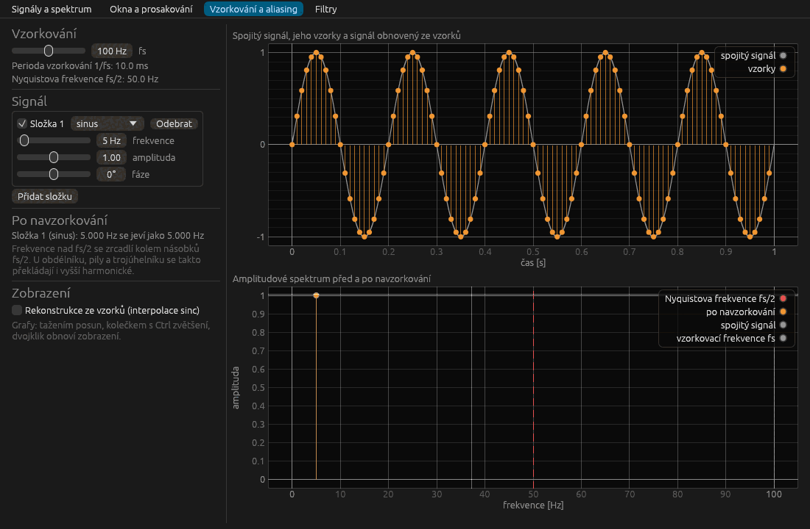
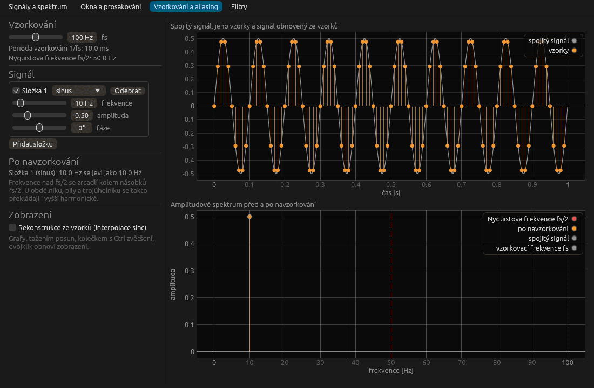
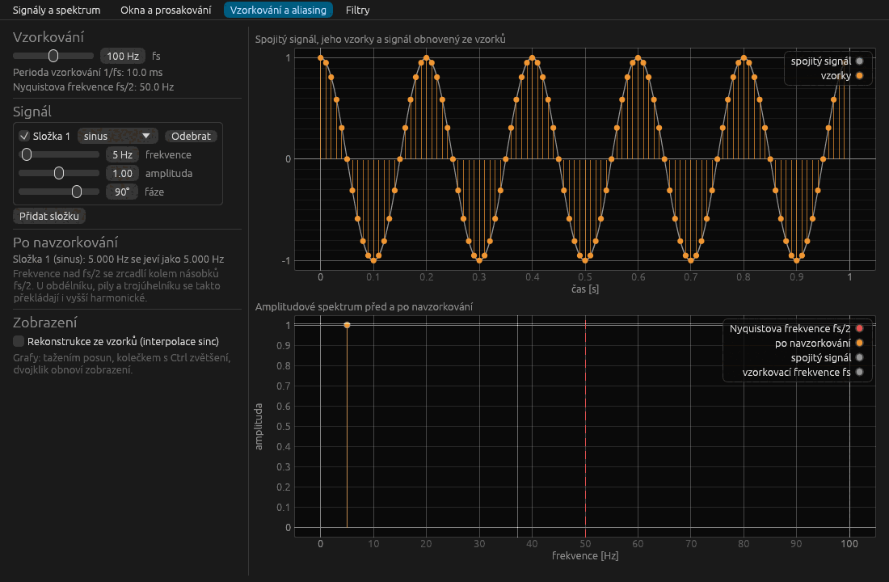

# Lekce 2: Sinusovka

## Cíl lekce

Pochopíš tři čísla, která sinusovku úplně popisují – **frekvenci**,
**amplitudu** a **fázi** – a naučíš se je přečíst z grafu.

## Základy

### Bod na otáčejícím se kole

Představ si kolo, které se rovnoměrně otáčí, a na jeho obvodu namalovaný
bod. Sleduj jen to, jak vysoko je bod nad osou kola. Výška roste, dosáhne
maxima, klesá, je záporná a po jedné otáčce se všechno opakuje. Když výšku
zakreslíš do grafu v závislosti na čase, dostaneš **sinusovku**.

Na tomto kole jsou vidět všechny tři veličiny:

- **Frekvence** `f` – kolikrát se kolo otočí za sekundu. Jednotka Hz.
- **Perioda** `T = 1/f` – jak dlouho trvá jedna otáčka.
- **Amplituda** `A` – poloměr kola, tedy největší výška bodu. Signál
  kmitá mezi `−A` a `+A`.
- **Fáze** `φ` (čti „fí“) – kde byl bod v čase 0, vyjádřeno jako úhel.
  Fáze 0° znamená, že bod začínal na úrovni osy a stoupal.

Sinusovky jsou všude: tón ladičky, střídavé napětí v zásuvce (50 Hz),
houpačka, kyvadlo. A hlavně: jak uvidíš v lekci 3, z nich lze složit
jakýkoli signál.

### Vzorec

```text
x(t) = A · sin(2π · f · t + φ)
```

- `x(t)` – hodnota signálu v čase `t`,
- `A` – amplituda,
- `f` – frekvence v Hz,
- `t` – čas v sekundách,
- `2π` – jedna celá otáčka vyjádřená v radiánech (`2π rad = 360°`),
- `2π · f · t` – úhel, o který se kolo otočí do času `t`: za 1 s je to
  `f` otáček,
- `φ` – fáze, počáteční úhel. Program ji zadává ve stupních.

Kosinus je tatáž vlna, jen s fází 90°: `cos α = sin(α + 90°)`. Kosinus
tedy v čase 0 začíná na vrcholu.

### Fáze jako posun v čase

Fáze posune celou vlnu v čase o

```text
Δt = (φ / 360°) · T
```

Kladná fáze posune vlnu **doleva**, tedy dřív: vlna je „napřed“. Například
pro `f = 5 Hz` je `T = 200 ms`, takže fáze 90° znamená posun o čtvrt
periody, tedy o 50 ms doleva.

## V programu

Opět použijeme záložku **Vzorkování a aliasing**, protože ukazuje přesně
jednu sekundu signálu. Nastav:

- `fs` = **100 Hz** (víc vzorků na vlnu, aby byl tvar dobře vidět),
- v sekci **Zobrazení** odškrtni „Rekonstrukce ze vzorků“,
- u **Složky 1** ponech sinus, frekvenci **5 Hz**, amplitudu **1.00**,
  fázi **0°**.



Co v horním grafu vidíš:

- **Frekvence:** za 1 s proběhne právě 5 vln. Vrcholy jsou v časech
  0,05; 0,25; 0,45; 0,65 a 0,85 s, tedy po 0,2 s. To je perioda
  `T = 1/5 s`.
- **Amplituda:** vrcholy mají výšku 1, dolní vrcholy −1.
- **Fáze:** v čase 0 je signál nulový a stoupá – tak začíná sinus s fází 0°.

Spodní graf už teď prozradí, kam míříme: je v něm jediná čára na frekvenci
**5 Hz** s výškou **1**. Spektrum tak jedním puntíkem říká „v signálu je
sinusovka 5 Hz s amplitudou 1“. Šedý a oranžový puntík jsou zatím na
stejném místě; rozdíl mezi nimi vysvětlí lekce 11.

## Pokusy

1. **Frekvence.** Nastav frekvenci **10 Hz**. → V grafu je 10 vln, vrcholy
   jsou po 0,1 s, protože `T = 1/10 s`. Čára ve spodním grafu se přesune na
   10 Hz.
2. **Amplituda.** Ponech 10 Hz a nastav amplitudu **0.50**. → Signál kmitá
   jen mezi −0,5 a 0,5 a čára ve spektru má výšku 0,5. Výška čáry ve
   spektru je amplituda.

   

3. **Fáze 90°.** Vrať frekvenci **5 Hz**, amplitudu **1.00** a nastav fázi
   **90°**. → Signál v čase 0 začíná na vrcholu (hodnota 1) – je to
   kosinus. Vrcholy jsou v časech 0; 0,2; 0,4; … s, celá vlna se posunula
   o 50 ms doleva (`90/360 · 200 ms`). Čára ve spodním grafu se **nezměnila**:
   amplitudové spektrum fázi neukazuje.

   

4. **Fáze 180° a −90°.** Nastav fázi **180°**. → Signál v čase 0 je nulový,
   ale klesá; v čase 0,05 s, kde měl původní sinus vrchol, je teď −1. Vlna je
   převrácená, `sin(α + 180°) = −sin α`. Při fázi **−90°** začíná signál na
   hodnotě −1.
5. **Fáze −180° a 180°** dávají úplně stejný graf: obě znamenají půl otáčky,
   jednou jedním a podruhé druhým směrem.
6. **Nulová frekvence.** Nastav fázi **90°** a frekvenci **0 Hz**. → Kolo
   se netočí, takže signál je konstanta `sin 90° = 1` (vodorovná čára)
   a ve spodním grafu je čára na 0 Hz s výškou 1. Konstantě se říká
   **stejnosměrná složka**. S fází 0° by vyšla konstanta `sin 0° = 0`
   a ve spektru by nebylo nic.

## Častá nedorozumění

- **„Kladná fáze posouvá vlnu doprava.“** Je to naopak: kladná fáze
  znamená, že vlna je napřed, vrcholy přijdou dřív – posun doleva.
- **„Nejvyšší vzorek je amplituda.“** V pokusu 2 (10 Hz, amplituda 0,5,
  `fs = 100 Hz`) mají nejvyšší vzorky hodnotu jen 0,476 – na samotný
  vrchol žádný vzorek nepadne. Amplituda patří vlně, ne vzorkům. Spektrum
  ji přesto ukáže správně (0,5), protože počítá se všemi vzorky najednou.
- **„Amplitudové spektrum ukazuje všechno.“** Fáze se v něm neprojeví
  (pokus 3). Pro fázi je samostatný graf, ke kterému se dostaneme
  v lekci 7.

## Shrnutí

- Sinusovka je `x(t) = A · sin(2π · f · t + φ)`.
- Frekvence `f` = počet vln za sekundu, perioda `T = 1/f`.
- Amplituda `A` = největší výchylka; signál kmitá mezi `−A` a `A`.
- Fáze `φ` = počáteční úhel; posouvá vlnu v čase o `(φ/360°) · T`,
  kladná doleva.
- Kosinus je sinus s fází 90°.
- Ve spektru je sinusovka jedna čára: poloha = frekvence, výška =
  amplituda.

## Otázky k zamyšlení

1. Napětí v zásuvce má frekvenci 50 Hz. Jak dlouhá je jedna perioda?
2. Jakou hodnotu má sinusovka v čase 0, když má amplitudu `A` a fázi `φ`?
3. Dvě sinusovky 5 Hz se liší jen fází: jedna má 0°, druhá 360°. Liší se
   jejich grafy?

<details>
<summary>Odpovědi</summary>

1. `T = 1/50 s = 20 ms`.
2. Dosadíme `t = 0`: `x(0) = A · sin φ`. Například pro `A = 1`, `φ = 30°`
   je to 0,5.
3. Neliší. 360° je celá otáčka, bod na kole je na stejném místě.
   Proto program nabízí jen fáze od −180° do 180°.

</details>

## Cvičení

1. Na grafu sinusovky jsou vrcholy v časech 0,1 s; 0,35 s a 0,6 s a mají
   výšku 1,5. Urči frekvenci, amplitudu a fázi. Nastav je v programu
   a zkontroluj.
2. O kolik milisekund a kterým směrem posune fáze 45° sinusovku 5 Hz?
3. Signál je `x(t) = 2 · cos(2π · 3 · t)`. Jak ho nastavíš v programu, který
   umí jen sinus?

<details>
<summary>Řešení</summary>

**1.** Vzdálenost sousedních vrcholů je perioda: `T = 0,35 − 0,1 = 0,25 s`,
takže `f = 1/T = 4 Hz`. Výška vrcholů je amplituda: `A = 1,5`.

Fázi určíme z polohy vrcholu. Sinus má vrchol, když je jeho úhel 90°.
Úhel v čase `t` je `360° · f · t + φ`. Pro vrchol v `t = 0,1 s`:

```text
360° · 4 · 0,1 + φ = 90°
144° + φ = 90°
φ = −54°
```

V programu nastav frekvenci 4 Hz, amplitudu 1.50 a fázi −54° (klikni na
číslo vedle posuvníku a napiš ho). Najeď myší na první vrchol: je v čase
0,1 s s hodnotou 1,5. V čase 0 má signál hodnotu `1,5 · sin(−54°) ≈ −1,21`.

**2.** Perioda je `T = 1/5 s = 200 ms`. Posun je
`Δt = 45/360 · 200 ms = 25 ms`. Fáze je kladná, takže doleva (vlna je
o 25 ms napřed).

**3.** Kosinus je sinus s fází 90°: `cos α = sin(α + 90°)`. Proto
`2 · cos(2π · 3 · t) = 2 · sin(2π · 3 · t + 90°)`. Nastav frekvenci 3 Hz,
amplitudu 2.00 a fázi 90°. Kontrola: v čase 0 má být hodnota
`2 · cos 0 = 2`, v čase 0,1 s hodnota `2 · cos(108°) ≈ −0,62`.

</details>

## Kam dál

- Další lekce: 3. Skládání signálů a myšlenka spektra (připravuje se).
- Předchozí lekce: [1. Signál a vzorek](01-signal-a-vzorek.md).
- V kódu: `src/dsp/signal.rs`, funkce `component_value` počítá přesně
  `A · sin(2π · f · t + φ)` (fázi převádí ze stupňů na radiány)
  a `waveform_value` vrací hodnotu tvaru vlny pro daný úhel.
