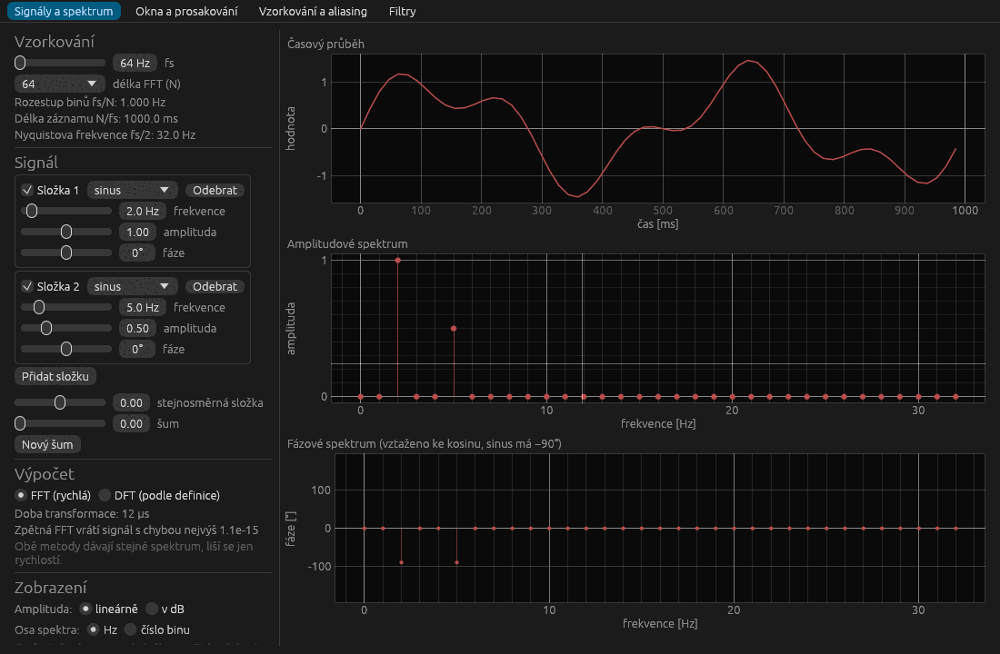
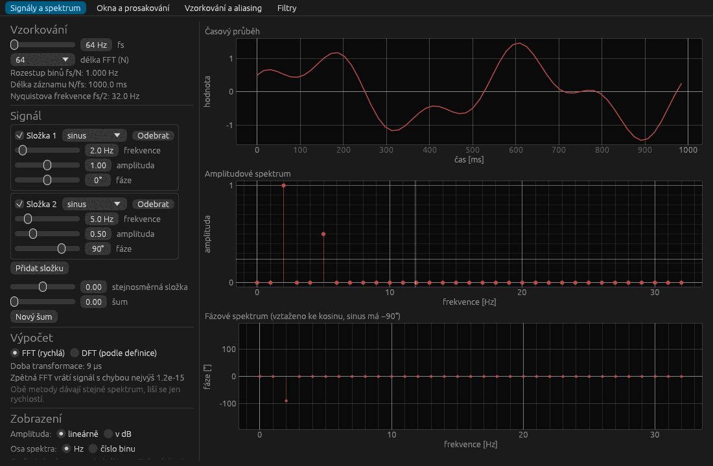
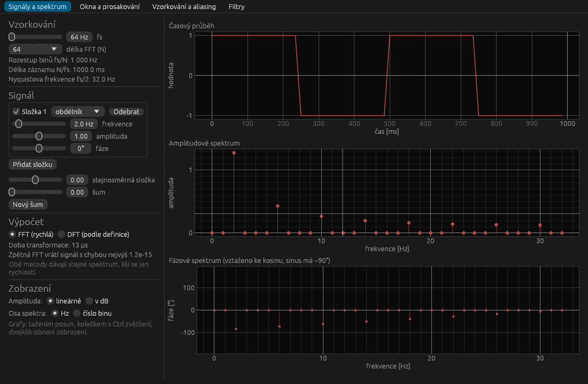
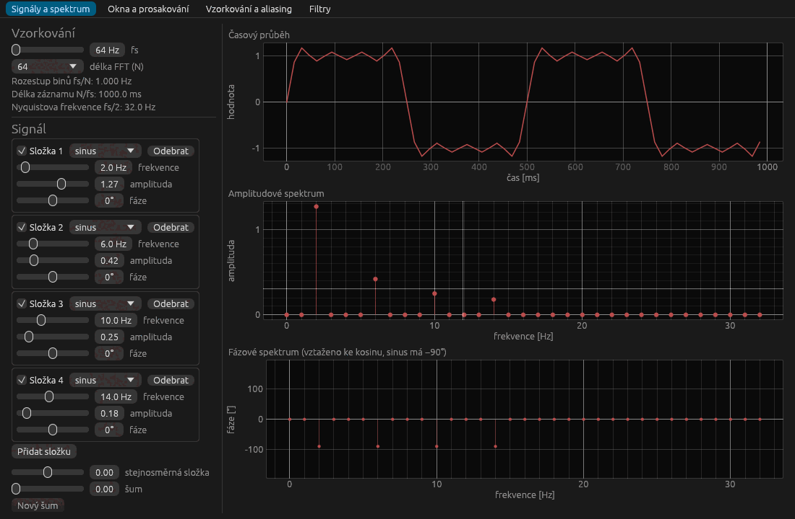

# Lekce 3: Skládání signálů a myšlenka spektra

## Cíl lekce

Pochopíš, že signály se dají sčítat, že i složitý signál lze poskládat ze
sinusovek a že **spektrum** je seznam těchto sinusovek: u každé frekvence
její amplituda.

## Základy

### Akord a recept

Když na klavíru zahraješ akord, zní najednou tři struny. Vzduch u tvého
ucha ale nekmitá třikrát – kmitá jedním složitým způsobem, který vznikl
sečtením tří vln. Ucho přesto pozná, že jde o tři tóny: rozloží zvuk zpět
na jednotlivé frekvence.

Podobně je to s ovocným koktejlem: v hotovém nápoji jednotlivé ovoce
nevidíš, ale **recept** říká, kolik čeho v něm je. Pro signál je takovým
receptem **spektrum**: seznam frekvencí a u každé, jak velká sinusovka
v signálu je.

### Sčítání signálů

Signály se sčítají bod po bodu: hodnota součtu v čase `t` je součet hodnot
obou signálů v tom čase.

```text
x(t) = x₁(t) + x₂(t)
```

Například sinusovka 2 Hz s amplitudou 1 a sinusovka 5 Hz s amplitudou 0,5:

```text
x(t) = 1 · sin(2π · 2 · t) + 0,5 · sin(2π · 5 · t)
```

### Každý periodický signál je součet sinusovek

Francouzský matematik Joseph Fourier ukázal, že každý periodický signál
s frekvencí `f` lze složit ze:

- **stejnosměrné složky** (konstanty, frekvence 0 Hz),
- sinusovek s frekvencemi `f`, `2f`, `3f`, … – takzvaných **harmonických**.
  První harmonická (frekvence `f`) se jmenuje **základní**.

Každá harmonická má svou amplitudu a fázi. Například obdélník s amplitudou 1
a frekvencí `f` obsahuje jen liché harmonické:

```text
obdélník(t) = 4/π · ( sin(2π·f·t) + sin(2π·3f·t)/3 + sin(2π·5f·t)/5 + … )
```

Amplitudy harmonických jsou tedy `4/π ≈ 1,27`, `4/(3π) ≈ 0,42`,
`4/(5π) ≈ 0,25`, `4/(7π) ≈ 0,18` a tak dále.

### Spektrum

**Amplitudové spektrum** je graf, který má na vodorovné ose frekvenci a na
svislé amplitudu. Každá sinusovka v signálu je v něm jedna svislá čára:

- poloha čáry = frekvence sinusovky,
- výška čáry = amplituda sinusovky.

Časový průběh a spektrum jsou **dva pohledy na tentýž signál**. Časový
průběh říká, jakou hodnotu má signál v kterém okamžiku. Spektrum říká,
z jakých sinusovek se skládá. Jak se spektrum ze vzorků spočítá, ukážou
lekce 4 až 6.

## V programu

Otevři záložku **Signály a spektrum**. Nastav:

1. `fs` = **64 Hz** (klikni na číslo vedle posuvníku a napiš 64),
2. **délka FFT (N)** = **64** (rozbalovací seznam).

Vlevo se ukáže „Rozestup binů fs/N: 1.000 Hz“, „Délka záznamu N/fs:
1000.0 ms“ a „Nyquistova frekvence fs/2: 32.0 Hz“. Program teď pracuje
s jednou sekundou signálu. Složky nemohou mít vyšší frekvenci než 32 Hz
(proč, vysvětlí lekce 11), proto se jejich frekvence při změně `fs`
zmenšily na 32 Hz. Nastav je znovu:

3. **Složka 1**: sinus, frekvence **2 Hz**, amplituda **1.00**, fáze **0°**,
4. **Složka 2**: sinus, frekvence **5 Hz**, amplituda **0.50**, fáze **0°**.



Grafy pod sebou:

- **Časový průběh** – součet obou sinusovek během 1000 ms. Pomalá vlna
  2 Hz (2 vrcholy za sekundu) nese drobnější vlnky 5 Hz. Nejvyšší hodnota je
  asi 1,46, ne 1,5, protože vrcholy obou vln se nikdy nesejdou úplně přesně.
- **Amplitudové spektrum** – čára na **2 Hz** s výškou **1** a čára na
  **5 Hz** s výškou **0,5**. Na ostatních frekvencích (0, 1, 3, 4, 6, …
  32 Hz) jsou puntíky na nule: takové sinusovky v signálu nejsou.
- **Fázové spektrum** – zatím ho přeskoč, patří do lekce 7.

Z časového průběhu bys obě složky poznával těžko. Spektrum je ukáže na
první pohled.

## Pokusy

1. **Vypni jednu složku.** Odškrtni políčko **Složka 2**. → V časovém
   grafu zůstane čistá sinusovka 2 Hz a ve spektru jediná čára na 2 Hz.
   Zaškrtni ji zase.
2. **Změň amplitudu složky.** Nastav u Složky 2 amplitudu **1.00**. → Čára
   na 5 Hz vyroste na 1 a vlnky v časovém grafu zesílí. Výška každé čáry
   patří jedné složce a nezávisí na ostatních. Vrať amplitudu **0.50**.
3. **Změň fázi složky.** Nastav u Složky 2 fázi **90°**. → Časový průběh
   vypadá úplně jinak, ale amplitudové spektrum se **nezměnilo** – pořád
   1 na 2 Hz a 0,5 na 5 Hz. Změnil se jen bod na 5 Hz ve fázovém spektru
   (z −90° na 0°). Tvar signálu tedy závisí i na fázích, amplitudové
   spektrum jen na amplitudách. Vrať fázi **0°**.

   

4. **Stejnosměrná složka.** Nastav posuvník **stejnosměrná složka** na
   **0.50**. → Celý signál se posune o 0,5 nahoru (teď kmitá zhruba mezi
   −0,96 a 1,96) a ve spektru přibude čára na **0 Hz** s výškou 0,5.
   Konstanta je „sinusovka s frekvencí 0“. Vrať ji na **0.00**.
5. **Obdélník.** Odškrtni Složku 2 a u Složky 1 přepni tvar na
   **obdélník** (frekvence 2 Hz, amplituda 1.00). → Ve spektru jsou čáry jen
   na lichých násobcích 2 Hz: 2, 6, 10, 14, … 30 Hz. Program ukáže výšky
   1,28; 0,43; 0,27; 0,20; 0,16; 0,14; 0,13; 0,13. První čtyři skoro sedí
   na vzorec `4/(πk)` (1,27; 0,42; 0,25; 0,18). Vyšší čáry jsou o něco
   vyšší, než říká vzorec, protože se do nich „přeložily“ harmonické nad
   32 Hz, které program nemůže zobrazit – to je aliasing z lekce 11.

   

6. **Pila a trojúhelník.** Přepni tvar na **pilu**. → Čáry jsou na
   **všech** násobcích 2 Hz (2, 4, 6, …) a slábnou jako `2/(πk)`: 0,64;
   0,32; 0,22; … Přepni na **trojúhelník**. → Zase jen liché harmonické, ale
   slábnou mnohem rychleji (`8/(π²k²)`): 0,81; 0,09; 0,04; … Trojúhelník
   nemá ostré skoky, a proto mu stačí málo vysokých frekvencí.

## Častá nedorozumění

- **„Obdélník má jen jednu frekvenci.“** Opakuje se sice s jednou
  frekvencí (2 Hz), ale skládá se z mnoha sinusovek. Ostré hrany potřebují
  vysoké harmonické.
- **„Když se signál v čase hodně změní, změní se i amplitudové
  spektrum.“** Ne nutně – změna fáze složky (pokus 3) změní tvar signálu,
  ale amplitudové spektrum ne.
- **„Spektrum ukazuje, kdy v signálu která frekvence zazněla.“** Spektrum
  popisuje celý záznam najednou. Kdyby sinusovka 5 Hz zněla jen v první
  půlce sekundy, spektrum by neřeklo kdy, jen že tam nějaká byla.

## Shrnutí

- Signály se sčítají bod po bodu.
- Každý periodický signál je součet stejnosměrné složky a harmonických
  (frekvence `f`, `2f`, `3f`, …).
- Amplitudové spektrum: frekvence na vodorovné ose, amplituda na svislé;
  každá sinusovka je jedna čára.
- Fáze složek mění tvar signálu, ale ne amplitudové spektrum.
- Ostré hrany (obdélník, pila) znamenají hodně vysokých harmonických.

## Otázky k zamyšlení

1. Proč má základní harmonická obdélníku s amplitudou 1 výšku 1,27, tedy
   víc než celý obdélník?
2. Spektrum signálu má čáry na 100, 200 a 300 Hz. Je signál periodický?
   Pokud ano, s jakou periodou?
3. Sečtu dvě úplně stejné sinusovky. Co se stane se spektrem?

<details>
<summary>Odpovědi</summary>

1. Ostatní harmonické vrcholy základní sinusovky „srazí“ dolů a zároveň
   zvednou místa kolem průchodu nulou. Součet je pak plochý na úrovni 1,
   i když samotná základní sinusovka sahá až do 1,27.
2. Ano. Všechny frekvence jsou násobky 100 Hz, takže se celý signál
   zopakuje po `1/100 s = 10 ms`.
3. Vznikne sinusovka stejné frekvence s dvojnásobnou amplitudou, takže
   čára bude dvakrát vyšší. (Pozor: platí to jen pro stejnou fázi – viz
   cvičení 3.)

</details>

## Cvičení

1. **Poskládej obdélník.** V nastavení z části „V programu“ (fs 64 Hz,
   N = 64) vytvoř čtyři sinusové složky tak, aby jejich součet připomínal
   obdélník 2 Hz s amplitudou 1.
2. Nakresli (na papír) amplitudové spektrum signálu
   `x(t) = 0,3 + sin(2π · 3 · t) + 0,5 · sin(2π · 9 · t + 90°)`
   a ověř ho v programu.
3. Složka 1 je sinus 4 Hz s amplitudou 1 a fází 0°, Složka 2 sinus 4 Hz
   s amplitudou 1 a fází 180°. Co uvidíš v časovém průběhu a ve spektru?

<details>
<summary>Řešení</summary>

**1.** Podle vzorce má obdélník s frekvencí 2 Hz harmonické na 2, 6, 10
a 14 Hz s amplitudami `4/π ≈ 1,27`, `4/(3π) ≈ 0,42`, `4/(5π) ≈ 0,25`
a `4/(7π) ≈ 0,18`, všechny s fází 0°. Postup:

- Složka 1: 2 Hz, amplituda 1.27, fáze 0°.
- Složka 2: 6 Hz, amplituda 0.42.
- Tlačítkem **Přidat složku** přidej Složku 3: 10 Hz, amplituda 0.25,
  a Složku 4: 14 Hz, amplituda 0.18 (nově přidaná složka má fázi 0°).



Časový průběh už vypadá jako obdélník, jen má zvlněné vrcholy a vrcholy
sahají až asi do 1,17. Ve spektru jsou přesně čtyři čáry, které jsi
nastavil. Můžeš přidat ještě dvě složky (program jich dovolí nejvýš 6):
18 Hz s amplitudou 0.14 a 22 Hz s amplitudou 0.12. Hrany zestrmí a vlnky
zhoustnou. Překmit u hran ale úplně nezmizí, ať přidáš harmonických
kolik chceš – tomu se říká Gibbsův jev.

**2.** Signál se skládá ze tří částí:

- `0,3` je stejnosměrná složka → čára na 0 Hz s výškou 0,3,
- `sin(2π · 3 · t)` → čára na 3 Hz s výškou 1,
- `0,5 · sin(2π · 9 · t + 90°)` → čára na 9 Hz s výškou 0,5. Fáze výšku
  neovlivní.

V programu (fs 64 Hz, N = 64): Složka 1 sinus 3 Hz, amplituda 1.00, fáze
0°; Složka 2 sinus 9 Hz, amplituda 0.50, fáze 90°; stejnosměrná složka
0.30. Spektrum ukáže přesně tyto tři čáry.

**3.** Fáze 180° převrací znaménko: `sin(α + 180°) = −sin α`. Druhá složka
je tedy přesně opačná k první a součet je v každém okamžiku nulový.
Časový průběh je vodorovná čára na nule a ve spektru nejsou žádné čáry.
Sinusovky stejné frekvence se tedy nesčítají jen podle amplitud – záleží
i na fázi. Při fázi 0° by vyšla čára 2, při 180° nula, při 90° něco mezi
(`√2 ≈ 1,41`).

</details>

## Kam dál

- Další lekce: [4. DFT jako měření shody](04-dft-mereni-shody.md).
- Předchozí lekce: [2. Sinusovka](02-sinusovka.md).
- Podrobnější text k záložce: [Signály a spektrum](../01-signaly-a-spektrum.md).
- V kódu: `src/dsp/signal.rs` – funkce `value_at` sčítá všechny zapnuté
  složky a stejnosměrnou složku, `waveform_value` počítá tvary obdélník,
  pila a trojúhelník.
