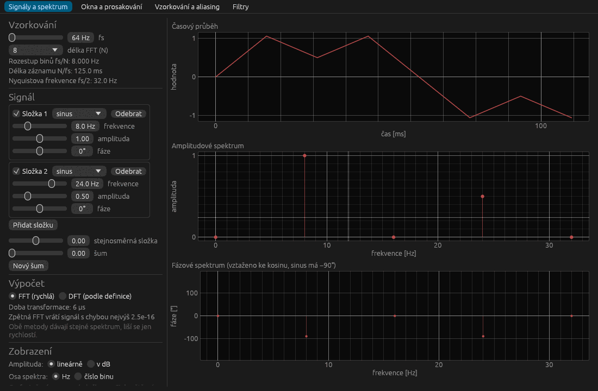
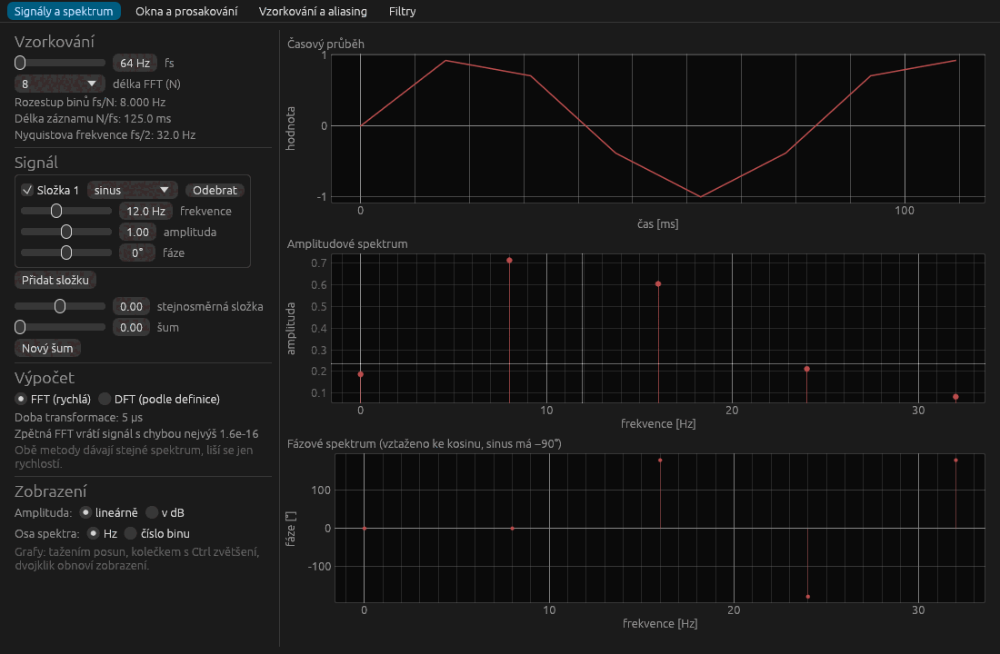

# Lekce 4: DFT jako měření shody

## Cíl lekce

Pochopíš, jak se ze vzorků spočítá, jak velká sinusovka dané frekvence
v signálu je: signál se vynásobí zkušební vlnou a výsledky se sečtou.
Tomuto postupu se říká **diskrétní Fourierova transformace (DFT)**.
Spočítáš ji ručně pro osm vzorků.

## Základy

### Zkušební vlna

Chceš zjistit, jestli je v signálu sinusovka 8 Hz. Vezmi zkušební
sinusovku 8 Hz a porovnej ji se signálem vzorek po vzorku: oba vzorky
vynásob a všechny součiny sečti.

- Pokud signál kmitá **v rytmu** zkušební vlny, mají oba vzorky většinou
  stejné znaménko. Součiny jsou kladné a součet vyjde velký.
- Pokud signál kmitá **jinou frekvencí**, je znaménko jednou stejné
  a jednou opačné. Kladné a záporné součiny se navzájem vyruší a součet
  vyjde nula.

Je to jako se dvěma lidmi na houpačkách vedle sebe: když se houpou ve
stejném rytmu, jsou pořád spolu; když v různém, jednou spolu, jednou proti
sobě a v průměru „nic společného“.

### Proč sinus i kosinus

Háček je ve fázi. Pokud je v signálu kosinus 8 Hz a zkoušíme sinusem 8 Hz,
vyjde součet také nula: kosinus je o čtvrt periody napřed a kladné
a záporné součiny se vyruší. Proto se zkouší **dvěma** vlnami najednou:
kosinem a sinem. Pro každou frekvenci tak vzniknou dvě čísla:

```text
C_k = Σ x[n] · cos(2π · k · n / N)
S_k = Σ x[n] · sin(2π · k · n / N)          sčítá se přes n = 0, 1, …, N−1
```

- `x[n]` – vzorky signálu, `N` – jejich počet,
- `k` – kolik celých period má zkušební vlna v celém záznamu (0, 1, 2, …),
- `Σ` – „sečti přes všechna `n`“,
- `C_k` – shoda s kosinem, `S_k` – shoda se sinem.

Zkušební vlna s `k` periodami v záznamu má frekvenci

```text
f_k = k · fs / N
```

protože záznam trvá `N / fs` sekund.

### Z `C` a `S` amplituda

Sinusovka s libovolnou fází se dá rozložit na kus kosinu a kus sinu, a tak
se její „shoda“ rozdělí mezi `C_k` a `S_k`. Celková velikost se spočítá
Pythagorovou větou a přepočítá na amplitudu:

```text
A_k = 2 · √(C_k² + S_k²) / N          pro k = 1 … N/2 − 1
A_0 = √(C_0² + S_0²) / N              (stejnosměrná složka, k = 0)
```

Proč `2/N`: sinusovka s amplitudou 1, která má v záznamu přesně `k` period,
dá `S_k = N/2` (průměr `sin²` přes celé periody je 1/2). Vynásobením `2/N`
vyjde amplituda 1. U `k = 0` je zkušební kosinus konstanta 1, takže `C_0`
je prostě součet vzorků a `C_0 / N` jejich průměr. (Stejně se zachází
s `k = N/2`; proč, vysvětlí lekce 5.)

### Ruční výpočet pro osm vzorků

Signál: sinusovka s jednou periodou v záznamu a amplitudou 1 plus
sinusovka se třemi periodami a amplitudou 0,5, `N = 8`:

```text
x[n] = sin(2π · 1 · n/8) + 0,5 · sin(2π · 3 · n/8)
```

Úhly jsou po `360°/8 = 45°`. Vzorky:

| n                   | 0 | 1     | 2   | 3     | 4 | 5      | 6    | 7      |
|---------------------|---|-------|-----|-------|---|--------|------|--------|
| `x[n]`              | 0 | 1,061 | 0,5 | 1,061 | 0 | −1,061 | −0,5 | −1,061 |

**Zkouška `k = 1`** (zkušební vlny mají úhel `n · 45°`):

| n                    | 0 | 1     | 2   | 3      | 4  | 5      | 6   | 7      |
|----------------------|---|-------|-----|--------|----|--------|-----|--------|
| `sin(n·45°)`         | 0 | 0,707 | 1   | 0,707  | 0  | −0,707 | −1  | −0,707 |
| `x[n] · sin(n·45°)`  | 0 | 0,75  | 0,5 | 0,75   | 0  | 0,75   | 0,5 | 0,75   |
| `cos(n·45°)`         | 1 | 0,707 | 0   | −0,707 | −1 | −0,707 | 0   | 0,707  |
| `x[n] · cos(n·45°)`  | 0 | 0,75  | 0   | −0,75  | 0  | 0,75   | 0   | −0,75  |

Součty: `S_1 = 4`, `C_1 = 0`. Amplituda `A_1 = 2 · √(0² + 4²) / 8 = 1`. ✔

**Zkouška `k = 2`** (úhel `n · 90°`):

| n                    | 0 | 1     | 2 | 3      | 4 | 5      | 6 | 7     |
|----------------------|---|-------|---|--------|---|--------|---|-------|
| `sin(n·90°)`         | 0 | 1     | 0 | −1     | 0 | 1      | 0 | −1    |
| `x[n] · sin(n·90°)`  | 0 | 1,061 | 0 | −1,061 | 0 | −1,061 | 0 | 1,061 |

`S_2 = 0` a podobně vyjde `C_2 = 0`. Sinusovka se dvěma periodami v signálu
není. ✔ (Zkouška `k = 3` je cvičení 1.)

To je celá DFT: pro každé `k` jeden takový řádek součinů a jeden součet.

## V programu

Záložka **Signály a spektrum**. Nastav:

1. `fs` = **64 Hz**, **délka FFT (N)** = **8**. Vlevo: „Rozestup binů fs/N:
   8.000 Hz“, „Délka záznamu N/fs: 125.0 ms“.
2. **Složka 1**: sinus **8 Hz**, amplituda **1.00**, fáze **0°**.
   Za 125 ms má právě 1 periodu, je to tedy `k = 1`.
3. **Složka 2**: sinus **24 Hz**, amplituda **0.50**, fáze **0°** (3 periody,
   `k = 3`).

Je to přesně signál z ručního výpočtu.



- **Časový průběh** spojuje čarami jen 8 vzorků, proto je hranatý. Když
  najedeš myší na body, uvidíš hodnoty z tabulky: 0; 1,061; 0,5; 1,061; 0;
  −1,061; −0,5; −1,061 (v časech po 15,625 ms).
- **Amplitudové spektrum** má jen 5 bodů: 0, 8, 16, 24 a 32 Hz, tedy
  `k = 0` až 4. Program ukazuje jen `k` do `N/2`; proč, vysvětlí lekce 5.
  Na 8 Hz je výška 1, na 24 Hz 0,5, jinde 0 – stejně jako v ručním výpočtu.

Na jiné frekvence se DFT „neptá“. Rozestup 8 Hz mezi body je `fs / N`.

## Pokusy

1. **Jen jedna složka.** Odškrtni Složku 2. → Zbude jediná čára na 8 Hz
   s výškou 1. Ve fázovém spektru je u ní −90°: to je znaménko toho, že
   shodu našel sinus, ne kosinus (podrobně v lekci 7).
2. **Kosinus místo sinu.** Nastav u Složky 1 fázi **90°**. → Výška čáry
   zůstane 1, ale fáze se změní na 0°. Teď je celá shoda v `C_1` (= 4)
   a `S_1 = 0`. Kdyby DFT zkoušela jen sinem, tuto sinusovku by neviděla.
3. **Jiný počet period.** Vrať fázi **0°** a nastav frekvenci **16 Hz**. →
   Čára se přesune na 16 Hz: zkušební vlna `k = 2` má v záznamu 2 periody
   stejně jako signál.
4. **Necelý počet period.** Nastav frekvenci **12 Hz** (1,5 periody za
   125 ms). → Žádná zkušební vlna nesedí přesně a výsledek se rozlije do
   všech bodů: 0 Hz: 0,19; 8 Hz: 0,71; 16 Hz: 0,60; 24 Hz: 0,21; 32 Hz:
   0,08. Tomuto jevu se říká prosakování a věnuje se mu lekce 8.

   

5. **Delší záznam.** Ponech 12 Hz a nastav **N = 64**. → Záznam trvá
   1000 ms, zkušební frekvence jsou po 1 Hz a 12 Hz mezi nimi je. Spektrum
   ukáže jedinou čáru na 12 Hz s výškou 1. Víc vzorků = víc zkušebních
   frekvencí.
6. **DFT podle definice.** V sekci **Výpočet** přepni na „DFT (podle
   definice)“. → Spektrum se nezmění. Program teď počítá přesně podle vzorců
   výše; přepínač „FFT (rychlá)“ dává stejný výsledek jinou cestou
   (lekce 6).

## Častá nedorozumění

- **„DFT najde jakoukoli frekvenci.“** Ptá se jen na frekvence
  `k · fs / N`. Frekvence mezi nimi se projeví rozmazaně (pokus 4).
- **„Stačí násobit sinem.“** Kosinus by tak zůstal neviditelný (pokus 2).
  Proto se vždy počítá `C_k` i `S_k`.
- **„Nula ve spektru znamená, že tam signál nic nemá.“** Platí to spolehlivě
  jen pro složky s celým počtem period v záznamu. Jinak se zkušební vlny
  přesně nevyruší.

## Shrnutí

- DFT měří shodu signálu se zkušebními vlnami: vynásob a sečti.
- Pro každé `k` se počítá shoda s kosinem `C_k` i se sinem `S_k`.
- Zkušební vlna `k` má `k` period v záznamu a frekvenci `k · fs / N`.
- Amplituda: `A_k = 2 · √(C_k² + S_k²) / N`, u `k = 0` bez dvojky.
- Vlny s různým celým počtem period v záznamu se při násobení a sčítání
  přesně vyruší – proto DFT složky čistě oddělí.

## Otázky k zamyšlení

1. Při `fs = 64 Hz` a `N = 8`: na které frekvence se DFT ptá?
2. Proč pro sinusovku s amplitudou 1 a `k = 1` vyšlo `S_1` právě `N/2 = 4`?
3. Co by vyšlo, kdybys pro `N = 8` zkusil `k = 8`?

<details>
<summary>Odpovědi</summary>

1. `k · 64 / 8 = k · 8 Hz` pro `k = 0 … 4`: 0, 8, 16, 24 a 32 Hz.
2. Signál i zkušební vlna jsou tentýž sinus, takže se sčítají jeho druhé
   mocniny: 0; 0,5; 1; 0,5; 0; 0,5; 1; 0,5. Součet je 4. Obecně je průměr
   `sin²` přes celé periody 1/2, takže součet `N` členů je `N/2`.
3. Zkušební vlna by měla úhel `n · 360°`, tedy na každém vzorku stejnou
   hodnotu jako pro `k = 0` (kosinus 1, sinus 0). Vzorky ji od konstanty
   nerozeznají – to je aliasing z lekce 11. Proto má smysl jen `k` od 0 do
   `N − 1` a pro reálný signál stačí do `N/2`.

</details>

## Cvičení

1. Dokonči ruční výpočet: spočítej `S_3`, `C_3` a amplitudu `A_3` pro
   signál z části „Základy“.
2. Signál je kosinus s jednou periodou v záznamu, `N = 8`:
   vzorky 1; 0,707; 0; −0,707; −1; −0,707; 0; 0,707. Spočítej `C_1`, `S_1`
   a `A_1`. Ověř v programu.
3. Signál je konstanta 0,5 (`N = 8`). Spočítej `A_0` a `C_1`. Jak to
   nastavíš v programu a co uvidíš?

<details>
<summary>Řešení</summary>

**1.** Úhel zkušební vlny je `3 · 45° = 135°` na vzorek, tedy `n · 135°`:

| n                     | 0 | 1     | 2    | 3     | 4  | 5      | 6    | 7      |
|-----------------------|---|-------|------|-------|----|--------|------|--------|
| `x[n]`                | 0 | 1,061 | 0,5  | 1,061 | 0  | −1,061 | −0,5 | −1,061 |
| `sin(n·135°)`         | 0 | 0,707 | −1   | 0,707 | 0  | −0,707 | 1    | −0,707 |
| `x[n] · sin(n·135°)`  | 0 | 0,75  | −0,5 | 0,75  | 0  | 0,75   | −0,5 | 0,75   |
| `cos(n·135°)`         | 1 | −0,707| 0    | 0,707 | −1 | 0,707  | 0    | −0,707 |
| `x[n] · cos(n·135°)`  | 0 | −0,75 | 0    | 0,75  | 0  | −0,75  | 0    | 0,75   |

`S_3 = 0,75 − 0,5 + 0,75 + 0,75 − 0,5 + 0,75 = 2`, `C_3 = 0`.
`A_3 = 2 · √(0² + 2²) / 8 = 0,5`. To je přesně amplituda druhé složky
a čára na 24 Hz v programu.

(Úhly nad 360° se zmenší o celé otáčky: `5 · 135° = 675° = 315°`,
`sin 315° = −0,707`.)

**2.** Zkušební úhel je `n · 45°`.

- `C_1`: součiny `x[n] · cos(n·45°)` jsou druhé mocniny kosinu:
  1; 0,5; 0; 0,5; 1; 0,5; 0; 0,5. Součet `C_1 = 4`.
- `S_1`: součiny `cos · sin`: 0; 0,5; 0; −0,5; 0; 0,5; 0; −0,5.
  Součet `S_1 = 0`.
- `A_1 = 2 · √(4² + 0²) / 8 = 1`.

V programu (fs 64 Hz, N = 8): jediná složka sinus 8 Hz, amplituda 1.00,
fáze 90°. Spektrum ukáže čáru 1 na 8 Hz, fázové spektrum 0°.

**3.** Pro `k = 0` je zkušební kosinus všude 1, takže
`C_0 = 8 · 0,5 = 4` a `S_0 = 0`. `A_0 = √(4²) / 8 = 0,5`.

Pro `k = 1`: `C_1 = 0,5 · (1 + 0,707 + 0 − 0,707 − 1 − 0,707 + 0 + 0,707)
= 0,5 · 0 = 0`. Kosinus s celou periodou má součet nula, takže konstanta
se s ním nijak „neshoduje“.

V programu: odškrtni všechny složky a nastav **stejnosměrnou složku** na
0.50. Časový průběh je vodorovná čára 0,5, ve spektru je jediná čára na
0 Hz s výškou 0,5.

</details>

## Kam dál

- Další lekce: 5. DFT: komplexní čísla a biny (připravuje se).
- Předchozí lekce: [3. Skládání signálů a myšlenka spektra](03-skladani-a-spektrum.md).
- V kódu: `src/dsp/fft.rs`, funkce `dft` – dvojitý cyklus přes `k` a `n`,
  který násobí vzorky otáčením `e^(−j·2π·k·n/N)`. Co znamená zápis s `j`,
  vysvětlí příští lekce: je to právě dvojice „kosinus a sinus“.
