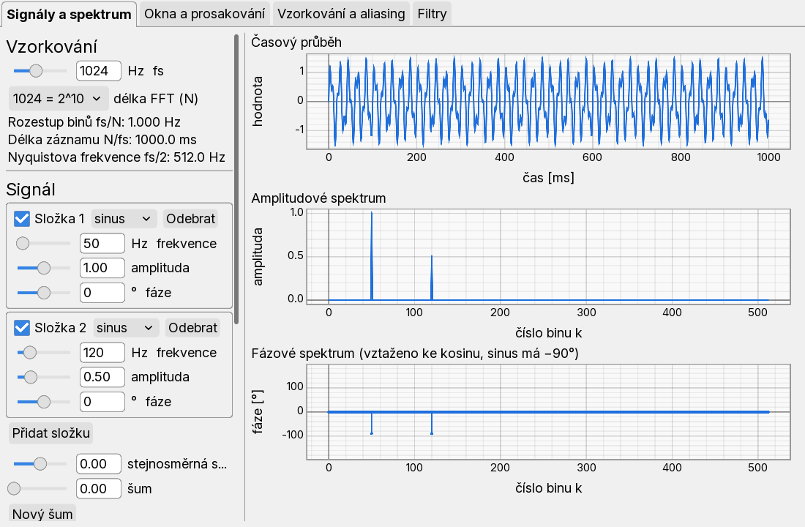
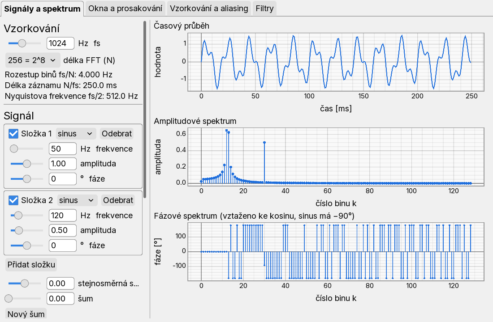

# Lekce 5: DFT – komplexní čísla a biny

## Cíl lekce

Naučíš se základy komplexních čísel a uvidíš, že DFT jen úsporně zapisuje
dvojici „shoda s kosinem a shoda se sinem“ z lekce 4. Pochopíš, co je
**bin**, jak spočítat jeho frekvenci a proč program ukazuje jen polovinu
spektra.

## Základy

### Komplexní číslo je bod v rovině

V lekci 4 jsme pro každou frekvenci dostali dvě čísla, `C_k` a `S_k`.
Dvojici čísel je šikovné brát jako jeden bod v rovině – jako souřadnice
na mapě. Takovému bodu se říká **komplexní číslo** a zapisuje se

```text
z = a + j·b
```

- `a` – **reálná část**, vodorovná souřadnice,
- `b` – **imaginární část**, svislá souřadnice,
- `j` – značka, která říká „tohle je svislá souřadnice“. (Matematici píšou
  `i`, elektrotechnici `j`, protože `i` je u nich proud.)

Bod můžeme popsat i jinak: **velikostí** (vzdáleností od počátku) a
**úhlem** (směrem od kladné vodorovné osy):

```text
|z| = √(a² + b²)          úhel z = atan2(b, a)
```

`atan2(b, a)` je úhel bodu `(a, b)` ve správném kvadrantu, od −180° do
180°. Například `z = −4j` (bod přímo dolů) má velikost 4 a úhel −90°.

```text
            im
             ↑
             |     • 1 + 2j   (velikost 2,24, úhel 63,4°)
             |
   ──────────┼──────────→ re
             |
             • −4j            (velikost 4, úhel −90°)
```

### Počítání s komplexními čísly

- **Sčítání** po složkách: `(1 + 2j) + (3 − j) = 4 + j`.
- **Násobení** jako závorky, jen s pravidlem `j · j = −1`:

```text
(a + jb) · (c + jd) = (a·c − b·d) + j·(a·d + b·c)
```

Násobení má hezký geometrický smysl: **velikosti se násobí a úhly sčítají**.
Vynásobit číslem `j` (velikost 1, úhel 90°) tedy znamená otočit bod
o 90° proti směru hodinových ručiček: `j · 1 = j`, `j · j = −1`.

### Ručička na kružnici: `e^(jφ)`

Bod na kružnici s poloměrem 1 natočený o úhel `φ` má souřadnice
`(cos φ, sin φ)`. Zapisuje se zkratkou (Eulerův vzorec):

```text
e^(jφ) = cos φ + j · sin φ
```

Nemusíš řešit, proč je tam „e na něco“. Stačí číst `e^(jφ)` jako
„ručička délky 1 natočená na úhel `φ`“. A `e^(−jφ) = cos φ − j · sin φ` je
ručička natočená na opačnou stranu.

### DFT s komplexními čísly

Teď už můžeme oba součty z lekce 4 zapsat jedním vzorcem:

```text
X[k] = Σ x[n] · e^(−j·2π·k·n/N)
     = Σ x[n] · cos(2π·k·n/N) − j · Σ x[n] · sin(2π·k·n/N)
     = C_k − j · S_k
```

- `X[k]` – výsledek DFT pro `k`, jedno komplexní číslo,
- `e^(−j·2π·k·n/N)` – ručička, která se během záznamu `k`-krát otočí
  (ve směru hodinových ručiček).

Velikost `|X[k]| = √(C_k² + S_k²)` je přesně to, co jsme v lekci 4
dosazovali do amplitudy. Program proto počítá

```text
amplituda = 2 · |X[k]| / N
fáze = úhel X[k]
```

A odtud plyne, proč má sinus ve spektru fázi −90°: pro sinus vyšlo
`C_k = 0` a `S_k = N/2`, takže `X[k] = −j · N/2` – bod přímo dolů, úhel
−90°. Kosinus dá `X[k] = N/2`, úhel 0°. **Fáze ve spektru se měří vůči
kosinu.**

### Biny

Číslu `k` se říká **bin** (anglicky „přihrádka“). DFT z `N` vzorků vrací
`N` binů, `k = 0, 1, …, N − 1`. Bin `k` odpovídá frekvenci

```text
f_k = k · fs / N
```

Sousední biny jsou od sebe vzdálené

```text
Δf = fs / N = 1 / (délka záznamu)
```

Tomu se říká **rozlišení** spektra. Závisí jen na tom, jak dlouho záznam
trvá: 1 s dá biny po 1 Hz, 0,25 s biny po 4 Hz.

### Proč jen polovina spektra

Pro reálný signál (a ten program vždy má) platí, že bin `N − k` je
**zrcadlem** binu `k`: má stejnou velikost a opačný úhel. Zkušební vlna
`N − k` má totiž ve vzorcích stejný kosinus a opačný sinus jako vlna `k`.
Reálná sinusovka se rozdělí napůl do binu `k` a do binu `N − k` (ručička
otáčející se jedním a druhým směrem).

Program proto ukazuje jen biny 0 až `N/2` a amplitudu násobí dvěma –
sečte obě poloviny. Výjimkou jsou bin 0 (stejnosměrná složka) a bin `N/2`
(frekvence `fs/2`), které zrcadlo nemají; u nich se dvěma nenásobí.

## V programu

Záložka **Signály a spektrum** ve výchozím stavu: `fs` = 1024 Hz,
N = 1024, sinusovky 50 Hz (amplituda 1) a 120 Hz (amplituda 0,5). Vlevo:
„Rozestup binů fs/N: 1.000 Hz“, „Délka záznamu N/fs: 1000.0 ms“.

V sekci **Zobrazení** přepni **Osa spektra** na **číslo binu**. Čáry jsou
teď na binech **50** a **120**: při rozestupu 1 Hz je číslo binu rovno
frekvenci v Hz. Na ose je 513 binů (0 až 512 = `N/2`).



## Pokusy

1. **Jiná vzorkovací frekvence.** Nastav `fs` = **2048 Hz** (N zůstane
   1024). → Rozestup binů je „2.000 Hz“, záznam trvá „500.0 ms“. Čáry se
   v binech přesunuly na **25** a **60** (`50/2` a `120/2`). Přepni osu na
   **Hz**: čáry jsou pořád na 50 a 120 Hz. Bin je jen pořadové číslo,
   frekvenci dává až `k · fs / N`. Vrať `fs` = **1024 Hz**.
2. **Kratší záznam.** Nastav **N = 256** (osa v binech). → Rozestup je
   „4.000 Hz“, záznam „250.0 ms“. Sinusovka 120 Hz padne na bin
   `120/4 = 30` a má výšku 0,50. Sinusovka 50 Hz by měla bin 12,5, takový
   ale neexistuje: rozdělí se hlavně do binů 12 a 13 (výšky 0,65 a 0,62)
   a trochu do okolních. To je prosakování z lekce 8.

   

3. **Fáze vůči kosinu.** Vrať **N = 1024**. Ve fázovém spektru mají obě
   čáry −90°. Nastav u Složky 1 fázi **30°**. → Fáze na binu 50 bude
   **−60°**: sinus s fází 30° je kosinus s fází `30° − 90° = −60°`. Vrať
   fázi **0°**.
4. **Bin N/2.** Odškrtni Složku 2 a u Složky 1 nastav frekvenci
   **512 Hz** (to je `fs/2`, bin 512). → Se fází 0° jsou všechny vzorky
   nulové (`sin(π·n) = 0`) a spektrum je prázdné. Nastav fázi **90°**: vzorky
   se střídají 1, −1, 1, −1 a na binu 512 je čára s výškou **1**. Bin `N/2`
   nemá zrcadlo, a proto program jeho amplitudu dvěma nenásobí.

## Častá nedorozumění

- **„Imaginární část je něco nereálného.“** Je to jen druhá souřadnice –
  shoda se sinem. Bez ní by nešlo spočítat amplitudu sinusovky
  s libovolnou fází.
- **„Bin je frekvence, kterou signál má.“** Bin je zkušební frekvence,
  na kterou se DFT ptá. Signál může mít frekvenci mezi biny (pokus 2).
- **„Biny nad N/2 obsahují vyšší frekvence.“** U reálného signálu jsou
  jen zrcadlem dolní poloviny (záporné frekvence). Vyšší frekvence než
  `fs/2` po navzorkování rozlišit nejde – viz lekce 11.

## Shrnutí

- Komplexní číslo `a + jb` je bod v rovině; má velikost a úhel.
- Při násobení se velikosti násobí a úhly sčítají.
- `e^(jφ) = cos φ + j sin φ` je ručička délky 1 natočená na úhel `φ`.
- DFT: `X[k] = Σ x[n] · e^(−j·2π·k·n/N) = C_k − j·S_k`.
- Amplituda `2·|X[k]|/N`, fáze = úhel `X[k]` vůči kosinu (sinus má −90°).
- Bin `k` má frekvenci `k · fs / N`, rozestup binů je `fs/N = 1/(délka
  záznamu)`.
- U reálného signálu stačí biny 0 až `N/2`.

## Otázky k zamyšlení

1. Proč má zkušební vlna `N − k` stejný kosinus a opačný sinus jako vlna
   `k`?
2. Co geometricky udělá vynásobení číslem `−j`?
3. Záznam trvá 0,5 s. Jaký je rozestup binů? Záleží na `fs`?

<details>
<summary>Odpovědi</summary>

1. Její úhel je `2π·(N − k)·n/N = 2π·n − 2π·k·n/N`. Celé otáčky `2π·n` na
   kosinus ani sinus nemají vliv, takže zbude úhel `−2π·k·n/N`. A platí
   `cos(−α) = cos α`, `sin(−α) = −sin α`.
2. `−j` má velikost 1 a úhel −90°: bod se otočí o 90° ve směru hodinových
   ručiček.
3. `Δf = 1 / 0,5 s = 2 Hz` a na `fs` nezáleží. Vyšší `fs` znamená víc
   vzorků (`N`), ale `fs/N` zůstane stejné.

</details>

## Cvičení

1. Spočítej `(1 + 2j) · (3 − j)`. Urči velikost a úhel výsledku a ověř, že
   velikosti se násobí a úhly sčítají.
2. V lekci 4 vyšlo pro signál s `N = 8` `C_1 = 0` a `S_1 = 4`. Zapiš `X[1]`
   jako komplexní číslo, urči amplitudu a fázi. Jak bude vypadat `X[7]`?
3. Zvuk je vzorkovaný `fs = 48 000 Hz` a analyzuje se FFT délky 4096. Jaký
   je rozestup binů a jak dlouhý je záznam? Do kterého binu by padl tón
   1000 Hz? Ověř první dvě čísla v programu.

<details>
<summary>Řešení</summary>

**1.** Roznásobíme:

```text
(1 + 2j)(3 − j) = 1·3 + 1·(−j) + 2j·3 + 2j·(−j)
                = 3 − j + 6j − 2j²
                = 3 + 5j + 2          (protože j² = −1)
                = 5 + 5j
```

Velikost `√(5² + 5²) = √50 ≈ 7,07`, úhel `atan2(5, 5) = 45°`.

Kontrola: `|1 + 2j| = √5 ≈ 2,236` s úhlem 63,4°, `|3 − j| = √10 ≈ 3,162`
s úhlem −18,4°. Součin velikostí `2,236 · 3,162 ≈ 7,07` ✔, součet úhlů
`63,4° − 18,4° = 45°` ✔.

**2.** `X[1] = C_1 − j·S_1 = 0 − 4j = −4j`. Velikost 4, úhel −90°.
Amplituda `2 · 4 / 8 = 1`, fáze −90° (je to sinus).

`X[7]` je zrcadlo `X[1]` (`7 = 8 − 1`): stejná velikost, opačný úhel,
tedy `X[7] = +4j`. Program bin 7 neukazuje, protože nenese nic nového.

**3.** Rozestup `Δf = 48 000 / 4096 ≈ 11,72 Hz`, délka záznamu
`4096 / 48 000 s ≈ 85,3 ms`. Tón 1000 Hz by měl bin
`1000 / 11,72 ≈ 85,33` – není to celé číslo, takže padne mezi biny 85
(996,1 Hz) a 86 (1007,8 Hz) a projeví se v obou (prosakování).

V programu nastav `fs` = 48000 a N = 4096. Vlevo uvidíš „Rozestup binů
fs/N: 11.7 Hz“ a „Délka záznamu N/fs: 85.3 ms“.

</details>

## Kam dál

- Další lekce: [6. FFT a proč je rychlá](06-fft.md).
- Předchozí lekce: [4. DFT jako měření shody](04-dft-mereni-shody.md).
- V kódu: `src/dsp/complex.zig` (komplexní číslo: `fromPolar`,
  `magnitude`, `phase`, násobení), `src/dsp/fft.zig` (funkce `dft`),
  `src/dsp/spectrum.zig` (funkce `oneSidedSpectrum`: biny 0 až `N/2`,
  násobení dvěma kromě binu 0 a `N/2`, převod na fázi ve stupních).
