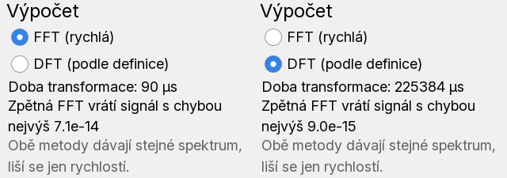

# Lekce 6: FFT a proč je rychlá

## Cíl lekce

Pochopíš myšlenku **rychlé Fourierovy transformace (FFT)**: DFT dlouhého
záznamu se dá poskládat z DFT kratších záznamů. Výsledek je přesně stejný,
jen výpočet je mnohem rychlejší. Spočítáš FFT čtyř vzorků ručně.

## Základy

### Kolik práce dá DFT

DFT podle definice (lekce 4 a 5) počítá pro každý z `N` binů součet `N`
součinů. To je `N · N = N²` násobení. Pro `N = 1024` přes milion, pro
`N = 4096` skoro 17 milionů. Zvuková karta přitom potřebuje spektrum
klidně stokrát za sekundu.

### Rozděl a panuj

Představ si, že máš seřadit balík karet. Rozdělíš ho na dvě poloviny,
každou seřadíš zvlášť (a ty opět rozdělíš na poloviny…) a nakonec obě
seřazené poloviny jednoduše slučuješ. Malé úlohy jsou mnohem levnější než
jedna velká.

FFT dělá totéž. Vzorky rozdělí na **sudé** (`x[0], x[2], x[4], …`)
a **liché** (`x[1], x[3], x[5], …`) a z každé poloviny spočítá DFT délky
`N/2`. Označme je `E[k]` (sudé) a `O[k]` (liché). Pak platí

```text
X[k]       = E[k] + w^k · O[k]
X[k + N/2] = E[k] − w^k · O[k]          pro k = 0 … N/2 − 1
```

- `w = e^(−j·2π/N)` – ručička otočená o jeden „dílek“ `360°/N`,
- `w^k` – otočení o `k` dílků,
- `E[k]`, `O[k]` – DFT sudých a lichých vzorků.

Proč to funguje:

- Liché vzorky jsou o jeden vzorek posunuté oproti sudým. Posun o jeden
  vzorek znamená u zkušební vlny `k` pootočení o `k` dílků, a to dělá
  násobení `w^k`.
- Druhá polovina binů (`k + N/2`) použije **tatáž** `E[k]` a `O[k]`, jen
  s opačným znaménkem, protože `w^(k + N/2) = −w^k` (otočení o půl kruhu
  navíc). Každé násobení se tak využije dvakrát.

Dvojici „součet a rozdíl“ se kvůli tvaru nákresu říká **motýlek**:

```text
  a ─────●───── a + w·b
          ╲  ╱
           ╳
          ╱  ╲
  b ──(·w)●───── a − w·b
```

### Až na samé dno

Každou polovinu lze zase rozdělit na sudé a liché. Pro `N = 8`:
8 → 2 × 4 → 4 × 2 → 8 × 1. DFT jediného vzorku je ten vzorek sám. Celý
výpočet má proto `log₂ N` pater (pro `N = 8` tři) a v každém patře je
`N/2` motýlků.

Opakované dělení na sudé a liché přeskládá vzorky do zvláštního pořadí –
**obrácených bitů** indexu. Pro `N = 8`: 0, 4, 2, 6, 1, 5, 3, 7. Například
1 = `001` binárně, obráceně `100` = 4. Program vzorky na začátku přerovná
a pak je skládá po patrech do bloků délky 2, 4, 8, … `N`.

Celé to funguje jen tehdy, když jde délku pořád půlit – `N` musí být
**mocnina dvou**. Proto program nabízí délky 8, 16, … 4096.

### Kolik se ušetří

| N    | DFT: N² násobení | FFT: (N/2)·log₂N motýlků | poměr |
|------|------------------|--------------------------|-------|
| 8    | 64               | 12                       | 5     |
| 1024 | 1 048 576        | 5 120                    | 205   |
| 4096 | 16 777 216       | 24 576                   | 683   |

(Text [Signály a spektrum](../01-signaly-a-spektrum.md) počítá „N·log₂N
operací“ a dostane poměr asi 340 – záleží na tom, co přesně počítáme.
Řádově jde vždy o stovky.)

### Zpětná FFT

Ze spektra jde dostat zpátky vzorky: stejný algoritmus, jen s opačným
znaménkem v exponentu (`e^(+j…)`) a na konci dělení `N`. Spektrum a vzorky
tedy obsahují přesně tutéž informaci.

## V programu

Záložka **Signály a spektrum** ve výchozím stavu (`fs` = 1024 Hz,
N = 1024). V sekci **Výpočet**:

- **FFT (rychlá) / DFT (podle definice)** – kterým algoritmem se spektrum
  počítá,
- **Doba transformace** – jak dlouho výpočet trval,
- **Zpětná FFT vrátí signál s chybou nejvýš …** – program na spektrum
  použije zpětnou FFT a porovná výsledek s původními vzorky. Ve výchozím
  stavu ukáže 2.7e-14, tedy 0,000 000 000 000 027: jen zaokrouhlovací
  chyby počítače.

Nastav **N = 4096** a přepínej mezi FFT a DFT. Spektrum se nezmění, změní
se jen doba transformace. Na našem testovacím počítači (program přeložený
s `-Doptimize=ReleaseSafe`) vyšlo:



FFT 90 µs, DFT 225 384 µs, tedy asi **2500× rychlejší**. U tebe budou čísla
jiná, ale poměr bude podobně velký. Je dokonce větší než 683 z tabulky:
DFT v programu počítá pro každý součin znovu kosinus a sinus, kdežto FFT
otáčí ručičku `w` jen násobením.

## Pokusy

1. **Stejné spektrum.** Při N = 1024 přepni mezi FFT a DFT. → Grafy se
   vůbec nezmění. FFT není přibližná metoda, počítá přesně totéž jinou
   cestou.
2. **Dvojnásobné N.** S FFT měň N: 1024 → 2048 → 4096 a sleduj dobu
   transformace. → Roste jen o něco víc než dvakrát s každým zdvojením.
   S DFT roste čtyřikrát, protože `(2N)² = 4N²`. (Měření stejných funkcí
   na testovacím počítači: FFT pro N = 1024, 2048 a 4096 trvala 19; 40
   a 86 µs. DFT pro N = 1024 trvala 13,9 ms a pro N = 4096 199 ms,
   tedy 14× déle.)
3. **DFT a posuvník.** Při DFT a N = 4096 táhni posuvníkem amplitudy. →
   Každá změna posuvníku teď znamená asi čtvrt sekundy výpočtu, takže
   program reaguje pomalu. S FFT reaguje okamžitě.
4. **Zpětná FFT.** Přidej šum **1.00** a měň složky. → Chyba zpětné FFT
   zůstává nepatrná, ať je signál jakýkoli: při N = 1024 a šumu 1.00 je to
   5.0e-14, při N = 4096 1.6e-13.

## Častá nedorozumění

- **„FFT je přibližná, DFT přesná.“** Obě dávají stejný výsledek (liší se
  jen zaokrouhlovacími chybami v posledních desetinných místech).
- **„FFT je jiná transformace než DFT.“** FFT je jen *algoritmus*, jak DFT
  spočítat rychle.
- **„Spektrum se nedá převést zpět na signál.“** Zpětná FFT vrátí přesně
  původní vzorky. Spektrum obsahuje veškerou informaci – amplitudy
  i fáze.

## Shrnutí

- DFT podle definice potřebuje `N²` násobení.
- FFT dělí vzorky na sudé a liché a skládá výsledek motýlky
  `a ± w^k · b`.
- Má `log₂N` pater po `N/2` motýlcích, `N` musí být mocnina dvou.
- Na začátku se vzorky přerovnají podle obrácených bitů indexu.
- Výsledek je stejný jako u DFT; zpětná FFT vrátí vzorky.

## Otázky k zamyšlení

1. Proč stačí spočítat `w^k · O[k]` jen jednou pro `X[k]` i `X[k + N/2]`?
2. Kolik pater a kolik motýlků má FFT pro `N = 1024`?
3. Proč DFT v programu funguje pro libovolné `N`, ale FFT jen pro mocniny
   dvou?

<details>
<summary>Odpovědi</summary>

1. Protože `w^(k + N/2) = −w^k` a `E`, `O` se po `N/2` binech opakují.
   Pro druhou polovinu se jen odečítá místo sčítání.
2. `log₂ 1024 = 10` pater, v každém `512` motýlků, celkem 5 120.
3. DFT je jen dvojitý cyklus přes `k` a `n`. FFT musí délku opakovaně
   půlit až na 1, což jde jen u mocniny dvou. (Proto záložka Vzorkování,
   kde počet vzorků mocnina dvou nebývá, počítá spektrum pomalou DFT.)

</details>

## Cvičení

1. Spočítej DFT dvou vzorků `x = [3, 1]`. Jaký signál to je?
2. Spočítej FFT čtyř vzorků `x = [2, 1, 0, 1]` pomocí rozdělení na sudé
   a liché. Výsledek převeď na amplitudy a urči, z čeho se signál skládá.
3. Spočítej stejně FFT signálu `x = [0, 1, 0, −1]`.
4. Kam se při `N = 16` přesune vzorek s indexem 3 a s indexem 5 při
   přerovnání podle obrácených bitů?

<details>
<summary>Řešení</summary>

**1.** Pro `N = 2` je `w = e^(−j·π) = −1` a jediný motýlek:

```text
X[0] = x[0] + x[1] = 3 + 1 = 4
X[1] = x[0] − x[1] = 3 − 1 = 2
```

Bin 0: amplituda `4/2 = 2` (stejnosměrná složka). Bin 1 je `N/2`, nemá
zrcadlo, amplituda `2/2 = 1`, úhel 0° (kosinus s frekvencí `fs/2`, vzorky
1 a −1). Signál je tedy `2 + 1·(1, −1) = (3, 1)` ✔.

**2.** `N = 4`, `w = e^(−j·90°) = −j`.

- Sudé vzorky `[x0, x2] = [2, 0]`: `E[0] = 2 + 0 = 2`, `E[1] = 2 − 0 = 2`.
- Liché vzorky `[x1, x3] = [1, 1]`: `O[0] = 1 + 1 = 2`, `O[1] = 1 − 1 = 0`.

Motýlky:

```text
X[0] = E[0] + w⁰·O[0] = 2 + 2      = 4
X[2] = E[0] − w⁰·O[0] = 2 − 2      = 0
X[1] = E[1] + w¹·O[1] = 2 + (−j)·0 = 2
X[3] = E[1] − w¹·O[1] = 2 − (−j)·0 = 2
```

Kontrola přímou DFT dá také `[4, 2, 0, 2]`. Amplitudy:

- bin 0: `4/4 = 1` → stejnosměrná složka 1,
- bin 1: `2 · 2 / 4 = 1`, úhel 0° → kosinus s jednou periodou v záznamu,
- bin 2 (`N/2`): `0`.

Signál je `1 + cos(2π·n/4)`: pro `n = 0, 1, 2, 3` to dá 2, 1, 0, 1 ✔.
(Bin 3 je zrcadlo binu 1 a má stejnou hodnotu 2.)

**3.** Sudé `[0, 0]`: `E = [0, 0]`. Liché `[1, −1]`: `O[0] = 0`, `O[1] = 2`.

```text
X[0] = 0 + 0         = 0
X[2] = 0 − 0         = 0
X[1] = 0 + (−j)·2    = −2j
X[3] = 0 − (−j)·2    = 2j
```

Bin 1: velikost 2, amplituda `2 · 2 / 4 = 1`, úhel −90° → sinus s jednou
periodou v záznamu, `x[n] = sin(2π·n/4)` = 0, 1, 0, −1 ✔. Bin 3 = `2j` je
zrcadlo (opačný úhel).

**4.** `N = 16` má 4 bity. `3 = 0011` → obráceně `1100 = 12`.
`5 = 0101` → obráceně `1010 = 10`.

</details>

## Kam dál

- Další lekce: [7. Decibely a fáze ve spektru](07-decibely-a-faze.md).
- Předchozí lekce: [5. DFT – komplexní čísla a biny](05-dft-komplexni-cisla-a-biny.md).
- V kódu: `src/dsp/fft.zig` – `bitReversePermutation` a `reverseBits`
  (přerovnání), `butterflyStage` (jedno patro motýlků), `transform`
  (společné jádro FFT i zpětné FFT), `ifft` (dělení `N`). Program měří
  dobu a chybu zpětné FFT v `src/ui/spectrum.zig` (funkce `compute`).
