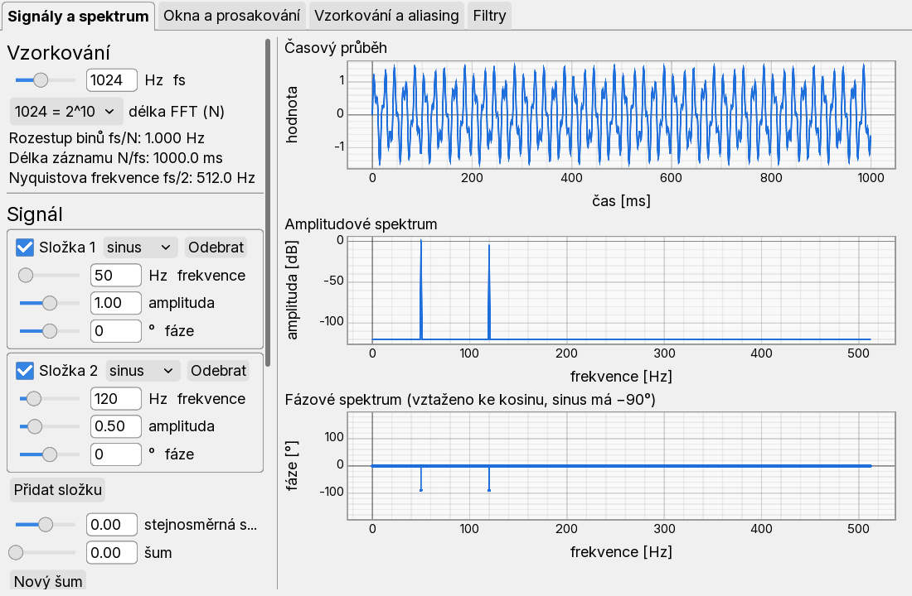
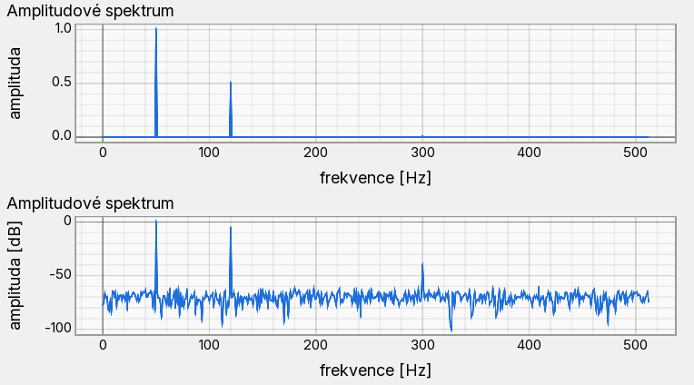
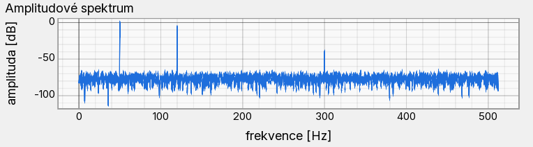

# Lekce 7: Decibely a fáze ve spektru

## Cíl lekce

Naučíš se číst amplitudové spektrum v **decibelech** a pochopíš, proč je
tak užitečné: najednou ukáže silné i velmi slabé složky. Pak se naučíš
číst **fázové spektrum** a poznáš, kdy fáze něco znamená a kdy je to jen
náhodné číslo.

## Základy

### Proč decibely

Na koncertě je zpěvák klidně milionkrát hlasitější než šustění programu
v sále, a přesto obojí slyšíš. Ucho vnímá hlasitost „logaritmicky“: každé
zdesateronásobení zní jako stejný krok navíc. Lineární graf to neumí –
čára 1 a čára 0,001 se do něj nevejdou zároveň, ta malá splyne s nulou.

**Decibely** (dB) převádějí poměry na kroky:

```text
úroveň v dB = 20 · log₁₀(A)
```

- `A` – amplituda (vůči 1; program bere amplitudu 1 jako 0 dB),
- `log₁₀` – desítkový logaritmus: kolikrát se musí 10 vynásobit sama
  sebou, aby vyšlo `A` (`log₁₀ 100 = 2`, `log₁₀ 0,01 = −2`).

| amplituda | dB       |
|-----------|----------|
| 2         | +6,02    |
| 1         | 0        |
| 0,5       | −6,02    |
| 0,1       | −20      |
| 0,01      | −40      |
| 0,001     | −60      |

Stačí si pamatovat: **×10 je +20 dB, ×2 je asi +6 dB.** Násobení se
v decibelech mění na sčítání, a proto se s nimi dobře počítá (to využijeme
u filtrů).

Zpátky z decibelů na amplitudu: `A = 10^(dB/20)`.

### Šumová hladina

Šum obsahuje trochu všech frekvencí. Ve spektru v dB proto vytvoří
roztřepený „koberec“ – **šumovou hladinu**. Sinusovky z něj vyčnívají.
Čím delší záznam, tím níž hladina leží: energie šumu se rozdělí do více
binů, zatímco sinusovka zůstane celá v jednom. Každé zdvojnásobení `N`
sníží hladinu asi o 3 dB.

### Fázové spektrum

Úhel komplexního čísla `X[k]` (lekce 5) je **fáze** složky na frekvenci
binu `k`. Program ji měří **vůči kosinu**: kosinus má 0°, sinus −90°.
Sinusovka s fází `φ` nastavenou v programu má ve spektru fázi

```text
fáze ve spektru = φ − 90°     (převedeno do rozsahu −180° až 180°)
```

Dvě důležité věci:

- Fáze záleží na tom, kde začíná záznam. Kdybys začal měřit o kousek
  později, všechny fáze se změní; amplitudy ne.
- Fáze má smysl jen tam, kde je silná složka. V binu, kde je jen šum,
  je úhel náhodný. Kde není vůbec nic, program fázi nastaví na 0°.

## V programu

Záložka **Signály a spektrum** ve výchozím stavu (fs 1024 Hz, N = 1024,
50 Hz s amplitudou 1, 120 Hz s amplitudou 0,5). V sekci **Zobrazení**
přepni **Amplituda** na **v dB**.



- Čára 50 Hz je na **0 dB** (amplituda 1), čára 120 Hz na **−6,02 dB**
  (amplituda 0,5).
- Ostatní biny obsahují jen zaokrouhlovací chyby, menší než −240 dB. Graf
  je ořízne na **−120 dB**, proto leží na spodní vodorovné čáře.
- **Fázové spektrum** ukazuje −90° u obou sinusovek a 0° všude jinde (tam
  nic není).

## Pokusy

1. **Slabá složka.** Klikni na **Přidat složku** a nastav Složku 3 na
   **300 Hz**, amplitudu **0.01**. → V dB je čára na **−40 dB**, jasně
   vidět. Přepni na **lineárně**: čára 0,01 je stokrát menší než čára 50 Hz
   a v grafu zanikne. Vrať **v dB**.
2. **Šum.** Nastav **šum** na **0.01**. → Objeví se šumová hladina zhruba
   kolem −70 dB (jednotlivé biny skáčou nahoru až k −61 dB a dolů). Čára
   300 Hz je asi 30 dB nad ní.

   

3. **Delší záznam.** Nastav **N = 4096**. → Šumová hladina klesne asi
   o 6 dB (medián z −70 na −77 dB), čáry 0, −6 a −40 dB zůstanou. Čtyřikrát
   delší záznam = dvě zdvojnásobení = asi 2 × 3 dB.

   

4. **Víc šumu.** Vrať **N = 1024** a nastav šum **0.10**. → Hladina se zvedne
   o 20 dB (asi na −50 dB, špičky až −41 dB) a čára −40 dB se v ní skoro
   ztratí. Vrať šum na **0.00**.
5. **Fáze složek.** Nastav u Složky 1 (50 Hz) fázi **90°**. → Ve fázovém
   spektru je u 50 Hz **0°** (kosinus). Fáze **180°** dá **90°**, fáze **45°**
   dá **−45°**. Vždy `φ − 90°`. Amplitudové spektrum se nemění.
6. **Fáze šumu.** Nastav šum zase na **0.01**. → Fázové spektrum se zaplní
   náhodnými body od −180° do 180°. Smysl mají jen body u 50, 120 a 300 Hz,
   kde je silná složka.

## Častá nedorozumění

- **„−40 dB znamená záporná amplituda.“** Ne, decibely jsou poměr: −40 dB
  je amplituda 0,01, pořád kladná. Záporné dB znamenají „menší než 1“.
- **„Šum je jen na šumové hladině.“** Šum přispívá do každého binu, i do
  binu se sinusovkou. Proto je s šumem čára 120 Hz občas o pár setin dB
  jinde než −6,02.
- **„Fáze každého binu něco znamená.“** Jen u binů se silnou složkou.
  Jinde je to úhel šumu nebo zaokrouhlovacích chyb.

## Shrnutí

- `dB = 20 · log₁₀(A)`; 0 dB = 1, −20 dB = 0,1, −6 dB ≈ 0,5.
- ×10 = +20 dB, ×2 ≈ +6 dB; násobení se mění na sčítání.
- Graf v dB ukáže silné i velmi slabé složky zároveň.
- Šum tvoří šumovou hladinu; dvojnásobné `N` ji sníží asi o 3 dB.
- Fáze se měří vůči kosinu: ve spektru je `φ − 90°`. Má smysl jen
  u silných složek.

## Otázky k zamyšlení

1. Kolik decibelů je mezi čarou s amplitudou 1 a čarou s amplitudou 0,001?
2. Proč šumová hladina s delším záznamem klesá, ale čára sinusovky ne?
3. Proč se fáze mění, když posunu začátek záznamu, ale amplituda ne?

<details>
<summary>Odpovědi</summary>

1. `0 − (−60) = 60 dB`. (Tisícinásobek = 3 × ×10 = 3 × 20 dB.)
2. Energie šumu se rozdělí mezi všechny biny; s dvojnásobným `N` je binů
   dvakrát víc, na každý připadne polovina výkonu (−3 dB). Sinusovka má
   celou energii v jednom binu bez ohledu na `N` a program ji přepočítá na
   amplitudu.
3. Posun začátku je totéž jako změna fáze každé složky (lekce 2). Velikost
   kmitů se posunem nezmění.

</details>

## Cvičení

1. Převeď: amplituda 0,2 na dB; −26 dB na amplitudu; o kolik se změní
   amplituda, když úroveň vzroste o 6 dB?
2. Ve fázovém spektru je u čáry 50 Hz údaj 60°. Jakou fázi má složka
   nastavenou na posuvníku? A jakou fázi uvidíš ve spektru pro posuvník
   −30°? Ověř v programu.
3. Při N = 1024 je šumová hladina kolem −70 dB. Chceš ji dostat na −79 dB.
   Jak dlouhé N potřebuješ?

<details>
<summary>Řešení</summary>

**1.**

- `20 · log₁₀(0,2) = 20 · (−0,699) ≈ −13,98 dB`.
- `A = 10^(−26/20) = 10^(−1,3) ≈ 0,050`.
- `10^(6/20) ≈ 1,995`, tedy amplituda se zhruba zdvojnásobí.

**2.** Platí `fáze ve spektru = φ − 90°`, tedy `φ = fáze ve spektru + 90°`.
Pro 60° je `φ = 150°`. Pro posuvník −30° je ve spektru `−30° − 90° =
−120°`. V programu (výchozí stav) nastav u Složky 1 fázi 150° a pak −30°
a sleduj bod u 50 Hz ve fázovém spektru: 60° a −120°.

**3.** Potřebuješ snížit hladinu o 9 dB. Každé zdvojnásobení `N` dá asi
−3 dB, takže potřebuješ tři zdvojnásobení: `1024 · 2³ = 8192`. Program
ale nabízí nejvýš 4096 (dvě zdvojnásobení, −6 dB, tedy asi −76 až
−77 dB). Na −79 dB tu tedy nedosáhneš – jinou cestou je menší šum.

</details>

## Kam dál

- Další lekce: [8. Prosakování](08-prosakovani.md).
- Předchozí lekce: [6. FFT a proč je rychlá](06-fft.md).
- V kódu: `src/dsp/spectrum.zig` – `oneSidedSpectrum` počítá
  `amplitude_db = 20·log₁₀(amplituda)` (nejméně −240 dB) a fázi ve
  stupních; pod amplitudou 10⁻⁹ fázi nastaví na 0. Ořez grafu na −120 dB
  je v `src/ui/spectrum.zig` (`db_floor`).
