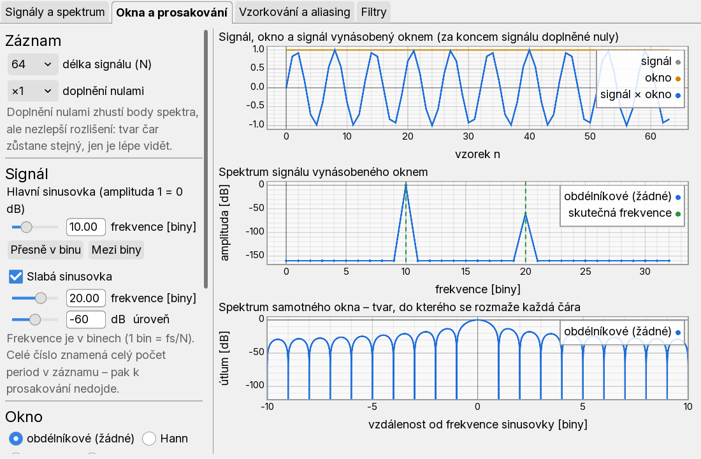
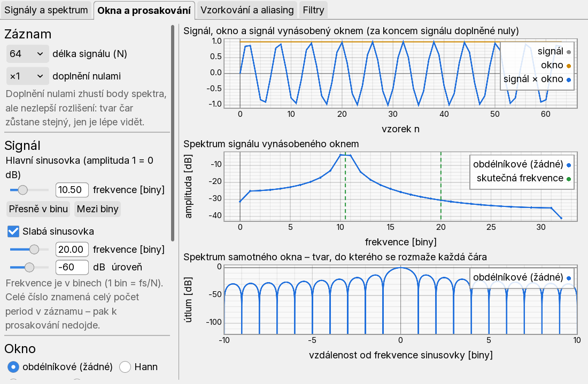
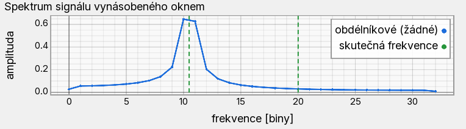

# Lekce 8: Prosakování

## Cíl lekce

Pochopíš, proč se čára sinusovky ve spektru někdy rozleje do celého
spektra (**prosakování**, anglicky *leakage*), kdy k tomu dochází a proč
to může úplně zakrýt slabý signál.

## Základy

### Smyčka, která nenavazuje

Představ si hudební smyčku, která se pořád dokola přehrává. Když je
useknutá přesně na konci taktu, navazuje hladce a nic nepoznáš. Když je
useknutá uprostřed tónu, na švu pokaždé lupne.

DFT se dívá na záznam právě jako na smyčku. Všechny její zkušební vlny
(lekce 4) mají v záznamu celý počet period, takže cokoli z nich poskládá,
se po `N` vzorcích přesně opakuje. DFT tedy „vidí“ signál, který vznikne
nekonečným opakováním záznamu.

- Má-li sinusovka v záznamu **celý počet period** (frekvence přesně na
  binu), opakovaný signál navazuje hladce. Spektrum je jediná čára.
- Má-li **necelý počet**, je na švu skok nebo zlom. Takový šev není
  sinusovka – potřebuje spoustu dalších frekvencí. Energie se rozlije do
  okolních binů a slabě až do celého spektra.

### Jakým tvarem se čára rozleje

Úsek signálu z nekonečně dlouhé sinusovky si můžeš představit jako
sinusovku vynásobenou **obdélníkovým oknem** – funkcí, která je 1 uvnitř
záznamu a 0 mimo něj. Každá čára se pak ve spektru nahradí tvarem
**spektra obdélníkového okna** posunutým na skutečnou frekvenci. Tento
tvar má:

- **hlavní lalok** od −1 do +1 binu kolem skutečné frekvence,
- **postranní laloky**; nejvyšší je −13,3 dB, další jsou stále nižší,
- **nuly** přesně ve vzdálenosti 1, 2, 3, … binů od skutečné frekvence.

DFT z tohoto tvaru vidí jen hodnoty na celých binech. Pro dlouhé záznamy
platí přibližně, že bin ve vzdálenosti `d` binů od skutečné frekvence
ukáže amplitudu

```text
A · |sin(π·d) / (π·d)|
```

- **Frekvence přesně na binu:** vzdálenosti ostatních binů jsou celá
  čísla, `sin(π·d) = 0` – všechny padnou do nul. Čistá čára.
- **Frekvence mezi biny (`…,5`):** vzdálenosti jsou 0,5; 1,5; 2,5; …
  a biny padnou na vrcholy laloků. Nejbližší bin ukáže jen
  `2/π ≈ 0,64` (−3,92 dB) a bin vzdálený 9,5 binu `1/(9,5·π) ≈ 0,034`
  (−29,5 dB).

## V programu

Otevři záložku **Okna a prosakování**. Frekvence se tu zadávají **v binech**
(program volí `fs = N`, takže 1 bin = 1 Hz). Výchozí stav: délka signálu
N = 64, hlavní sinusovka amplituda 1 (0 dB) v binu 10, slabá sinusovka
−60 dB v binu 20.

Okna jsou téma lekce 9; teď je vypneme. V sekci **Okno** vyber
**obdélníkové (žádné)**.



Tři grafy:

1. **Signál, okno a signál vynásobený oknem** – při obdélníkovém okně je
   okno (oranžově) všude 1 a modrý signál je přesně původní sinusovka.
2. **Spektrum signálu vynásobeného oknem** v dB. Zelené čárkované čáry
   ukazují skutečné frekvence obou sinusovek. Je tu jen bod **0 dB** v binu
   10 a bod **−60 dB** v binu 20. Ostatní body jsou na dně grafu (program
   ořízne vše pod −160 dB). Vlevo: „Nejvyšší čára spektra: 0.00 dB“.
3. **Spektrum samotného okna** – tvar, do kterého se rozmaže každá čára.
   Vodorovná osa je vzdálenost od skutečné frekvence v binech. Vlevo:
   „První nula hlavního laloku: ±1.00 binu“, „Nejvyšší postranní lalok:
   −13.3 dB“.

Teď klikni na **Mezi biny** (frekvence 10.50).



- Čára se rozlila: bin 10 má **−3,79 dB**, bin 11 **−4,05 dB**, biny 9
  a 12 asi −13 a −14 dB a dál to pomalu klesá.
- V binu 20 je prosakování **−30,5 dB**. Slabá sinusovka −60 dB je 30 dB
  pod ním a **úplně zmizela**.
- „Nejvyšší čára spektra: −3.79 dB“ – skutečná amplituda je přitom 0 dB.
  (Teorie pro dlouhý záznam říká −3,92 dB; u N = 64 se trochu přimíchá
  i zrcadlová čára ze záporných frekvencí, viz lekce 5.)

Podívej se na konec časového grafu: vzorek 63 má hodnotu 0,86 a vlna
klesá. Další vzorek by měl být 0 a pak −0,86, ale opakovaný záznam začíná
nulou a pokračuje **nahoru** (+0,86). Na švu je zlom. Při frekvenci 10.00
naopak poslední vzorek −0,83 hladce navazuje na začátek 0 a +0,83.

## Pokusy

1. **Malý posun.** Nastav frekvenci **10.25**. → Nejvyšší čára −1,02 dB,
   v binu 20 prosakování −29,5 dB. I čtvrt binu stačí, aby se slabá
   sinusovka ztratila.
2. **Ještě menší posun.** Nastav **10.01**. → Nejvyšší čára je skoro 0 dB,
   ale prosakování v binu 20 je pořád −57 dB – vyšší než slabá sinusovka
   (−60 dB), takže ji nevidíš čistě. Bez okna je bezpečné jen přesných
   10.00.
3. **Lineárně.** Při **10.50** přepni **Amplituda** na **lineárně**. → Vidíš
   dvě čáry kolem 0,65 a 0,63 a „ocásek“, který v binu 20 klesne na 0,03.
   Lineárně prosakování vypadá nevinně – teprve v dB je vidět, že
   převyšuje slabý signál.

   

4. **Silnější slabý signál.** Vrať **v dB** a zvyš úroveň slabé sinusovky
   na **−20 dB**. → V binu 20 se objeví hrbol (asi −19,6 dB) nad okolním
   prosakováním (kolem −30 dB). Slabý signál je vidět, jen když je silnější
   než prosakování na jeho místě.
5. **Delší záznam.** Nastav úroveň zpět na **−60 dB** a délku signálu
   **N = 1024**, frekvenci **10.50**. → Obrázek v binech vypadá skoro
   stejně: nejvyšší čára −3,71 dB, v binu 20 prosakování −32,7 dB.
   Delší záznam zúží biny v hertzích, ale prosakování neodstraní.
6. **Tvar okna.** Porovnej body ve druhém grafu s třetím grafem. Při
   10.50 leží biny 10 a 11 na hlavním laloku (0,5 binu od středu), biny 9
   a 12 na prvním postranním laloku (1,5 binu), další dál na nižších
   lalocích. Při 10.00 padnou všechny do nul.

## Častá nedorozumění

- **„Prosakování je chyba FFT.“** FFT počítá přesně. Prosakování vzniká
  tím, že máme jen konečný úsek signálu, který nekončí po celých periodách.
- **„Delší záznam prosakování odstraní.“** Jen zmenší rozestup binů
  v hertzích. Ve vzdálenosti několika binů zůstane prosakování podobné
  (pokus 5).
- **„Nejvyšší čára ukazuje amplitudu.“** Při frekvenci mezi biny je
  nejvyšší čára až o 3,9 dB nižší (amplituda 0,64 místo 1).

## Shrnutí

- DFT vidí záznam jako nekonečně opakovanou smyčku.
- Necelý počet period → šev (skok nebo zlom) → energie se rozlije do
  ostatních binů: prosakování.
- Každá čára se rozmaže tvarem spektra okna; bez okna je to obdélníkové
  okno s postranními laloky od −13,3 dB.
- Frekvence přesně na binu: všechny ostatní biny padnou do nul.
- Prosakování silné složky může zakrýt slabou složku i desítky binů daleko.

## Otázky k zamyšlení

1. Proč při frekvenci přesně 10.00 nevidíme žádné prosakování, i když
   tvar okna má postranní laloky?
2. `fs = 1000 Hz`, `N = 1000`. Bude prosakovat sinusovka 50,5 Hz?
   A sinusovka 50 Hz při `N = 512`?
3. Když v praxi frekvenci signálu předem neznáš, můžeš ji „trefit“ do binu?

<details>
<summary>Odpovědi</summary>

1. Biny padnou ve vzdálenostech 1, 2, 3, … binů od frekvence, a tam má
   spektrum obdélníkového okna přesně nuly.
2. Při `N = 1000` jsou biny po 1 Hz, 50,5 Hz je mezi nimi → prosakuje.
   Při `N = 512` jsou biny po `1000/512 ≈ 1,953 Hz` a 50 Hz je bin 25,6 →
   také prosakuje. (Navíc program FFT potřebuje N mocninu dvou.)
3. Obvykle ne – signály mají více frekvencí, které se navíc mění. Proto se
   používají okna (lekce 9), která prosakování výrazně potlačí.

</details>

## Cvičení

1. V záložce **Signály a spektrum** (fs 1024 Hz) jsou sinusovky 50 Hz,
   120 Hz a 50,5 Hz. Které budou prosakovat při N = 1024 a které při
   N = 256?
2. Odhadni vzorcem `|sin(π·d)/(π·d)|`, jakou úroveň v dB ukážou biny 9 a 12,
   když je frekvence 10,5 binu. Porovnej s programem.
3. Slabá sinusovka je 40 dB pod silnou a 15 binů od ní. Silná sinusovka je
   přesně mezi biny. Uvidíš slabou bez okna? Použij vzorec.

<details>
<summary>Řešení</summary>

**1.** Prosakuje frekvence, která není celočíselným násobkem rozestupu
binů `fs/N`.

- N = 1024: rozestup 1 Hz. 50 a 120 Hz jsou celé biny (50 a 120), 50,5 Hz
  ne → prosakuje jen 50,5 Hz.
- N = 256: rozestup 4 Hz. 120 Hz = bin 30 → neprosakuje. 50 Hz = bin 12,5
  a 50,5 Hz = bin 12,625 → obě prosakují. (Snímek v lekci 5 ukazuje právě
  50 Hz rozlité do binů 12 a 13.)

**2.** Biny 9 a 12 jsou od 10,5 vzdálené `d = 1,5`:

```text
|sin(1,5·π) / (1,5·π)| = 1 / (1,5·π) ≈ 0,212
20 · log₁₀(0,212) ≈ −13,5 dB
```

Program při N = 64 ukáže v binu 9 −13,0 dB a v binu 12 −13,8 dB. Rozdíl
proti vzorci (a mezi oběma biny) způsobuje zrcadlová čára ze záporných
frekvencí, která se u krátkého záznamu přimíchá.

**3.** Pro `d = 15` (silná sinusovka je mezi biny, takže biny jsou ve
vzdálenostech 14,5 a 15,5; vezmeme bližší):

```text
1 / (14,5·π) ≈ 0,022  →  20 · log₁₀(0,022) ≈ −33 dB
```

Prosakování je asi −33 dB, slabá sinusovka −40 dB → slabá je pod
prosakováním a bez okna ji neuvidíš.

Ověření v záložce Okna a prosakování (N = 64, obdélníkové okno, hlavní
10.50, slabá 25.00 na −40 dB): v binu 25 je −32,7 dB a v sousedních
binech 24 a 26 −33,2 a −34,0 dB. Slabá sinusovka se projeví jen sotva
znatelným hrbolkem v prosakování.

</details>

## Kam dál

- Další lekce: [9. Okna](09-okna.md).
- Předchozí lekce: [7. Decibely a fáze ve spektru](07-decibely-a-faze.md).
- Podrobnější text k záložce: [Okna a prosakování](../02-okna-a-prosakovani.md).
- V kódu: `src/dsp/window.zig` – úvodní komentář o prosakování,
  `windowResponse` (spektrum okna) a `analyzeWindow` (první nula
  a nejvyšší postranní lalok). Výpočet záložky je v `src/ui/windows.zig`
  (funkce `compute`).
