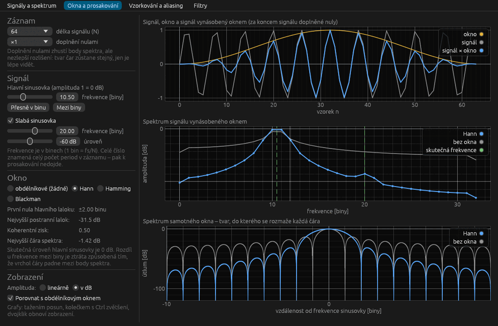
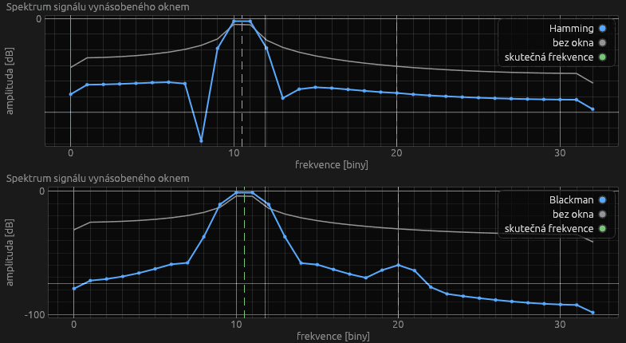
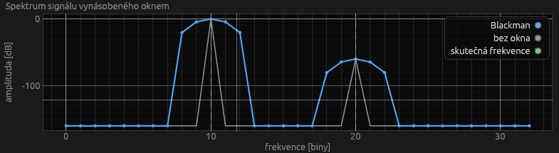

# Lekce 9: Okna

## Cíl lekce

Pochopíš, jak **okno** potlačí prosakování: záznam se na krajích plynule
ztlumí, takže šev zmizí. Naučíš se, co okno stojí (širší čára) a jak
vybrat okno podle toho, co chceš ve spektru vidět.

## Základy

### Ztlumit kraje

V lekci 8 jsme viděli, že prosakování způsobuje šev na hranici opakování
záznamu. Šev zmizí, když se záznam na začátku i na konci plynule ztlumí
k nule – jako když DJ na konci smyčky stáhne hlasitost a na začátku ji zase
vytáhne. Pak už nezáleží na tom, kde vlna skončila: na švu je vždy nula.

**Okno** je řada vah `w[n]`, jedna pro každý vzorek. Uprostřed jsou kolem 1,
na krajích u 0. Před FFT se jimi signál vynásobí:

```text
y[n] = x[n] · w[n]
```

Všechna okna v programu mají tvar

```text
w[n] = a0 − a1 · cos(2π·n/N) + a2 · cos(4π·n/N)
```

| okno        | a0   | a1   | a2   |
|-------------|------|------|------|
| obdélníkové | 1    | 0    | 0    |
| Hann        | 0,5  | 0,5  | 0    |
| Hamming     | 0,54 | 0,46 | 0    |
| Blackman    | 0,42 | 0,5  | 0,08 |

„Obdélníkové okno“ jsou samé jedničky – tedy žádné okno.

### Co okno udělá se spektrem

Lekce 8 ukázala, že každá čára se rozmaže tvarem **spektra okna**. Okno
s plynulými kraji má jiný tvar spektra než obdélník:

- **postranní laloky** jsou mnohem nižší → méně prosakování daleko od čáry,
- **hlavní lalok** je širší → čára je rozmazanější a blízké frekvence se
  hůř rozliší.

Obojí najednou mít nejde: každé okno je kompromis.

### Koherentní zisk

Okno signál zeslabí – v průměru o hodnotu `a0` (Hann na polovinu). Tomu se
říká **koherentní zisk**. Program to vyrovná: amplitudu nedělí počtem
vzorků `N`, ale součtem vah okna. Sinusovka s amplitudou 1 proto i s oknem
ukáže 0 dB.

### Hodnoty změřené programem

Pro N = 64 (hodnoty ukazuje panel vlevo; poslední dva sloupce pro hlavní
sinusovku v 10,5 binu):

| okno        | 1. nula  | nejvyšší postranní lalok | koherentní zisk | nejvyšší čára | prosakování v binu 20 |
|-------------|----------|--------------------------|-----------------|---------------|-----------------------|
| obdélníkové | ±1 bin   | −13,3 dB                 | 1,00            | −3,79 dB      | −30,5 dB              |
| Hann        | ±2 biny  | −31,5 dB                 | 0,50            | −1,42 dB      | −68,6 dB              |
| Hamming     | ±2 biny  | −42,4 dB                 | 0,54            | −1,74 dB      | −47,7 dB              |
| Blackman    | ±3 biny  | −58,1 dB                 | 0,42            | −1,10 dB      | −76,5 dB              |

Zajímavost: Hamming má nižší *nejvyšší* postranní lalok než Hann, ale
v binu 20 prosakuje víc. Jeho laloky totiž se vzdáleností klesají pomalu,
kdežto Hannovy rychle (Hann je na krajích hladce nulový, Hamming končí na
0,08).

## V programu

Záložka **Okna a prosakování**, výchozí stav: N = 64, okno **Hann**,
hlavní sinusovka v binu 10, slabá sinusovka −60 dB v binu 20,
„Porovnat s obdélníkovým oknem“ zaškrtnuto. Klikni na **Mezi biny**
(10.50).



- **Horní graf:** šedě signál, oranžově Hannovo okno (kopeček od 0 do 1
  a zpět), modře jejich součin. Modrý signál začíná i končí v nule – šev
  zmizel.
- **Prostřední graf:** modře spektrum s oknem, šedě bez okna. S oknem
  klesá spektrum od čáry mnohem rychleji. Slabá sinusovka v binu 20 je
  vidět jako hrbolek (kolem −59 dB); bez okna by byla pod prosakováním
  −30,5 dB.
- **Panel vlevo:** „První nula hlavního laloku: ±2.00 binu“, „Nejvyšší
  postranní lalok: −31.5 dB“, „Koherentní zisk: 0.50“, „Nejvyšší čára
  spektra: −1.42 dB“ (bez okna to bylo −3,79 dB).
- **Spodní graf:** spektrum Hannova okna (modře) proti obdélníkovému
  (šedě). Hlavní lalok je dvakrát širší, postranní laloky jsou mnohem níž
  a rychle klesají.

## Pokusy

1. **Hamming.** Vyber **Hamming**. → Prosakování v binu 20 je −47,7 dB
   a slabá sinusovka −60 dB **zmizí**. Ve spodním grafu je vidět, že
   Hammingovy postranní laloky jsou skoro vodorovné.
2. **Blackman.** Vyber **Blackman**. → Prosakování v binu 20 je
   −76,5 dB, slabá sinusovka je vidět ještě zřetelněji než s Hannem
   (kolem −60 dB).

   

3. **Cena za okno.** S Blackmanem klikni na **Přesně v binu** (10.00). →
   Místo jednoho bodu má čára pět: biny 8 až 12 s úrovněmi −20,4; −4,5; 0;
   −4,5 a −20,4 dB. S Hannem jsou to tři body (−6,0; 0; −6,0 dB),
   s Hammingem tři (−7,4; 0; −7,4 dB), bez okna jediný.

   

4. **Ztráta mezi biny.** Přepínej okna při 10.50 a sleduj „Nejvyšší čára
   spektra“: obdélníkové −3,79, Hann −1,42, Hamming −1,74, Blackman
   −1,10 dB. Širší hlavní lalok je nahoře plošší, takže čára mezi biny
   méně „klesne“.
5. **Koherentní zisk.** Podívej se na horní graf s Blackmanem: modrý signál
   je výrazně menší než šedý. Průměr okna je 0,42 („Koherentní zisk:
   0.42“). Program tím dělí, takže čára ve spektru přesto ukazuje 0 dB.

## Častá nedorozumění

- **„Okno prosakování odstraní.“** Jen ho potlačí. I s Blackmanem je
  v binu 20 −76,5 dB, ne nic.
- **„Nejlepší je vždycky Blackman.“** Má nejnižší prosakování, ale
  nejširší čáru. Na rozlišení dvou blízkých stejně silných tónů je horší
  (lekce 10). Když má signál celý počet period, je nejlepší žádné okno.
- **„Okno zmenší amplitudu ve spektru.“** Zmenšilo by, ale program to
  koherentním ziskem vyrovná. Pozor na to u jiných programů.

## Shrnutí

- Okno vynásobí záznam vahami, které kraje plynule ztlumí; šev zmizí.
- Každá čára se rozmaže tvarem spektra okna.
- Nižší postranní laloky (méně prosakování) = širší hlavní lalok (horší
  rozlišení).
- Hann: dobrý univerzální kompromis. Blackman: slabé signály vedle
  silných. Obdélníkové: celé periody nebo nejostřejší čára.
- Koherentní zisk (průměr okna) se ve výpočtu amplitudy vyrovnává.

## Otázky k zamyšlení

1. Proč má Hannovo okno na prvním vzorku nulu a proč to pomáhá?
2. Měřím slabý signál 10 binů vedle silného. Které okno zvolím?
3. Kdy je nejlepší nepoužít žádné okno?

<details>
<summary>Odpovědi</summary>

1. Pro `n = 0` je `0,5 − 0,5 · cos 0 = 0`. Signál vynásobený oknem tedy na
   švu začíná i končí u nuly a opakovaný záznam navazuje bez skoku.
2. Okno s nízkým prosakováním daleko od čáry: Blackman (−76,5 dB v binu 20
   při 10,5) nebo Hann (−68,6 dB). Hamming (−47,7 dB) ne.
3. Když mají všechny složky v záznamu celý počet period (např. při
   synchronním vzorkování). Pak nedochází k prosakování a obdélníkové okno
   dává nejužší čáru.

</details>

## Cvičení

1. Spočítej Hannovo okno pro `N = 8` a jeho koherentní zisk.
2. Program ukazuje s Hannem při 10.50 „Nejvyšší čára spektra: −1.42 dB“.
   Jakou amplitudu by z toho čtenář odhadl a o kolik procent se spletl?
3. Ve spektru je silná sinusovka (0 dB) mezi biny a 9,5 binu od ní slabá
   −65 dB. Pro každé okno z tabulky rozhodni, zda bude slabá vidět.

<details>
<summary>Řešení</summary>

**1.** `w[n] = 0,5 − 0,5 · cos(2π·n/8) = 0,5 − 0,5 · cos(n · 45°)`:

| n      | 0 | 1     | 2   | 3     | 4 | 5     | 6   | 7     |
|--------|---|-------|-----|-------|---|-------|-----|-------|
| cos    | 1 | 0,707 | 0   | −0,707| −1| −0,707| 0   | 0,707 |
| `w[n]` | 0 | 0,146 | 0,5 | 0,854 | 1 | 0,854 | 0,5 | 0,146 |

Součet vah je `0 + 0,146 + 0,5 + 0,854 + 1 + 0,854 + 0,5 + 0,146 = 4`,
průměr `4 / 8 = 0,5`. Koherentní zisk je 0,5 – rovný `a0`.

(Okno je „periodické“: vzorek 8, který by měl také hodnotu 0, už do
záznamu nepatří. Proto je nula jen na začátku.)

**2.** `A = 10^(−1,42/20) ≈ 0,849`. Skutečná amplituda je 1, odhad je tedy
asi o 15 % menší. Bez okna (−3,79 dB, `A ≈ 0,646`) by chyba byla asi 35 %.

**3.** Slabá sinusovka je vidět, když je silnější než prosakování v jejím
binu. Vzdálenost 9,5 binu odpovídá binu 20 při hlavní sinusovce v 10,5,
takže použijeme poslední sloupec tabulky:

- obdélníkové −30,5 dB > −65 dB → nevidět,
- Hamming −47,7 dB > −65 dB → nevidět,
- Hann −68,6 dB < −65 dB → podle čísel ano, ale rezerva je jen 3,6 dB,
- Blackman −76,5 dB < −65 dB → rezerva 11,5 dB.

Ověření v programu (hlavní 10.50, slabá 20.00 na −65 dB) ukáže, že malá
rezerva nestačí. S Hannem mají biny 18 až 21 úrovně −62,4; −64,6; −63,4
a −68,1 dB: slabá sinusovka se sama rozmaže do sousedních binů, splyne
s prosakováním a žádný zřetelný vrchol v binu 20 nevznikne. S Blackmanem
je v binu 20 −64,7 dB a vedle −68,1 a −69,0 dB – zřetelný vrchol. Slabý
signál tedy potřebuje nad prosakováním rezervu aspoň několik dB, ne jen
těsné „víc než“.

</details>

## Kam dál

- Další lekce: [10. Doplnění nulami a rozlišení](10-doplneni-nulami-a-rozliseni.md).
- Předchozí lekce: [8. Prosakování](08-prosakovani.md).
- Podrobnější text k záložce: [Okna a prosakování](../02-okna-a-prosakovani.md).
- V kódu: `src/dsp/window.rs` – `cosine_terms` (koeficienty a0, a1, a2),
  `window` (periodické okno), `apply_window`, `analyze_window` (koherentní
  zisk, první nula, nejvyšší postranní lalok). Dělení součtem vah je
  v `src/ui/windows.rs` (funkce `windowed_spectrum`) a v
  `src/dsp/spectrum.rs` (parametr `window_sum`).
