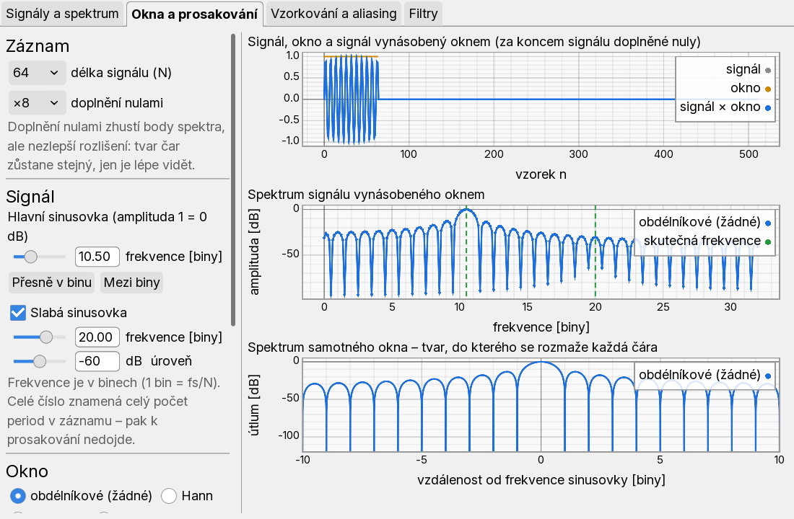
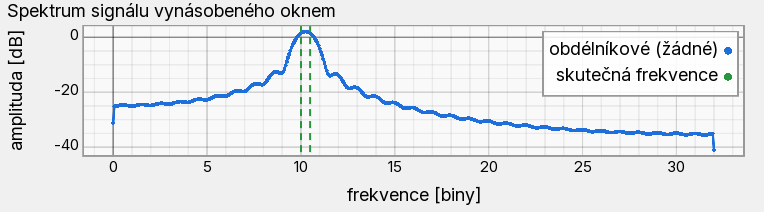
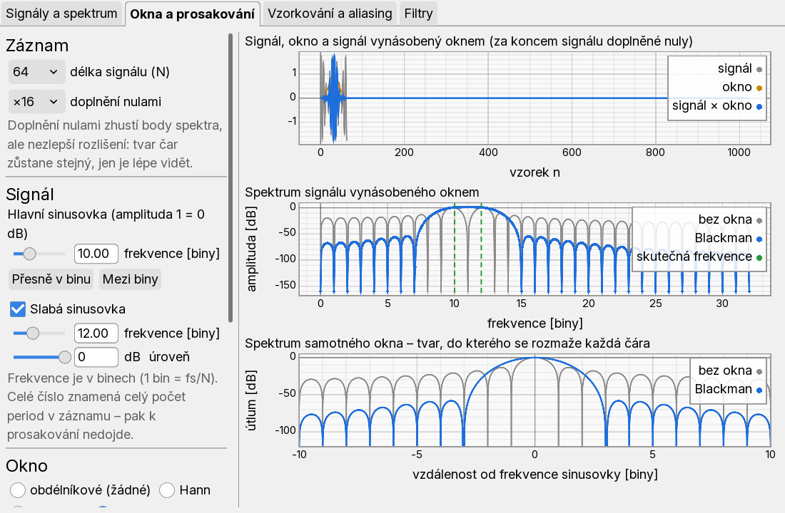
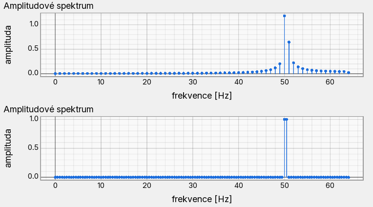

# Lekce 10: Doplnění nulami a rozlišení

## Cíl lekce

Pochopíš, co udělá **doplnění nulami** (zero-padding): spektrum je hustší
a hezčí, ale dvě blízké frekvence od sebe neoddělí. Zjistíš, co doopravdy
určuje **rozlišení** – délka skutečného záznamu.

## Základy

### Doplnění nulami

Za `N` vzorků signálu se přidají nuly, třeba tak, aby vzorků bylo
`P · N`, a spočítá se delší FFT. Body spektra jsou pak po

```text
fs / (P · N)
```

místo po `fs / N` – je jich `P`-krát víc a leží i mezi původními biny.

Nová informace ale nepřibyla: nuly nic neříkají o signálu. Body jen
hustěji „navzorkují“ tutéž křivku – tvar spektra okna posunutý na
frekvenci sinusovky (lekce 8 a 9). Je to jako zvětšit rozmazanou fotku:
pixelů je víc, rozmazání stejné.

K čemu to je:

- spektrum vypadá jako hladká křivka a je vidět skutečný tvar laloků,
- vrchol čáry se dá přečíst přesněji (frekvence i amplituda),
- FFT potřebuje délku mocninu dvou, takže se kratší signál nulami doplní.

### Rozlišení

Dvě sinusovky blízkých frekvencí se ve spektru rozmažou do dvou
hlavních laloků. Když se laloky překrývají moc, splynou do jednoho kopce.
Šířka hlavního laloku je ±1 bin (bez okna), ±2 biny (Hann, Hamming),
±3 biny (Blackman), měřeno v binech **původního** záznamu, tedy
v jednotkách

```text
1 / T          T = N / fs = délka záznamu v sekundách
```

Pravidlo palce: dvě stejně silné sinusovky rozlišíš, když jsou od sebe
alespoň o šířku poloviny hlavního laloku, tedy zhruba o 1 bin bez okna,
2 biny s Hannem a 3 s Blackmanem. Je to jen orientační pravidlo: laloky
obou sinusovek se sčítají jako komplexní čísla, takže přesný tvar kopce
závisí i na jejich fázích. Zlepšit rozlišení jde jen **delším záznamem**
(větším `T`) – doplnění nulami `T` nemění.

## V programu

Záložka **Okna a prosakování**. Nastav okno **obdélníkové (žádné)**
a klikni na **Mezi biny** (10.50). Pak v sekci **Záznam** nastav
**doplnění nulami** na **×8**.



- **Horní graf:** 64 vzorků signálu a za nimi nuly až do vzorku 511.
- **Prostřední graf:** místo 33 bodů jich je 257 (od 0 do 32 binů po
  osminách). Body vykreslí hladkou křivku: hlavní lalok a postranní laloky
  – přesně tvar ze spodního grafu posunutý na 10,5.
- **Nejvyšší čára spektra:** **0.00 dB** (bez doplnění −3,79 dB). Mezi
  novými body je teď i přesně 10,5, takže vrchol je vidět.
- **Šířka čáry se nezměnila:** hlavní lalok pořád sahá od 9,5 do 11,5 binu.

## Pokusy

1. **Stačí ×2.** Nastav doplnění **×2**. → Nejvyšší čára je 0.00 dB: body
   jsou po půl binu a 10,5 mezi nimi je. S **×1** zase −3,79 dB.
2. **S oknem.** Vyber **Hann** a ×8. → Nejvyšší čára 0.00 dB (bez doplnění
   −1,42 dB) a hlavní lalok sahá od 8,5 do 12,5 binu – dvakrát širší než bez
   okna, doplnění na tom nic nezmění.
3. **Půl binu nestačí.** Okno obdélníkové, doplnění **×16**, hlavní
   sinusovka **10.00**, slabá sinusovka na **10.50** s úrovní **0 dB**
   (stejně silná). → Ve spektru je jediný kopec s vrcholem asi 2,1 dB u
   10,25 binu. Doplnění zobrazilo tvar velmi jemně, ale dvě sinusovky
   v něm nejsou poznat.

   

4. **Dva biny a okno.** Nastav slabou sinusovku na **12.00** (0 dB), ×16,
   a vyber **Blackman** (zaškrtnuté „Porovnat s obdélníkovým oknem“). →
   Šedá křivka bez okna má dva vrcholy u 10 a 12 binů s hlubokým údolím
   mezi nimi. Modrá Blackmanova křivka je jeden plochý kopec s maximem
   1,51 dB u 11 binu: dva biny jsou pro Blackmanův hlavní lalok (±3 biny)
   málo.

   

5. **Delší záznam pomůže.** Přepni na záložku **Signály a spektrum**,
   nastav `fs` = **128 Hz**, **N = 128** (záznam 1 s), Složku 1 sinus
   **50 Hz**, Složku 2 sinus **50.5 Hz** (obě amplituda 1.00). → Ve spektru
   je u 50 Hz bod 1,18 a u 51 Hz 0,65, kolem drobnější body – jedna
   rozmazaná čára. Nastav **N = 256** (záznam 2 s, biny po 0,5 Hz). → Dvě
   čisté čáry: 50 Hz a 50,5 Hz, obě s výškou 1,00.

   

## Častá nedorozumění

- **„Doplnění nulami zvyšuje rozlišení.“** Zvyšuje jen hustotu bodů.
  Rozlišení dvou frekvencí určuje délka skutečného záznamu (pokusy 3 až 5).
- **„Doplnění nulami je podvod / k ničemu.“** Je užitečné: ukáže tvar
  čáry a dovolí přesněji odečíst vrchol (pokus 1).
- **„Delší FFT znamená vždy delší záznam.“** Jen pokud jsou ty vzorky
  skutečné. V záložce Signály a spektrum program generuje N skutečných
  vzorků, v záložce Okna se při doplnění přidávají nuly.

## Shrnutí

- Doplnění nulami: za signál nuly, delší FFT, body spektra po
  `fs / (P·N)`.
- Ukáže tvar čáry a přesnější vrchol, ale čára se nezúží.
- Rozlišení ≈ šířka hlavního laloku v jednotkách `1/T`; bez okna
  zhruba 1 bin, s Hannem 2, s Blackmanem 3.
- Lepší rozlišení = delší záznam. Okna s nízkými postranními laloky
  rozlišení zhoršují.

## Otázky k zamyšlení

1. Proč se nejvyšší čára při ×2 dostane na 0 dB, ale při ×1 ne?
2. Mám záznam 0,25 s. Jak blízko mohou být dvě stejně silné frekvence,
   aby je Hannovo okno ještě rozlišilo?
3. Proč u dvou blízkých sinusovek pomůže obdélníkové okno víc než
   Blackman, i když Blackman má mnohem nižší prosakování?

<details>
<summary>Odpovědi</summary>

1. Při ×2 jsou body spektra po půl binu, takže jeden leží přesně na 10,5,
   na vrcholu hlavního laloku. Při ×1 jsou jen celé biny, nejbližší je
   0,5 binu od vrcholu.
2. Jeden bin je `1/0,25 s = 4 Hz`. Hann potřebuje zhruba 2 biny, tedy asi
   8 Hz.
3. Rozlišení určuje šířka hlavního laloku: obdélníkové okno má ±1 bin,
   Blackman ±3. Nízké postranní laloky pomáhají u slabého signálu daleko
   od silného, ne u dvou blízkých stejně silných.

</details>

## Cvičení

1. Signál je vzorkovaný `fs = 10 000 Hz` a záznam trvá 0,1 s. Kolik má
   vzorků, jaký je rozestup binů a jaký bude rozestup bodů po doplnění
   nulami na 4096? Jak blízké frekvence rozliší bez okna?
2. Potřebuješ rozlišit tóny 1000 Hz a 1003 Hz, oba stejně silné, s Hannovým
   oknem. Jak dlouhý záznam potřebuješ (podle pravidla palce)?
3. V záložce Signály a spektrum je `fs` = 128 Hz a sinusovky 50 Hz
   a 50,25 Hz. Jakou nejmenší délku N zvolíš, aby byly ve spektru dvě
   oddělené čáry? Ověř v programu.

<details>
<summary>Řešení</summary>

**1.** Vzorků je `N = 10 000 · 0,1 = 1000`. Rozestup binů
`fs/N = 10 000/1000 = 10 Hz`. Po doplnění na 4096 jsou body po
`10 000/4096 ≈ 2,44 Hz`. Rozlišení ale zůstane dané záznamem 0,1 s: bez
okna zhruba 1 bin = `1/0,1 s = 10 Hz`.

**2.** Rozdíl je 3 Hz a Hann potřebuje zhruba 2 biny, takže jeden bin musí
být nejvýš 1,5 Hz: `1/T ≤ 1,5 Hz`, tedy `T ≥ 1/1,5 ≈ 0,67 s`. (Pravidlo
palce – s rezervou se volí delší záznam.)

**3.** Frekvence se liší o 0,25 Hz. Záložka Signály a spektrum okno
nepoužívá (obdélníkové), stačí tedy rozestup binů nejvýš 0,25 Hz:
`fs/N ≤ 0,25 Hz`, tedy `N ≥ 128/0,25 = 512` (záznam 4 s). Program nabízí
mocniny dvou, 512 mezi nimi je.

V programu: `fs` = 128, N = 512, složky 50 Hz a 50.25 Hz s amplitudou
1.00. Biny jsou po 0,25 Hz, obě frekvence padnou přesně na bin a spektrum
ukáže dvě čáry s výškou 1,00 (u 50 a 50,25 Hz). Při N = 256 (biny po
0,5 Hz) by 50,25 Hz padla mezi biny a čáry by splynuly.

</details>

## Kam dál

- Další lekce: [11. Vzorkování a aliasing](11-vzorkovani-a-aliasing.md).
- Předchozí lekce: [9. Okna](09-okna.md).
- Podrobnější text k záložce: [Okna a prosakování](../02-okna-a-prosakovani.md).
- V kódu: `src/dsp/window.zig`, funkce `zeroPad` (doplnění nulami)
  a `windowResponse` (spektrum okna z okna doplněného nulami na
  nejméně 16 384 bodů). Při doplnění se amplituda dělí součtem vah
  **bez** přidaných nul (`src/dsp/spectrum.zig`, `window_sum`).
