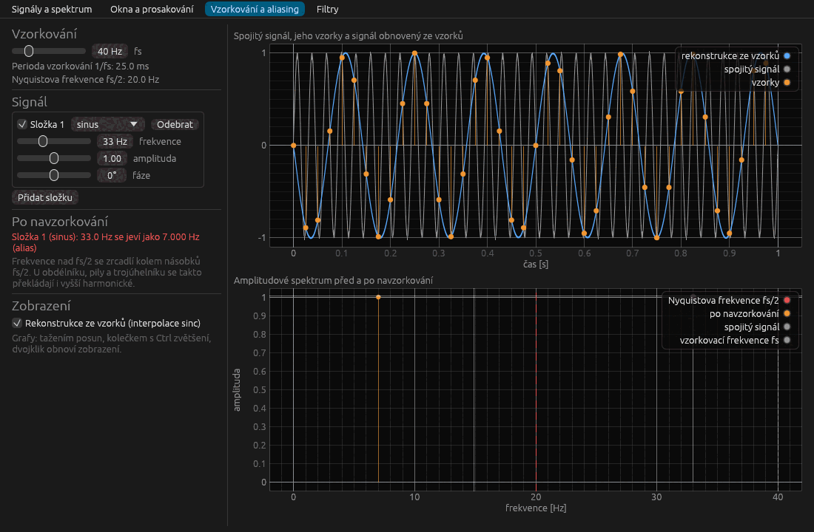
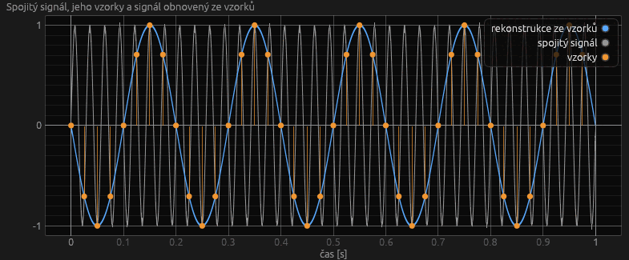
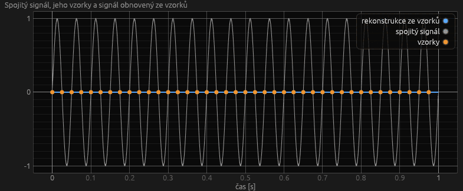
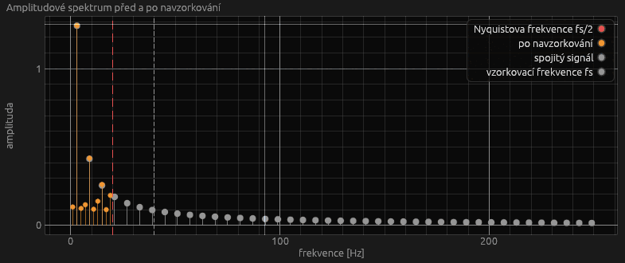

# Lekce 11: Vzorkování a aliasing

## Cíl lekce

Pochopíš, kolik vzorků za sekundu stačí, aby se signál dal zachytit
(**vzorkovací věta**), co je **Nyquistova frekvence** a proč se příliš
vysoké frekvence po navzorkování „převléknou“ za nižší (**aliasing**).

## Základy

### Kola, která se točí pozpátku

Ve filmu se kola dostavníku někdy zdánlivě točí pomalu nebo dokonce
pozpátku. Kamera totiž kolo „vzorkuje“ – fotí ho 24× za sekundu. Když se
paprsek mezi dvěma snímky posune skoro o celou mezeru mezi paprsky, vypadá
to, jako by se posunul jen kousek zpátky. Oko z fotek složí jiný, pomalejší
pohyb, než jaký se skutečně děje.

### Aliasing

Totéž se děje se sinusovkami. Sinusovka s frekvencí `f` a sinusovka
s frekvencí `f + fs` (o jednu vzorkovací frekvenci vyšší) se mezi dvěma
vzorky liší přesně o jednu celou otáčku navíc. Ve vzorcích proto mají
**úplně stejné hodnoty** a nedají se rozlišit. Totéž platí pro `f + 2·fs`,
`f − fs` a tak dál.

Navíc sinusovka se zápornou frekvencí `−f` vypadá jako `f` s opačnou fází
(kolo pozpátku). Z toho plyne, že každá frekvence se po navzorkování
objeví někde mezi 0 a `fs/2`:

```text
f_alias = | f − fs · round(f / fs) |
```

- `f` – skutečná frekvence,
- `fs` – vzorkovací frekvence,
- `round` – zaokrouhlení na nejbližší celé číslo, tedy „odečti nejbližší
  násobek `fs`“,
- `| … |` – absolutní hodnota.

Frekvence se „skládají“ jako harmonika kolem násobků `fs/2`:

```text
skutečná f:  0 ──── fs/2 ──── fs ──── 3fs/2 ──── 2fs ──→
po vzorkování: 0 ↗  fs/2  ↘   0   ↗   fs/2   ↘    0
```

Příklady pro `fs = 40 Hz`: 30 Hz → 10 Hz, 33 Hz → 7 Hz, 40 Hz → 0 Hz,
45 Hz → 5 Hz, 70 Hz → 10 Hz.

### Vzorkovací věta a Nyquistova frekvence

Polovině vzorkovací frekvence `fs/2` se říká **Nyquistova frekvence**.

> **Vzorkovací věta:** Signál, který neobsahuje frekvence od `fs/2` výš,
> lze ze vzorků přesně obnovit.

Jinak řečeno: na každou periodu nejvyšší frekvence musí připadnout **víc
než dva vzorky**. Přesně dva nestačí – záleží pak na tom, kam vzorky
padnou (pokus 4).

Když signál vyšší frekvence obsahuje, po navzorkování se už nedá poznat,
které z frekvencí `f`, `fs − f`, `fs + f`, … to byly. Proto se ve
skutečných zařízeních **před** převodník zařazuje analogová dolní propust
(antialiasingový filtr), která vysoké frekvence odstraní dřív, než se
navzorkují.

## V programu

Záložka **Vzorkování a aliasing** ve výchozím stavu: `fs` = 40 Hz
(„Nyquistova frekvence fs/2: 20.0 Hz“), sinus 5 Hz, rekonstrukce ze vzorků
zapnutá.

Grafy:

- **Horní:** šedě spojitý signál, oranžově vzorky, modře signál
  dopočítaný ze vzorků (rekonstrukce, podrobně v lekci 12). Modrá křivka
  ukazuje, jakou sinusovku vzorky „opravdu“ popisují.
- **Dolní:** šedé puntíky = spektrum spojitého signálu (skutečné
  frekvence), oranžové = spektrum spočítané ze vzorků. Červená čárkovaná
  svislice je Nyquistova frekvence, šedá čárkovaná je `fs`.
- **Panel „Po navzorkování“:** u každé složky napíše, jak se jeví. Je-li
  to alias, je text červený.

Nastav frekvenci složky na **33 Hz**:



- Šedá sinusovka 33 Hz kmitá rychle, oranžové vzorky ale leží na pomalé
  modré vlně se 7 periodami za sekundu.
- Panel: „Složka 1 (sinus): 33.0 Hz se jeví jako 7.000 Hz (alias)“.
- Ve spektru je oranžová čára na **7 Hz** (výška 1). Šedá čára spojitého
  signálu stojí na 33 Hz; její puntík nahoře zakrývá legenda grafu.

## Pokusy

1. **Přes Nyquistovu frekvenci.** Pomalu zvyšuj frekvenci od 15 Hz:
   15, 19, 21, 25 Hz. → Do 19 Hz panel píše „se jeví jako“ tutéž frekvenci.
   Od 21 Hz je text červený: 21 Hz → 19 Hz, 25 Hz → 15 Hz. Oranžová čára
   se od červené svislice (20 Hz) „odrazí“ zpět dolů, zatímco šedá jde
   dál doprava.
2. **Převrácená vlna.** Nastav **35 Hz**. → Jeví se jako 5 Hz, ale modrá
   vlna začíná směrem **dolů** (vzorky 0; −0,707; −1; …), kdežto skutečná
   5 Hz začíná nahoru (0; 0,707; 1; …). `35 − 40 = −5`: záporná frekvence
   = obrácená fáze.

   

3. **O celé fs výš.** Nastav **45 Hz**. → Jeví se jako 5 Hz, tentokrát
   se stejnou fází jako skutečná 5 Hz (`45 − 40 = +5`): vzorky jsou úplně
   stejné jako ve výchozím stavu. **70 Hz** se jeví jako 10 Hz.
4. **Přesně na Nyquistově frekvenci.** Nastav **20 Hz** a fázi **0°**. →
   Všechny vzorky padnou do průchodů nulou (`sin(π·n) = 0`), signál ze
   vzorků „zmizel“ a oranžová čára ve spektru chybí. Fáze **90°**: vzorky
   jsou střídavě +1 a −1, oranžová čára na 20 Hz má výšku 1. Fáze **45°**:
   vzorky ±0,707, čára 0,707. Na samotné hranici `fs/2` záleží na fázi,
   proto věta vyžaduje frekvence **pod** `fs/2`.

   

5. **Frekvence rovná fs.** Nastav **40 Hz**. → Při fázi 0° jsou zase
   všechny vzorky nulové, při fázi **90°** jsou všechny rovné 1: každý vzorek
   padne na stejné místo periody a sinusovka se změní na konstantu.
   Oranžová čára je na **0 Hz** s výškou 1.
6. **Obdélník.** Nastav fázi **0°**, tvar **obdélník**, frekvence **3 Hz**.
   → Šedé čáry jsou na lichých harmonických 3, 9, 15, 21, 27, … Hz až do
   250 Hz. Oranžové čáry jsou jen do 20 Hz, ale na **všech** lichých
   frekvencích 1, 3, 5, 7, … 19 Hz: harmonické nad 20 Hz se do pásma
   „přeložily“ (21 → 19, 27 → 13, 33 → 7, 39 → 1, 45 → 5 Hz…). Například
   na 1 Hz je čára 0,12, přestože obdélník 3 Hz na 1 Hz nic nemá.

   

## Častá nedorozumění

- **„Stačí vzorkovat dvojnásobkem nejvyšší frekvence.“** Přesně
  dvojnásobek nestačí (pokus 4) a skutečné antialiasingové filtry
  potřebují rezervu. Vzorkuje se raději víc.
- **„Aliasing se dá ze vzorků odstranit.“** Po navzorkování už nejde
  poznat, co je alias a co skutečná frekvence. Musí se mu zabránit
  **před** vzorkováním.
- **„Aliasing se týká jen frekvencí nad fs.“** Týká se všeho nad `fs/2`.
  Frekvence mezi `fs/2` a `fs` se zrcadlí (pokus 1).

## Shrnutí

- Sinusovky `f` a `f ± k·fs` mají stejné vzorky; `−f` je `f` s opačnou
  fází.
- Po navzorkování je každá frekvence na `|f − fs · round(f/fs)|`, tedy
  mezi 0 a `fs/2`.
- Nyquistova frekvence `fs/2`: signál ji nesmí obsahovat ani překročit.
- Na hranici `fs/2` záleží na fázi – i proto je potřeba rezerva.
- Ostré tvary (obdélník) mají harmonické nad `fs/2`, které se přeloží
  do pásma. Brání se tomu filtrem před vzorkováním.

## Otázky k zamyšlení

1. Zvuk na CD má `fs = 44 100 Hz`. Proč zrovna tolik?
2. Proč se v pokusu 6 objevily čáry na frekvencích 1, 5, 7, 11, 13 … Hz,
   které nejsou násobky 3 Hz?
3. Mobil vzorkuje zvuk 8 000 Hz. Co se stane s pískáním 5 000 Hz?

<details>
<summary>Odpovědi</summary>

1. Lidské ucho slyší zhruba do 20 kHz. Nyquistova frekvence 22,05 kHz
   nechává rezervu 2 kHz pro antialiasingový filtr, který nemůže mít
   nekonečně strmý přechod.
2. Vznikly přeložením harmonických nad 20 Hz: 39 → `|39 − 40| = 1`,
   45 → `|45 − 40| = 5`, 33 → `|33 − 40| = 7`, 51 → `|51 − 40| = 11`,
   27 → `|27 − 40| = 13`. Skutečné harmonické 3, 9, 15 Hz zůstaly na místě
   (a k jejich výšce se přičetly aliasy dalších harmonických).
3. `f_alias = |5000 − 8000 · round(0,625)| = |5000 − 8000| = 3000 Hz`.
   Bez filtru by se ozvalo jako tón 3 kHz. Proto má telefon před
   převodníkem filtr.

</details>

## Cvičení

1. `fs = 1000 Hz`. Na jakých frekvencích se objeví sinusovky 1300 Hz,
   600 Hz a 2050 Hz?
2. Kolo má 12 paprsků a točí se 2 otáčky za sekundu. Kamera snímá
   25 snímků za sekundu. Jak se bude kolo ve filmu zdánlivě točit?
3. Signál je součet sinu 5 Hz (amplituda 1) a sinu 33 Hz (amplituda 0,5)
   a vzorkuje se 40 Hz. Jaké čáry budou ve spektru po navzorkování? Ověř
   v programu.
4. Signál obsahuje frekvence do 15 Hz. Jakou nejmenší celočíselnou `fs`
   v programu nastavíš a co se stane při `fs = 30 Hz`?

<details>
<summary>Řešení</summary>

**1.**

- 1300 Hz: `1300/1000 = 1,3`, zaokrouhleno 1 → `|1300 − 1000| = 300 Hz`.
- 600 Hz: `0,6` → 1 → `|600 − 1000| = 400 Hz` (je nad `fs/2 = 500`,
  zrcadlí se).
- 2050 Hz: `2,05` → 2 → `|2050 − 2000| = 50 Hz`.

**2.** Kolo vypadá stejně po posunu o jeden paprsek, takže důležitá je
frekvence, s jakou se paprsky střídají: `12 · 2 = 24` paprsků za sekundu,
tedy 24 Hz. Kamera „vzorkuje“ 25 Hz. Se znaménkem: `24 − 25 · round(24/25)
= 24 − 25 = −1`. Záporná frekvence znamená pohyb pozpátku: kolo se zdánlivě
posune o 1 paprsek za sekundu dozadu, tj. `1/12` otáčky za sekundu
pozpátku.

**3.** 5 Hz je pod Nyquistovou frekvencí 20 Hz → zůstane na 5 Hz (výška 1).
33 Hz → `|33 − 40| = 7 Hz` (výška 0,5). Ve spektru po navzorkování budou
dvě oranžové čáry: 5 Hz (1,0) a 7 Hz (0,5). Šedé čáry spojitého signálu
budou na 5 Hz a 33 Hz.

V programu: výchozí stav, **Přidat složku** (přidá sinus 10 Hz) a nastav ji
na 33 Hz s amplitudou 0.50. Panel ukáže „Složka 2 (sinus): 33.0 Hz se jeví
jako 7.000 Hz (alias)“.

**4.** Potřebujeme `fs/2 > 15 Hz`, tedy `fs > 30 Hz`; nejmenší celé číslo
je **31 Hz**. Při `fs = 30 Hz` leží složka 15 Hz přesně na Nyquistově
frekvenci: podle fáze se zobrazí špatně, při fázi 0° jsou všechny její
vzorky nulové a zmizí úplně.

</details>

## Kam dál

- Další lekce: [12. Rekonstrukce ze vzorků](12-rekonstrukce.md).
- Předchozí lekce: [10. Doplnění nulami a rozlišení](10-doplneni-nulami-a-rozliseni.md).
- Podrobnější text k záložce: [Vzorkování a aliasing](../03-vzorkovani-a-aliasing.md).
- V kódu: `src/dsp/sampling.rs`, funkce `alias_frequency` (vzorec výše)
  a `sample`. Spektra v záložce počítá `src/ui/sampling.rs` (funkce
  `compute`): spojitý signál nahrazuje vzorkování 2048 Hz, spektrum po
  navzorkování se počítá pomalou DFT, protože počet vzorků (`fs`) obvykle
  není mocnina dvou.
