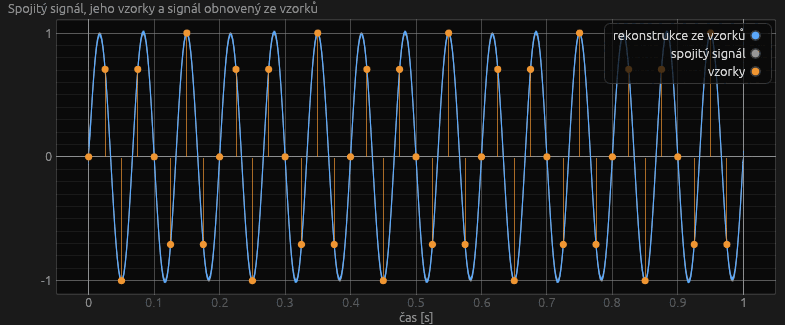
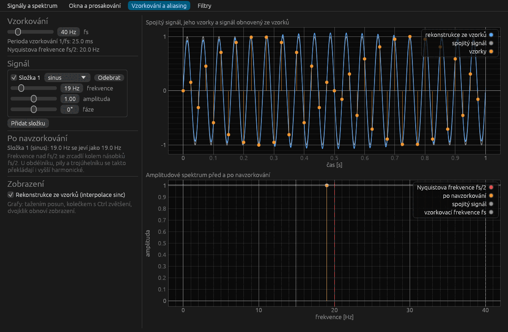
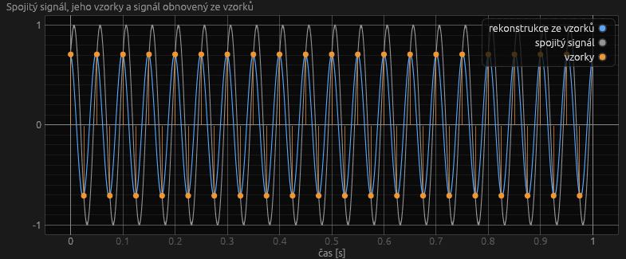
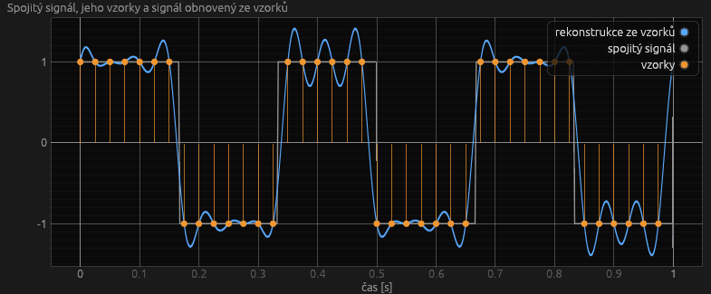

# Lekce 12: Rekonstrukce ze vzorků

## Cíl lekce

Pochopíš, jak se ze vzorků dopočítá spojitý signál zpět – funkcí **sinc** –
a proč to funguje přesně jen tehdy, když signál splňuje vzorkovací větu.

## Základy

### Spojit tečky – ale jak?

Máš řadu teček a máš je spojit čarou. Nejjednodušší by bylo spojit je
rovnými úseky („lomená čára“). Lomená čára má ale v každé tečce ostrý zlom,
a ostré zlomy znamenají vysoké frekvence (lekce 3). Takový signál by
obsahoval frekvence nad `fs/2`, které původní signál neměl.

Vzorkovací věta říká víc: pokud původní signál neměl frekvence od `fs/2`
výš, existuje **jediná** hladká křivka, která tečkami prochází a takové
frekvence nemá. A dá se spočítat.

### Funkce sinc

```text
sinc(x) = sin(π·x) / (π·x)          a sinc(0) = 1
```

Je to vlnka, která má uprostřed hodnotu 1, ve všech ostatních celých
číslech hodnotu 0 a mezi nimi kmitá se slábnoucí amplitudou:

| x        | 0 | 0,5   | 1 | 1,5    | 2 | 2,5   |
|----------|---|-------|---|--------|---|-------|
| sinc(x)  | 1 | 0,637 | 0 | −0,212 | 0 | 0,127 |

Její spektrum je ploché až do `fs/2` a nad ním nulové – sinc obsahuje
přesně všechny „povolené“ frekvence a žádnou jinou. (Stejná funkce se
objeví v lekci 13 jako ideální dolní propust.)

### Obnova: na každý vzorek jedna sinc

Na každý vzorek se položí funkce sinc vynásobená hodnotou vzorku
a posunutá na jeho čas. Všechny se sečtou (Whittakerova–Shannonova
interpolace):

```text
x(t) = Σ x[n] · sinc(fs · (t − tₙ))
```

- `x(t)` – obnovená hodnota v libovolném čase `t`,
- `x[n]` – vzorek číslo `n`, `tₙ = n / fs` jeho čas,
- `fs · (t − tₙ)` – vzdálenost od vzorku měřená v počtu period vzorkování,
- součet je přes všechny vzorky.

Proč obnova prochází přesně vzorky: v čase vzorku `n` má jeho sinc
hodnotu 1 a sinc všech ostatních vzorků hodnotu 0 (vzdálenost je celé
číslo).

### Háčky

- Přesná obnova potřebuje **nekonečně mnoho vzorků** – sinc slábne jen
  pomalu. Program proto počítá i se vzorky 1 s před a 1 s za zobrazeným
  úsekem; malá chyba přesto zůstane.
- Pokud signál měl frekvence nad `fs/2`, obnova místo nich ukáže jejich
  **aliasy** – jediný signál pod `fs/2`, který má stejné vzorky.

## V programu

Záložka **Vzorkování a aliasing**, výchozí stav (`fs` = 40 Hz, sinus
5 Hz). Rekonstrukce je zapnutá („Rekonstrukce ze vzorků (interpolace
sinc)“), modrá křivka. Přes šedou spojitou křivku není vidět – shodují se:
největší rozdíl v zobrazeném úseku je 0,002.

Nastav frekvenci **15 Hz**:



Na periodu připadá jen `40/15 ≈ 2,7` vzorku. Vzorky (0; 0,707; −1; 0,707;
0; −0,707; 1; −0,707; …) na první pohled sinusovku nepřipomínají, a přesto
modrá obnova leží na šedé křivce (největší rozdíl 0,014). Funkce sinc „ví“,
že mezi vzorky nesmí být nic rychlejšího než 20 Hz.

## Pokusy

1. **Těsně pod hranicí.** Nastav **19 Hz**. → Vzorky tvoří zvláštní vzor,
   jako by se signál dvakrát za sekundu „stáhl“ k nule. Modrá obnova přesto
   kopíruje šedou sinusovku 19 Hz s konstantní amplitudou; největší rozdíl
   je 0,073 – větší než u 15 Hz, protože blízko `fs/2` je potřeba víc
   vzorků z okolí a okraj 1 s už úplně nestačí.

   

2. **Na hranici.** Nastav **20 Hz** a fázi **45°**. → Vzorky jsou střídavě
   +0,707 a −0,707. Obnova je kosinus s amplitudou jen asi 0,7, šedý signál
   má amplitudu 1 a jinou fázi. Na samotné hranici `fs/2` vzorky neurčí
   amplitudu a fázi zvlášť – proto věta říká „pod `fs/2`“.

   

3. **Nad hranicí.** Fázi vrať na **0°** a nastav **21 Hz**. → Modrá obnova
   je sinusovka **19 Hz**. Obnova vždy vybere signál pod `fs/2`, který má
   stejné vzorky.
4. **Snižování fs.** Nastav frekvenci **10 Hz** a postupně `fs`: **25**,
   **21**, **20**, **15 Hz**. → Při 25 a 21 Hz obnova sedí (největší rozdíl
   0,009 a 0,039). Při 20 Hz (přesně `2·f`) jsou vzorky nulové a obnova je
   nula. Při 15 Hz vyjde 5 Hz (alias).
5. **Obdélník.** Vrať `fs` = **40 Hz** a nastav tvar **obdélník** 3 Hz. →
   Modrá obnova není obdélník: u hran se rozkmitá a překmitne až na 1,41.
   Obdélník má harmonické nad 20 Hz a ty se přeložily do pásma jako aliasy
   (lekce 11).

   

## Častá nedorozumění

- **„Vzorky stačí spojit rovnými čarami.“** Lomená čára obsahuje frekvence
  nad `fs/2`. Správná obnova vede přes sinc (nebo její praktické
  přiblížení).
- **„Když vzorky nevypadají jako sinusovka, informace se ztratila.“**
  Pokus s 15 a 19 Hz ukazuje opak: pod `fs/2` je informace úplná, jen ji
  oko nevidí.
- **„Rekonstrukce opraví aliasing.“** Nemůže – obnova vždy vybere frekvenci
  pod `fs/2` (pokus 3).

## Shrnutí

- Signál bez frekvencí od `fs/2` výš je vzorky určen jednoznačně.
- Obnova: `x(t) = Σ x[n] · sinc(fs · (t − tₙ))`, na každý vzorek jedna
  sinc.
- Sinc je 1 v nule a 0 v ostatních celých číslech, proto obnova prochází
  vzorky.
- Přesná obnova potřebuje nekonečně mnoho vzorků; blízko `fs/2` je to
  nejcitlivější.
- Frekvence nad `fs/2` se obnoví jako aliasy.

## Otázky k zamyšlení

1. Proč se obnovený signál v čase vzorku `n` rovná přesně `x[n]`?
2. Proč vzorky sinusovky 19 Hz při `fs = 40 Hz` vypadají, jako by se
   dvakrát za sekundu stáhly k nule?
3. Proč je u frekvencí blízko `fs/2` obnova citlivější na to, kolik
   vzorků kolem máme?

<details>
<summary>Odpovědi</summary>

1. V čase `tₙ` má sinc vzorku `n` argument 0 a hodnotu 1. Všechny ostatní
   sinc mají argument celé nenulové číslo, a tedy hodnotu 0.
2. 19 Hz je o 1 Hz pod `fs/2 = 20 Hz`. Sousední vzorky mají skoro opačná
   znaménka (jako u 20 Hz) a velikost vzorků se pomalu mění podle
   `|sin(2π · 1 Hz · t)|` – ta je nulová v časech 0; 0,5 a 1 s. Je to
   „rozdíl“ 20 − 19 = 1 Hz, který oko vidí.
3. Takový signál „vypadá“ ve vzorcích skoro jako střídání + a −, liší se
   jen pomalou obálkou. Aby obnova poznala přesný tvar, potřebuje vzorky
   z dlouhého úseku – sinc slábne pomalu a příspěvky vzdálených vzorků se
   nevyruší.

</details>

## Cvičení

1. Ověř hodnoty v tabulce: spočítej `sinc(0,5)` a `sinc(1,5)`.
2. Signál má jediný nenulový vzorek `x[0] = 1` (ostatní 0), `fs = 40 Hz`.
   Jakou hodnotu má obnova v čase 12,5 ms a v čase 25 ms?
3. Vzorky jsou `x[0] = 1`, `x[1] = 1`, ostatní 0, `fs = 40 Hz`. Spočítej
   obnovu v čase 12,5 ms (uprostřed mezi nimi) a porovnej s lomenou čarou.

<details>
<summary>Řešení</summary>

**1.**

- `sinc(0,5) = sin(0,5·π) / (0,5·π) = 1 / (π/2) = 2/π ≈ 0,637`.
- `sinc(1,5) = sin(1,5·π) / (1,5·π) = −1 / (1,5·π) = −2/(3π) ≈ −0,212`.

**2.** Obnova je jediná sinc: `x(t) = 1 · sinc(40 · t)`.

- `t = 12,5 ms = 0,0125 s`: `40 · 0,0125 = 0,5` → `sinc(0,5) ≈ 0,637`.
- `t = 25 ms`: `40 · 0,025 = 1` → `sinc(1) = 0`. (To je čas vzorku 1,
  který je nulový – obnova jím musí projít.)

**3.** Sčítáme dvě sinc. V čase 12,5 ms je vzdálenost od vzorku 0 rovna
`40 · 0,0125 = 0,5` periody, od vzorku 1 `40 · (0,0125 − 0,025) = −0,5`.

```text
x(12,5 ms) = 1 · sinc(0,5) + 1 · sinc(−0,5) = 0,637 + 0,637 ≈ 1,27
```

(sinc je souměrná: `sinc(−x) = sinc(x)`.) Lomená čára by mezi dvěma
jedničkami dala 1. Obnova jde nad 1, protože hladká křivka bez vysokých
frekvencí musí z nuly vystoupat k oběma jedničkám a zase klesnout – vznikne
kopec vyšší než samotné vzorky.

</details>

## Kam dál

- Další lekce: 13. Konvoluce a FIR filtry (připravuje se).
- Předchozí lekce: [11. Vzorkování a aliasing](11-vzorkovani-a-aliasing.md).
- Podrobnější text k záložce: [Vzorkování a aliasing](../03-vzorkovani-a-aliasing.md).
- V kódu: `src/dsp/sampling.rs`, funkce `sinc` a `reconstruct` (součet
  přes všechny vzorky). Okraj 1 s je konstanta `MARGIN_S` v
  `src/ui/sampling.rs`.
