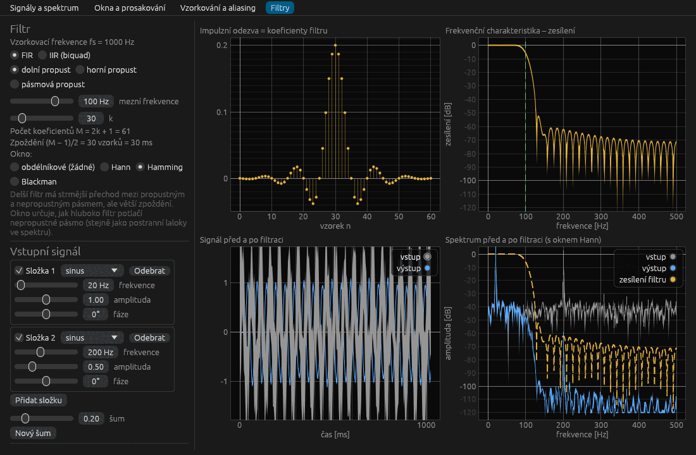
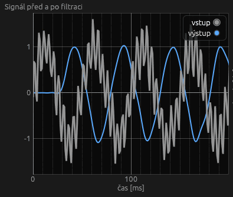
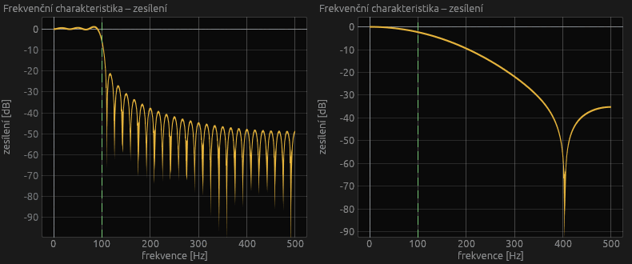
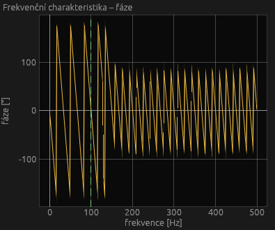

# Lekce 13: Konvoluce a FIR filtry

## Cíl lekce

Pochopíš, že číslicový filtr je jen **vážený klouzavý průměr** vzorků
(konvoluce), že ho úplně popisuje jeho **impulzní odezva** a že ve spektru
filtr jednoduše **násobí** každou frekvenci svým zesílením. Uvidíš, jak se
navrhne FIR dolní propust z funkce sinc a okna – tedy ze všeho, co už znáš.

## Základy

### Klouzavý průměr

Teploty se den ode dne mění nahodile. Když chceš vidět trend, spočítáš
pro každý den průměr posledních tří dnů:

```text
y[n] = (x[n] + x[n−1] + x[n−2]) / 3
```

Rychlé kolísání se tím vyhladí, pomalé změny zůstanou. To je **dolní
propust**: propouští nízké frekvence a potlačuje vysoké.

Příklad: vstup 0, 0, 1, 1, 1, 1, 0, 0 (krátký „schod“). Výstup:

| n                       | 0 | 1 | 2    | 3    | 4 | 5 | 6    | 7    |
|-------------------------|---|---|------|------|---|---|------|------|
| `x[n]`                  | 0 | 0 | 1    | 1    | 1 | 1 | 0    | 0    |
| `y[n]` (průměr tří)     | 0 | 0 | 0,33 | 0,67 | 1 | 1 | 0,67 | 0,33 |

Ostré hrany se změnily na rampy. A vstup, který rychle střídá znaménko
(1, −1, 1, −1, …), dá při průměru dvou vzorků samé nuly – nejvyšší
frekvence zmizí úplně.

### Konvoluce

Průměr nemusí mít všechny váhy stejné. Obecně:

```text
y[n] = Σ h[k] · x[n − k]          pro k = 0 … M−1
```

- `x[n]` – vstupní vzorky, `y[n]` – výstupní vzorky,
- `h[k]` – váhy (**koeficienty filtru**), je jich `M`,
- `x[n − k]` – vzorek o `k` kroků starší.

Této operaci se říká **konvoluce**. Filtr, který pracuje jen se vstupními
vzorky, se jmenuje **FIR** (z angl. *finite impulse response* – konečná
impulzní odezva).

### Impulzní odezva

Pošli na vstup **impulz**: jediný vzorek 1 a pak samé nuly. Ve vzorci
zbude u každého `n` jediný člen a výstup je `h[0], h[1], h[2], …` – přesně
koeficienty. Impulzní odezva FIR filtru jsou jeho koeficienty a filtr úplně
popisuje.

### Filtr ve spektru

Lineární filtr nemění frekvence. Sinusovka projde jako sinusovka **stejné
frekvence**, jen se změní její amplituda a fáze. Kolikrát se zesílí,
popisuje **frekvenční charakteristika** `|H(f)|` (je to FFT impulzní
odezvy). Proto platí:

> **Konvoluce v čase = násobení ve spektru.**
> Spektrum výstupu = spektrum vstupu × `H(f)`.

V decibelech se násobení mění na sčítání: úroveň výstupu = úroveň vstupu +
zesílení filtru v dB.

### Návrh dolní propusti metodou okna

Jak získat koeficienty, které propustí vše pod mezní frekvencí `fc`
a nic nad ní?

1. Ideální dolní propust má impulzní odezvu **sinc** (lekce 12):
   `h[n] = 2·fc/fs · sinc(2·fc/fs · n)`. Je ale nekonečně dlouhá.
2. Usekneme ji na `M` koeficientů kolem středu. Useknutí = obdélníkové okno
   → charakteristika zvlní, jako prosakování v lekci 8.
3. Proto ji vynásobíme (souměrným) **oknem** z lekce 9.
4. Koeficienty vydělíme jejich součtem, aby zesílení na 0 Hz bylo přesně 1.

Horní propust vznikne jako „vstup minus dolní propust“, pásmová jako
rozdíl dvou dolních propustí.

### Zpoždění a lineární fáze

Koeficienty jsou souměrné kolem středu. Výstup je proto vážený průměr
vzorků kolem vzorku vzdáleného `(M − 1)/2` kroků do minulosti: filtr
signál **zpozdí** o

```text
D = (M − 1) / 2 vzorků
```

Všechny frekvence o stejný čas – tvar signálu se nezkreslí, jen posune.
Fáze pak klesá s frekvencí lineárně, o `360° · f · D/fs` (**lineární
fáze**).

## V programu

Záložka **Filtry**, výchozí stav: `fs` = 1000 Hz (pevně), vstup sinus
20 Hz (amplituda 1) + sinus 200 Hz (amplituda 0,5) + šum 0,20. Filtr **FIR**,
**dolní propust**, mezní frekvence **100 Hz**, **k** = 30, okno
**Hamming**. Panel: „Počet koeficientů M = 2k + 1 = 61“, „Zpoždění
(M − 1)/2 = 30 vzorků = 30 ms“.



Čtyři grafy:

- **Impulzní odezva = koeficienty filtru** (vlevo nahoře): 61 bodů,
  souměrných kolem vzorku 30. Největší je `h[30] ≈ 0,200`; tvar je sinc
  ztlumená oknem.
- **Frekvenční charakteristika – zesílení** (vpravo nahoře): do 100 Hz
  kolem 0 dB, na **100 Hz −6,0 dB** (zesílení 0,5), pak strmý pokles.
  Od 129 Hz (první nula) je nepropustné pásmo, jeho nejvyšší vlnka je
  −52,3 dB. Na 200 Hz je zesílení −62,1 dB.
- **Signál před a po filtraci** (vlevo dole): šedý vstup, modrý výstup.
- **Spektrum před a po filtraci** (vpravo dole, s oknem Hann): šedý vstup,
  modrý výstup, žlutá čárkovaná charakteristika filtru. Čára 200 Hz
  klesla z −6,3 dB na −68,4 dB, tedy přesně o zesílení filtru
  (−6,3 − 62,1). Šum nad 100 Hz klesl stejně.

## Pokusy

1. **Zpoždění.** Přibliž si (Ctrl + kolečko) prvních 200 ms časového
   grafu. → Výstup prvních pár desítek ms jen pomalu „rozjíždí“, protože
   filtr počítá s nulami před začátkem signálu. Pak je to čistá sinusovka
   20 Hz posunutá o 30 ms: vrchol vstupní sinusovky v 12,5 ms má na výstupu
   protějšek ve 42,5 ms. Od 100 ms dál se výstup od sinusovky 20 Hz
   zpožděné o 30 ms liší nejvýš o 0,18 (zbytek šumu pod 100 Hz).

   

2. **Délka filtru.** Měň **k**. → `k = 1` (M = 3): na 200 Hz jen −0,8 dB,
   filtr skoro nefiltruje. `k = 3` (M = 7): −9,5 dB na 200 Hz, první nula až
   na 404 Hz. `k = 10`: první nula 186 Hz, `k = 60`: 114,5 Hz,
   `k = 100`: 108,5 Hz. Delší filtr = strmější přechod, ale zpoždění roste
   (`k = 100` → 100 ms).
3. **Okno.** Při `k = 30` přepínej okna a sleduj nepropustné pásmo:
   obdélníkové −21,4 dB (první nula 110,5 Hz, v propustném pásmu
   je zvlnění, na 20 Hz +0,5 dB), Hann −44,0 dB (128 Hz), Hamming −52,3 dB
   (129 Hz), Blackman −75,5 dB (150 Hz). Stejný kompromis jako u spekter
   v lekci 9: hlubší potlačení = pozvolnější přechod.

   

4. **Lineární fáze.** Vrať Hamming a přepni **Charakteristika** na
   **fáze**. → V propustném pásmu je pravidelná „pila“: fáze klesá
   o 10,8° na každý hertz (`360° · 0,030 s`) a jen se přetáčí přes ±180°.
   Na 20 Hz ukazuje 144° (= −216°), na 50 Hz −180°, na 80 Hz −144°.

   

5. **Horní propust.** Přepni na **horní propust** (100 Hz). → Sinusovka
   20 Hz je potlačena o 48,1 dB, výstup obsahuje sinusovku 200 Hz (−0,01 dB)
   a šum nad 100 Hz.
6. **Pásmová propust.** Přepni na **pásmovou propust**: posuvníky „dolní
   mez“ 100 Hz a „horní mez“ 250 Hz. → 200 Hz projde (−0,01 dB), 20 Hz je
   potlačeno o 45,3 dB.

## Častá nedorozumění

- **„Filtr mění frekvence.“** Lineární filtr frekvence nemění, jen
  amplitudy a fáze. Nové frekvence nevzniknou.
- **„Zpoždění je chyba filtru.“** Je to cena za souměrné koeficienty
  (lineární fázi): filtr potřebuje vzorky z „obou stran“ středu.
- **„Konvoluce znamená vynásobit vzorek po vzorku.“** Násobí se vzorek po
  vzorku ve **spektru**. V čase je to vážený průměr přes `M` vzorků.

## Shrnutí

- FIR filtr: `y[n] = Σ h[k] · x[n−k]` (konvoluce, vážený klouzavý průměr).
- Impulzní odezva = koeficienty; filtr je jí úplně popsán.
- Ve spektru filtr násobí: výstup = vstup × `H(f)`, v dB sčítání.
- Návrh metodou okna: useknutá sinc × okno, součet = 1. Na mezní frekvenci
  zesílení 0,5 (−6 dB).
- Délka určuje strmost přechodu, okno hloubku potlačení.
- Souměrné koeficienty → zpoždění `(M−1)/2` a lineární fáze.

## Otázky k zamyšlení

1. Proč je výstup FIR filtru zpožděný a o kolik?
2. Proč se na začátku výstupu objevuje přechodový děj a jak dlouho trvá?
3. Proč má filtr navržený oknem na mezní frekvenci zesílení právě 1/2?

<details>
<summary>Odpovědi</summary>

1. Souměrná impulzní odezva má těžiště uprostřed, `(M − 1)/2` vzorků od
   začátku. Výstup je vážený průměr vzorků kolem tohoto místa. Pro M = 61
   a `fs = 1000 Hz` je to 30 vzorků = 30 ms.
2. Filtr bere vzorky před začátkem signálu jako nuly. Dokud nemá v paměti
   `M` skutečných vzorků (61 ms), průměruje i tyto nuly.
3. Useknutí a okno „rozmažou“ ostrý skok ideální charakteristiky
   (z 1 na 0) do plynulého přechodu, který je kolem mezní frekvence
   souměrný. Uprostřed přechodu je průměr obou úrovní, tedy 1/2.

</details>

## Cvičení

1. Spočítej ručně konvoluci `x = [1, 2, 3, 4]` s `h = [0,5; 0,5]`
   (výstup stejně dlouhý jako vstup, vzorky před začátkem jsou nuly).
2. Filtr `h = [0,5; 0,5]` (průměr dvou vzorků). Jaké má zesílení pro
   frekvenci 0 a pro frekvenci `fs/2`? Zkus to bez vzorce, jen úvahou
   o vzorcích.
3. Na vstupu je sinusovka 200 Hz s amplitudou 0,5 a filtr má na 200 Hz
   zesílení −62,1 dB. Jakou amplitudu má na výstupu?
4. Chceš FIR filtr se zpožděním nejvýš 20 ms při `fs = 1000 Hz`. Jaké
   největší `k` můžeš v programu nastavit a co to znamená pro strmost?

<details>
<summary>Řešení</summary>

**1.** `y[n] = 0,5 · x[n] + 0,5 · x[n−1]`:

- `y[0] = 0,5 · 1 + 0,5 · 0 = 0,5` (před začátkem nula),
- `y[1] = 0,5 · 2 + 0,5 · 1 = 1,5`,
- `y[2] = 0,5 · 3 + 0,5 · 2 = 2,5`,
- `y[3] = 0,5 · 4 + 0,5 · 3 = 3,5`.

Výstup `[0,5; 1,5; 2,5; 3,5]` – každý vzorek je průměr dvou sousedních.

**2.**

- Frekvence 0 je konstanta, např. 1, 1, 1, … Průměr dvou jedniček je 1 →
  zesílení 1 (0 dB). Obecně: zesílení na 0 Hz je součet koeficientů,
  `0,5 + 0,5 = 1`.
- Frekvence `fs/2` jsou vzorky 1, −1, 1, −1, … (lekce 5). Průměr dvou
  sousedních je vždy 0 → zesílení 0. Filtr ji úplně odstraní.

(Vzorcem: `|H| = |cos(π·f/fs)|`, což dá 1 pro `f = 0` a 0 pro `f = fs/2`.)

**3.** Zesílení `10^(−62,1/20) ≈ 0,00079`. Výstup: `0,5 · 0,00079 ≈ 0,0004`.
V dB: amplituda 0,5 je −6,0 dB, výstup `−6,0 − 62,1 = −68,1 dB` (spektrum
v programu ukazuje −68,4 dB; malý rozdíl způsobuje okno Hann ve spektru
a šum).

**4.** Zpoždění je `k` vzorků (protože `(M − 1)/2 = k`), tedy `k` ms. Pro
nejvýš 20 ms je `k = 20` (M = 41). Kratší filtr než výchozí (k = 30) má
pozvolnější přechod: první nula charakteristiky bude dál než 129 Hz
a nepropustné pásmo začne později. Kratší zpoždění se platí horší
strmostí – nebo se použije IIR filtr (lekce 14).

</details>

## Kam dál

- Další lekce: [14. IIR filtr – biquad](14-iir-biquad.md).
- Předchozí lekce: [12. Rekonstrukce ze vzorků](12-rekonstrukce.md).
- Podrobnější text k záložce: [Filtry](../04-filtry.md).
- V kódu: `src/dsp/filter.rs` – `convolve` (konvoluce), `design_fir`,
  `windowed_low_pass` (sinc × okno, normování součtem),
  `spectral_inversion` (horní propust), `frequency_response`. Symetrické
  okno je `symmetric_window` v `src/dsp/window.rs`.
