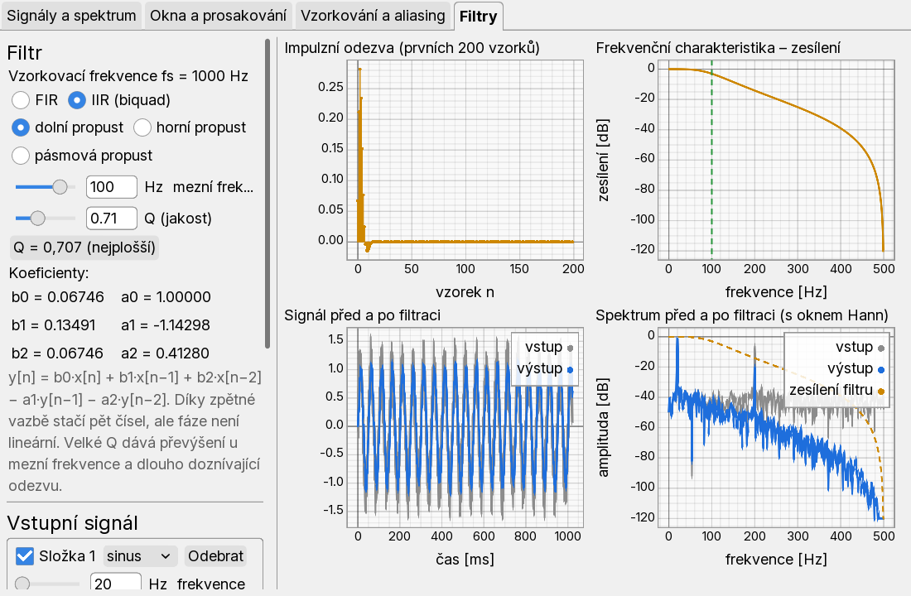
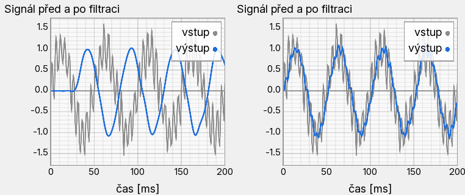
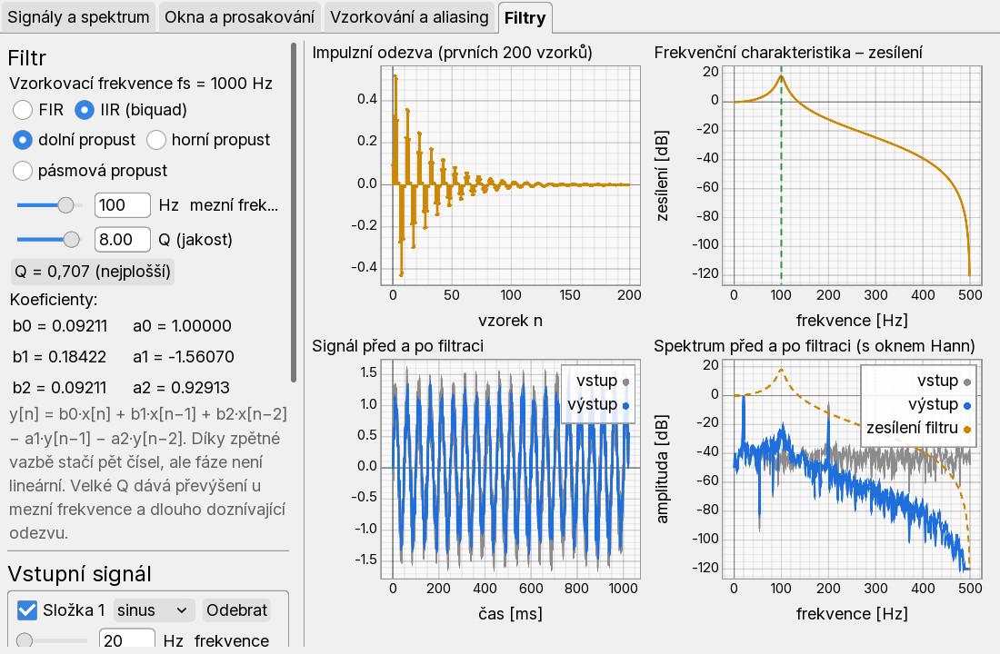
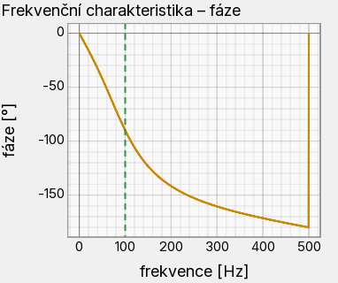
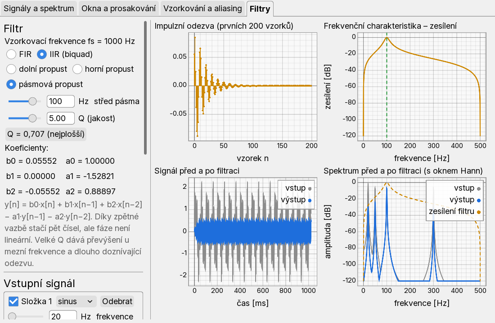

# Lekce 14: IIR filtr – biquad

## Cíl lekce

Pochopíš, jak filtr se **zpětnou vazbou** (IIR) dosáhne účinku s pěti
čísly místo desítek, co znamená **činitel jakosti Q** a čím se IIR filtr
liší od FIR: malým zpožděním, ale nelineární fází a hrozbou nestability.

## Základy

### Zpětná vazba

FIR filtr z lekce 13 počítal výstup jen ze vstupních vzorků. **IIR** filtr
(*infinite impulse response*) přidá i **předchozí výstupy**. Nejjednodušší
příklad:

```text
y[n] = 0,5 · x[n] + 0,5 · y[n−1]
```

Pošli na vstup impulz (1, 0, 0, …): výstup je 0,5; 0,25; 0,125; 0,0625; …
Každý výstup je polovina předchozího a odezva **nikdy úplně neskončí** –
jen doznívá. Odtud „nekonečná impulzní odezva“. Jediný koeficient zpětné
vazby nahradil nekonečně mnoho koeficientů FIR.

Zpětná vazba je jako ozvěna v hale nebo houpačka: když houpačku postrčíš,
kmitá ještě dlouho sama. A když ji strkáš ve správném rytmu (na její
vlastní frekvenci), rozhoupe se víc – to je **rezonance**.

### Nestabilita

Když zpětná vazba vrací víc, než přijala, výstup roste nade všechny meze.
Například `y[n] = x[n] + 1,1 · y[n−1]` dá na impulz 1; 1,1; 1,21; 1,33;
1,46; … a roste dál. Takový filtr je **nestabilní** (jako pískání
mikrofonu u reproduktoru). U FIR filtru se to stát nemůže.

### Biquad

**Bikvadratický filtr** (biquad) je IIR filtr druhého řádu: pamatuje si
dva předchozí vstupy a dva předchozí výstupy.

```text
y[n] = b0·x[n] + b1·x[n−1] + b2·x[n−2] − a1·y[n−1] − a2·y[n−2]
```

- `b0, b1, b2` – váhy vstupních vzorků (jako u FIR),
- `a1, a2` – váhy zpětné vazby (minus je jen zvyk zápisu),
- `a0 = 1` – výstup `y[n]` stojí v rovnici sám.

Pět čísel. Program je počítá podle známé „kuchařky“ R. Bristow-Johnsona
(Audio EQ Cookbook) ze dvou údajů:

- **frekvence `f0`** – mezní frekvence (dolní a horní propust) nebo střed
  pásma (pásmová propust),
- **činitel jakosti `Q`** – jak ostrý je zlom nebo jak úzké pásmo.

U dolní a horní propusti je zesílení na `f0` rovno `Q`:

- `Q = 0,707` (= `1/√2`): nejplošší propustné pásmo, na `f0` −3 dB,
- větší `Q`: převýšení (rezonance) u `f0`,
- menší `Q`: pozvolnější zlom.

U pásmové propusti je zesílení na `f0` vždy 1 a šířka pásma (mezi body
−3 dB) je zhruba `f0 / Q`.

### Fáze

Zpětná vazba zpozdí různé frekvence různě – fáze **není lineární** a tvar
signálu se trochu zkreslí. Celkové zpoždění je ale malé (jednotky ms),
mnohem menší než u FIR s podobným účinkem.

## V programu

Záložka **Filtry**, výchozí signál (20 Hz, 200 Hz, šum 0,20). Přepni
**IIR (biquad)**, **dolní propust**, mezní frekvence **100 Hz**. Výchozí
`Q` je 0,707.



- **Panel „Koeficienty“:** b0 = 0.06746, b1 = 0.13491, b2 = 0.06746,
  a0 = 1.00000, a1 = −1.14298, a2 = 0.41280.
- **Impulzní odezva (prvních 200 vzorků):** 0,0675; 0,2120; 0,2819;
  0,2347; … a rychle dozní (od vzorku 13 je menší než 0,001).
- **Zesílení:** 20 Hz −0,01 dB, 50 Hz −0,24 dB, **100 Hz −3,01 dB**,
  200 Hz −14,15 dB, 400 Hz −39,1 dB. Přechod je mnohem pozvolnější než
  u FIR (filtr druhého řádu klesá asi o 12 dB na oktávu; směrem k 500 Hz
  ještě rychleji, protože tam má nulu).
- **Spektrum:** čára 200 Hz klesla z −6,3 dB jen na −20,4 dB. Ve výstupu
  zůstal kousek sinusovky 200 Hz a šumu.

## Pokusy

1. **Zpoždění.** Přibliž si prvních 200 ms časového grafu a porovnej
   s FIR z lekce 13. → IIR výstup sleduje vstup skoro bez zpoždění:
   sinusovka 20 Hz je zpožděná jen asi o 2,2 ms (fáze −15,9° na 20 Hz),
   FIR o 30 ms. Zato je na výstupu IIR vidět zbytek rychlejších kmitů.

   

2. **Q a rezonance.** Zvyšuj **Q**. → `Q = 2`: na 100 Hz +6,02 dB
   (zesílení 2), vrchol 6,30 dB u 94 Hz; odezva doznívá déle (nad 0,001 do
   vzorku 40). `Q = 8`: na 100 Hz **+18,06 dB** (zesílení 8) a impulzní
   odezva kmitá skoro 200 vzorků. Tlačítko **Q = 0,707 (nejplošší)** vrátí
   výchozí hodnotu. `Q = 0,5`: na 100 Hz −6,02 dB, žádné převýšení.

   

3. **Nelineární fáze.** Přepni **Charakteristika** na **fáze**. → Fáze
   klesá plynule z 0° k −180°, na 100 Hz je přesně −90°, na 200 Hz −141,7°.
   Není to přímka jako u FIR: zpoždění v čase je pro 10 Hz asi 2,2 ms, pro
   100 Hz 2,5 ms.

   

4. **Horní propust.** Přepni na **horní propust** (Q = 0,707). → 20 Hz
   −28,5 dB, 100 Hz −3,01 dB, 200 Hz −0,17 dB.
5. **Pásmová propust.** Přepni na **pásmovou propust**, střed **100 Hz**,
   **Q = 5**. Nastav vstup: složky 20 Hz (1.00), 50 Hz (0.50), 100 Hz
   (0.50), 300 Hz (0.50), šum 0.00 (tlačítkem **Přidat složku** máš až
   čtyři). → Pásmo −3 dB je 91,5 až 109,5 Hz (≈ `100/5 = 20 Hz` široké).
   100 Hz projde beze změny, 50 Hz je zeslabená o 17,9 dB, 20 Hz o 27,9 dB,
   300 Hz o 26,0 dB. S `Q = 0,707` by pásmo sahalo od 53,5 do 178 Hz.

   

## Častá nedorozumění

- **„IIR je horší než FIR.“** Je jiný: pět čísel místo desítek, malé
  zpoždění, ale nelineární fáze a menší strmost u jednoho biquadu.
  V audiu (ekvalizéry) se IIR používá běžně.
- **„Q je šířka pásma.“** Q je poměr frekvence a šířky pásma
  (`Q ≈ f0 / šířka`). Větší Q = **užší** pásmo.
- **„Impulzní odezvu IIR jde zobrazit celou.“** Je nekonečná; program
  ukazuje prvních 200 vzorků.

## Shrnutí

- IIR filtr používá i předchozí výstupy (zpětnou vazbu); impulzní odezva
  je nekonečná.
- Biquad: `y[n] = b0·x[n] + b1·x[n−1] + b2·x[n−2] − a1·y[n−1] − a2·y[n−2]`.
- `Q = 0,707` nejplošší; větší Q = rezonance a delší doznívání.
- Malé zpoždění, ale nelineární fáze.
- Špatné koeficienty → nestabilita; filtry z kuchařky jsou pro `Q > 0`
  a `0 < f0 < fs/2` stabilní.

| vlastnost                    | FIR (k = 30, Hamming) | IIR biquad (Q = 0,707) |
|------------------------------|-----------------------|------------------------|
| počet koeficientů            | 61                    | 5                      |
| zpoždění pro 20 Hz           | 30 ms                 | asi 2,2 ms             |
| fáze                         | lineární              | nelineární             |
| zesílení na 100 Hz           | −6,0 dB               | −3,0 dB                |
| zesílení na 200 Hz           | −62,1 dB              | −14,2 dB               |
| stabilita                    | vždy                  | jen při dobrých koeficientech |

## Otázky k zamyšlení

1. Proč má IIR filtr „nekonečnou“ impulzní odezvu, když má jen pět
   koeficientů?
2. Kdy zvolím IIR a kdy FIR?
3. Proč s rostoucím Q impulzní odezva kmitá déle?

<details>
<summary>Odpovědi</summary>

1. Každý výstup se přes zpětnou vazbu vrací do dalších výstupů. Impulz tak
   „koluje“ ve smyčce a slábne, ale nikdy úplně nezmizí.
2. IIR, když záleží na výpočetní náročnosti a malém zpoždění a nevadí
   nelineární fáze (např. ekvalizéry v audiu). FIR, když je potřeba lineární
   fáze, zaručená stabilita nebo velmi strmá a přesně tvarovaná
   charakteristika.
3. Velké Q znamená slabé tlumení rezonance – jako houpačka s dobře
   namazaným závěsem. Ostrý vrchol ve spektru (úzký rozsah frekvencí)
   odpovídá dlouhému kmitání v čase.

</details>

## Cvičení

1. Filtr `y[n] = 0,5 · x[n] + 0,5 · y[n−1]`. Spočítej prvních pět vzorků
   impulzní odezvy a jeho zesílení na 0 Hz (vstup samé jedničky).
2. Z koeficientů výchozího biquadu (b0 = 0,06746, b1 = 0,13491,
   b2 = 0,06746, a1 = −1,14298, a2 = 0,41280) spočítej ručně první tři vzorky
   impulzní odezvy a porovnej s programem.
3. Jaké zesílení (v dB) má IIR dolní propust na mezní frekvenci při
   `Q = 2`? A při `Q = 0,5`?

<details>
<summary>Řešení</summary>

**1.** Impulz `x = 1, 0, 0, …`, na začátku `y[−1] = 0`:

- `y[0] = 0,5 · 1 + 0,5 · 0 = 0,5`
- `y[1] = 0,5 · 0 + 0,5 · 0,5 = 0,25`
- `y[2] = 0,125`, `y[3] = 0,0625`, `y[4] = 0,03125`.

Pro samé jedničky se výstup ustálí na hodnotě `y`, pro kterou platí
`y = 0,5 · 1 + 0,5 · y`, tedy `0,5 · y = 0,5` a `y = 1`. Zesílení na 0 Hz
je 1 (0 dB) – je to dolní propust.

**2.** Impulz: `x[0] = 1`, ostatní 0; předchozí `y` jsou 0.

```text
y[0] = b0 · 1                         = 0,06746
y[1] = b1 · 1 − a1 · y[0]
     = 0,13491 + 1,14298 · 0,06746    = 0,13491 + 0,07711 = 0,21202
y[2] = b2 · 1 − a1 · y[1] − a2 · y[0]
     = 0,06746 + 1,14298 · 0,21202 − 0,41280 · 0,06746
     = 0,06746 + 0,24233 − 0,02785    = 0,28194
```

Program ukazuje 0,0675; 0,2120; 0,2819 ✔ (najeď myší na první tři body
impulzní odezvy). Pozor na znaménka: v rovnici je `− a1 · y[n−1]` a `a1` je
záporné, takže se člen přičítá.

**3.** Zesílení na mezní frekvenci je rovno Q.

- `Q = 2`: `20 · log₁₀ 2 ≈ +6,02 dB` (převýšení).
- `Q = 0,5`: `20 · log₁₀ 0,5 ≈ −6,02 dB`.

Program ukazuje přesně tyto hodnoty na 100 Hz.

</details>

## Kam dál

- Další lekce: [15. Shrnutí](15-shrnuti.md).
- Předchozí lekce: [13. Konvoluce a FIR filtry](13-konvoluce-a-fir.md).
- Podrobnější text k záložce: [Filtry](../04-filtry.md).
- V kódu: `src/dsp/filter.zig` – `designBiquad` (vzorce z kuchařky),
  `biquadFilter` (rovnice výše, „přímá forma I“),
  `biquadImpulseResponse`, `frequencyResponse` (charakteristika
  z koeficientů `b` a `a`).
