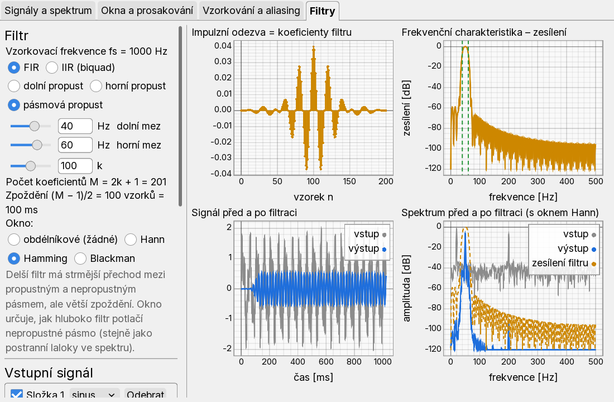

# Lekce 15: Shrnutí

## Cíl lekce

Projdeš celou učebnici jako jeden příběh, dostaneš tahák nejdůležitějších
vzorců a vyzkoušíš si tři úlohy, ve kterých se potkají znalosti z více
lekcí.

## Základy

### Celý příběh v jednom odstavci

Spojitý signál se **navzorkuje** s frekvencí `fs` (lekce 1). Vzorky je
nutné brát dost hustě – víc než dva na periodu nejvyšší frekvence – jinak se
vysoké frekvence převléknou za nízké (**aliasing**, lekce 11). Pak ze
vzorků jde signál přesně obnovit funkcí sinc (lekce 12). Každý signál je
součtem **sinusovek** (lekce 2 a 3) a **DFT** zjistí, jak velké jsou:
násobí signál zkušebními vlnami a sčítá (lekce 4 a 5). **FFT** spočítá
totéž mnohem rychleji (lekce 6). Spektrum se čte v **decibelech** (lekce 7).
Protože záznam je konečný, čára mimo bin **prosakuje** (lekce 8); **okno**
prosakování potlačí za cenu širší čáry (lekce 9). Rozlišení dvou frekvencí
určuje délka záznamu, ne **doplnění nulami** (lekce 10). **Filtry** mění
amplitudy jednotlivých frekvencí: FIR jako vážený průměr (konvoluce),
s lineární fází a zpožděním (lekce 13), IIR se zpětnou vazbou, s malým
zpožděním a nelineární fází (lekce 14).

### Tahák vzorců

| co                         | vzorec                                        | lekce |
|----------------------------|-----------------------------------------------|-------|
| čas vzorku                 | `tₙ = n / fs`                                  | 1     |
| sinusovka                  | `x(t) = A · sin(2π·f·t + φ)`                   | 2     |
| posun fází                 | `Δt = (φ/360°) · T`                            | 2     |
| DFT                        | `X[k] = Σ x[n] · e^(−j·2π·k·n/N)`              | 4, 5  |
| frekvence binu             | `f_k = k · fs / N`                             | 5     |
| rozestup binů              | `Δf = fs / N = 1 / (délka záznamu)`            | 5     |
| amplituda z DFT            | `2 · \|X[k]\| / N` (bin 0 a `N/2` bez dvojky)    | 5     |
| FFT: počet operací         | `(N/2) · log₂N` motýlků místo `N²` násobení    | 6     |
| decibely                   | `dB = 20 · log₁₀(A)`; ×10 = +20 dB, ×2 ≈ +6 dB | 7     |
| fáze ve spektru            | `φ − 90°` (vůči kosinu)                        | 7     |
| prosakování bez okna       | `≈ \|sin(π·d) / (π·d)\|`, `d` = vzdálenost v binech | 8  |
| okno                       | `w[n] = a0 − a1·cos(2πn/N) + a2·cos(4πn/N)`    | 9     |
| alias                      | `\|f − fs · round(f / fs)\|`                     | 11    |
| rekonstrukce               | `x(t) = Σ x[n] · sinc(fs · (t − tₙ))`          | 12    |
| konvoluce (FIR)            | `y[n] = Σ h[k] · x[n − k]`                     | 13    |
| zpoždění FIR               | `(M − 1) / 2` vzorků                           | 13    |
| biquad                     | `y[n] = b0·x[n] + b1·x[n−1] + b2·x[n−2] − a1·y[n−1] − a2·y[n−2]` | 14 |

## V programu

Kterou záložku na co:

| chci vidět …                                   | záložka                |
|------------------------------------------------|------------------------|
| vzorky, alias, obnovu ze vzorků                | Vzorkování a aliasing  |
| spektrum složeného signálu, biny, dB, fázi, rychlost FFT | Signály a spektrum |
| prosakování, okna, doplnění nulami             | Okna a prosakování     |
| filtr, jeho charakteristiku a co udělá se signálem | Filtry             |

## Pokusy

Tři závěrečné úlohy. Každá spojuje několik lekcí.

1. **Proč čára prosakuje?** Záložka **Signály a spektrum**: `fs` =
   **1000 Hz**, N = **1024**, jediná složka sinus **100 Hz**, amplituda v dB.
   → Místo čáry 0 dB je rozlitý kopec s vrcholem −2,41 dB (amplituda 0,76)
   u 99,61 Hz a prosakování sahá daleko (kolem 200 Hz ještě asi −51 dB). Rozestup
   binů je `1000/1024 ≈ 0,977 Hz` a 100 Hz je bin 102,4 – není celý
   (lekce 5 a 8). Nastav `fs` = **1024 Hz**: 100 Hz je bin 100 a spektrum je
   jediná čára s amplitudou 1,00.
2. **Odkud se vzal tón 13 Hz?** Záložka **Vzorkování a aliasing**: `fs` =
   **40 Hz**, Složka 1 sinus 5 Hz (1.00), Složka 2 sinus **27 Hz** (0.50).
   → Ve spektru po navzorkování jsou čáry 5 Hz a **13 Hz** – alias
   `|27 − 40| = 13` (lekce 11). Zvyš `fs` na **60 Hz** (Nyquist 30 Hz): čáry
   jsou na 5 a 27 Hz, alias zmizel a rekonstrukce odpovídá spojitému
   signálu – největší odchylka v zobrazeném úseku je 0,014, kdežto při
   40 Hz byla skoro 1 (lekce 12).
3. **Vytáhni ze signálu 50 Hz.** Záložka **Filtry**: vstup sinus 20 Hz
   (1.00), sinus **50 Hz** (0.50), sinus 200 Hz (0.50), šum 0.20 (složku
   přidáš tlačítkem a nastavíš). Filtr FIR, **pásmová propust**, dolní mez
   **40 Hz**, horní mez **60 Hz**.
   - Při `k = 30` je na 50 Hz zesílení jen −4,5 dB – pásmo 20 Hz je pro
     61 koeficientů moc úzké, přechod se do něj nevejde (lekce 13).
   - Při **k = 100** (M = 201): 50 Hz 0,0 dB, 20 Hz −90,6 dB, 200 Hz
     −85,3 dB. Výstup je čistá sinusovka 50 Hz s amplitudou 0,5 zpožděná
     o 100 ms (od 250 ms se od ní liší nejvýš o 0,05 – zbytek šumu
     v pásmu).
   - Pro srovnání IIR pásmová propust, střed 50 Hz, Q = 5: 20 Hz jen
     −20,5 dB, 200 Hz −26,8 dB, zato téměř bez zpoždění (lekce 14).

   

## Častá nedorozumění

Tři nejčastější omyly z celé učebnice:

- **„FFT je přibližná.“** FFT počítá přesně DFT. Rozlitá čára je
  prosakování (konečný záznam), ne chyba výpočtu.
- **„Doplnění nulami zlepší rozlišení.“** Jen zhustí body. Rozlišení
  zlepší jen delší skutečný záznam.
- **„Aliasing se dá odstranit po navzorkování.“** Nedá – musí se mu
  zabránit filtrem před vzorkováním.

## Shrnutí

- Vzorkuj víc než dvakrát rychleji, než je nejvyšší frekvence signálu.
- Spektrum = recept ze sinusovek; DFT ho měří, FFT ho počítá rychle.
- Čti spektrum v dB a počítej s prosakováním; okno je kompromis.
- Rozlišení = délka záznamu.
- Filtr násobí spektrum svou charakteristikou: FIR (lineární fáze,
  zpoždění, stabilní), IIR (málo koeficientů, malé zpoždění, nelineární
  fáze).

## Otázky k zamyšlení

1. Mám signál s frekvencemi do 3 kHz a chci rozlišit tóny vzdálené 2 Hz.
   Jaké `fs` a jak dlouhý záznam zvolím (bez okna)?
2. Proč se ve spektru filtrovaného signálu (záložka Filtry) používá okno
   Hann, i když ho filtr sám nepotřebuje?
3. Co mají společného useknutí sinc u FIR filtru a prosakování ve spektru?

Odpovědi

1. `fs` víc než 6 kHz (s rezervou pro filtr třeba 8 kHz). Rozestup binů
   nejvýš 2 Hz → záznam aspoň `1/2 Hz = 0,5 s`, tedy při 8 kHz aspoň
   4000 vzorků (FFT 4096).
2. Frekvence složek obecně neleží na binech (biny jsou po
   `1000/1024 ≈ 0,98 Hz`). Bez okna by prosakování silných složek zakrylo,
   co filtr v nepropustném pásmu udělal.
3. Je to tentýž jev: useknutí nekonečné řady obdélníkovým oknem. Ve spektru
   způsobí postranní laloky (prosakování), u filtru zvlnění
   charakteristiky. Pomůže v obou případech plynulé okno.

## Cvičení

1. `fs = 8000 Hz`, `N = 1024`. Jaký je rozestup binů, délka záznamu a na
   které frekvenci se objeví tón 5000 Hz?
2. Ve spektru v dB je čára −26 dB. Jaká je amplituda? A kdyby ji filtr
   zeslabil o dalších 14 dB?
3. FIR filtr má 41 koeficientů a `fs = 1000 Hz`. O kolik zpozdí signál?
   Jaké `k` to v programu je?
4. Dvě stejně silné sinusovky jsou od sebe 3 Hz. Záznam trvá 0,5 s. Rozliším
   je s Hannovým oknem? A bez okna?

Řešení

**1.** Rozestup `8000 / 1024 ≈ 7,81 Hz`, záznam `1024 / 8000 = 0,128 s
= 128 ms`. Tón 5000 Hz je nad Nyquistovou frekvencí 4000 Hz:
`|5000 − 8000 · round(0,625)| = |5000 − 8000| = 3000 Hz` (lekce 5 a 11).

**2.** `A = 10^(−26/20) ≈ 0,050`. Po zeslabení o 14 dB je úroveň
`−26 − 14 = −40 dB`, tedy `A = 0,01` (lekce 7: zeslabení v dB se sčítá).

**3.** `(41 − 1) / 2 = 20` vzorků = 20 ms. V programu `M = 2k + 1 = 41`,
tedy `k = 20` (lekce 13).

**4.** Bin je `1 / 0,5 s = 2 Hz`, takže 3 Hz je 1,5 binu. Hann potřebuje
podle pravidla palce asi 2 biny → nerozliší (nebo jen na hraně). Bez okna
stačí zhruba 1 bin → rozliší. Na jistotu s Hannem by byl potřeba záznam
aspoň `2 / 3 Hz ≈ 0,67 s` (lekce 10).

## Kam dál

- Předchozí lekce: [14. IIR filtr – biquad](14-iir-biquad.md).
- Zpět na [obsah učebnice](README.md).
- Stručné shrnutí teorie ke každé záložce: [docs/](../README.md).
- Celý kód výpočtů je v `src/dsp/` a má jednotkové testy (`zig build test`).
  Přehled, co je kde, je v tabulce „Kde je co v kódu“ v
  [docs/README.md](../README.md).
- Témata, která učebnice nepokrývá a o kterých se dá číst dál:
  spektrogram (krátkodobá Fourierova transformace), další okna (Kaiser,
  flat-top), návrh IIR filtrů vyšších řádů (Butterworth jako řetězec
  biquadů), převzorkování (decimace a interpolace).
